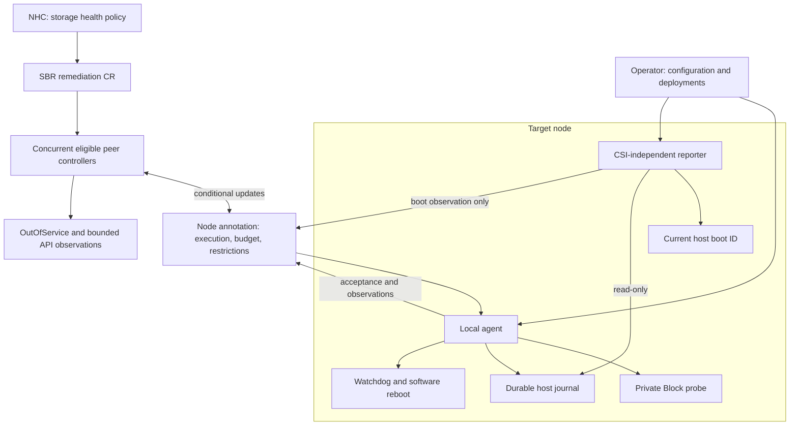
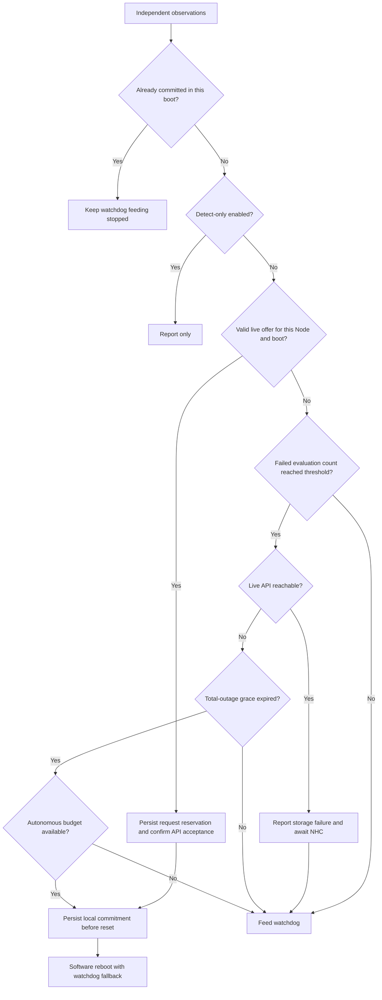
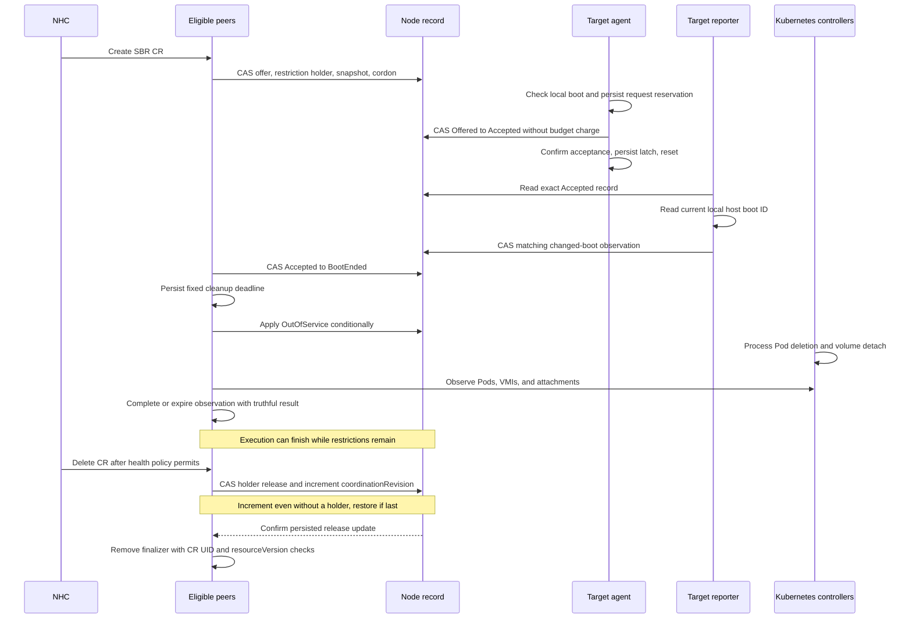
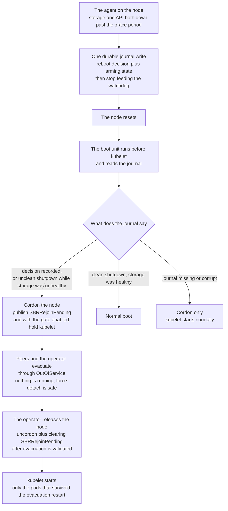

# Storage-Arbitrated Remediation for OpenShift Virtualization

| Item | Value |
|---|---|
| Status | Proposal for review |
| Target release | 5.9.0 |
| Tracking | `RHWA-1839`, `RHWA-1837`, `RFE-9581` |

Contributors: Daniel Froehlich ([@DanielFroehlich](https://github.com/DanielFroehlich)), Wesley Hayutin ([@weshayutin](https://github.com/weshayutin)), Pranav Gaikwad ([@pranavgaikwad](https://github.com/pranavgaikwad)), and Michal Pryc ([@mpryc](https://github.com/mpryc)).

## Index

- [1. Introduction](#1-introduction)
- [2. Motivation](#2-motivation)
- [3. Goals](#3-goals)
- [4. Non-Goals](#4-non-goals)
- [5. Design](#5-design)
  - [5.1. Use-case matrix](#51-use-case-matrix)
  - [5.2. Components and ownership](#52-components-and-ownership)
  - [5.3. Configuration API](#53-configuration-api)
  - [5.4. Private probe volume](#54-private-probe-volume)
  - [5.5. Storage and API decision policy](#55-storage-and-api-decision-policy)
  - [5.6. Host journal and repeated-request checks](#56-host-journal-and-repeated-request-checks)
  - [5.7. Remediation CR status and reboot evidence](#57-remediation-cr-status-and-reboot-evidence)
  - [5.8. Requested remediation, escalation, and cleanup](#58-requested-remediation-escalation-and-cleanup)
  - [5.9. NHC policy and reboot limits](#59-nhc-policy-and-reboot-limits)
  - [5.10. Startup, shutdown, and observability](#510-startup-shutdown-and-observability)
- [6. Open Questions](#6-open-questions)
- [7. Upgrade / Downgrade Concerns](#7-upgrade--downgrade-concerns)
- [8. Test Plan](#8-test-plan)
- [Alternatives considered](#alternatives-considered)
- [Terminology](#terminology)

## 1. Introduction

Storage Based Remediation (SBR) currently uses shared storage for heartbeats and fence messages. Node Healthcheck Operator (NHC) creates a `StorageBasedRemediation` custom resource (remediation CR) when its policy permits remediation.

This proposal adds `BlockPerNode` to the existing `sharedStorageVolumeMode` field in the SBR config CR. Each selected node uses a private Block volume to check storage access. SBR stores remediation history in a file on the host. NHC uses SBR as its remediation provider. The host file is called the journal in this document. The local agent writes this file.

The local SBR agent reboots its host and reports boot information. Peer controllers apply OutOfService and check workload cleanup through the API until a fixed deadline. This proposal accepts the existing risks when workloads are not isolated or scheduling restrictions are removed. Existing `Filesystem` and `Block` configurations retain their shared-storage behavior.

See the [Terminology table](#terminology) for definitions of the resource names and design terms used in this document.

## 2. Motivation

The current shared Block volume requires concurrent writes from multiple nodes. Some storage drivers cannot provide this access. Private probe volumes remove that shared-write requirement.

A storage-focused policy should preserve running virtual machines during API or network loss when storage remains usable. When the API remains reachable, NHC should decide whether storage failure permits remediation. When both storage and API access fail, the local agent needs to decide whether to reboot without an API request.

## 3. Goals

- Preserve existing `Filesystem` and shared `Block` behavior. Keep `Filesystem` as the effective default when the volume mode is absent.
- Introduce new mode `BlockPerNode` that will use private probe volumes per node instead of a shared volume.
- Distinguish temporary input/output (I/O) errors from sustained failure through a configurable probe deadline and consecutive failed health evaluations.
- Keep the watchdog active during isolated API loss when storage remains healthy.
- Reboot autonomously after sustained combined storage and API loss.
- Enforce one local agent per host to control the watchdog and write the journal.
- Persist request identity and boot information across agent and host restarts.
- Retain SBR's OutOfService taint without direct Pod deletion. Report the results of cleanup checks within the fixed period separately from reboot success.
- Report saved information that proves a recorded boot ended, without depending on the probe volume.
- Continue tracking an accepted remediation request even if NHC stops the request or someone deletes its `StorageBasedRemediation` CR. SBR must still confirm that the request’s recorded initial boot ended (`BootEnded`). Incomplete workload cleanup alone must not prevent CR deletion or later requests after the required boot confirmation and Node updates.

## 4. Non-Goals

- Remove or redesign the existing `Filesystem` and shared `Block` modes.
- In the new mode, inspect another node's private probe volume or exchange fence messages through it.
- Perform or queue cleanup for an autonomous remediation during API loss.
- Provide general hard-dead-node VM high availability without a separately qualified external fencing topology.
- Support multiple StorageClasses or multiple probes per node in this release.
- Guarantee remediation CR lifecycle progress when no peer that meets Section 5.2 requirements remains running with API access.

## 5. Design

### 5.1. Use-case matrix

These rows describe the proposed BlockPerNode behavior. They distinguish supported decisions from deferred guarantees. They do not claim that every failure leads to automatic workload recovery.

Each requested remediation below requires a peer that meets the requirements in Section 5.2 and runs with API access. Local watchdog decisions do not depend on peer availability. If no such peer is available, SBR retains the request state until a peer can continue processing it.

| # | Scenario | Proposed behavior | Limit or dependency |
|---|---|---|---|
| 1 | Healthy storage and API | The local agent probes storage, feeds the watchdog, and reports storage as healthy. | Probe results describe the selected backend, not every workload volume. |
| 2 | Cluster-wide API outage with healthy storage | The local agent continues feeding the watchdog. It does not reboot its host for API loss alone. | Other Kubernetes and workload controllers have independent behavior. |
| 3 | Broad storage outage with reachable API | The local agent reports unhealthy storage after `maxConsecutiveFailures` consecutive failed health evaluations. It waits for a valid request from NHC. Running peers reconcile through the API despite their own probe failures. | NHC thresholds can block new requests. Reports can arrive late, and agents can already have decided to reboot. Therefore, these thresholds cannot guarantee that no node reboots. Peer startup can remain blocked by CSI. |
| 4 | Storage and API unavailable | After storage becomes unhealthy and the total-outage grace expires, the local agent performs at most one autonomous reboot during the unresolved outage period. SBR skips workload cleanup for this attempt and preserves any existing requested-remediation record. | The agent cannot reboot autonomously again if it has used its one attempt for the outage or cannot establish its history. Recovery of Pods elsewhere is not guaranteed. |
| 5 | One node loses API or cluster-network access | The local agent keeps feeding the watchdog while its storage remains healthy. | Configure NHC for the storage condition only. |
| 6 | One node loses storage with API available | NHC creates a request. A peer records it as Offered on the Node. The target agent accepts the request and reboots. After the request reaches `BootEnded`, a peer applies OutOfService and checks cleanup until completion or the deadline. | Processing can stop while an accepted request has not reached BootEnded or the required boot information is unavailable. Continuing isolation is not guaranteed. |
| 7 | Kernel panic, host freeze, or power loss | A qualified armed watchdog can reboot a powered host that stops feeding it. | It cannot restore power. A dead node cannot publish the storage condition. Hard-dead failover is outside the base policy. |
| 8 | Planned agent restart or upgrade | Before a planned agent stop, the local agent disarms its watchdog if it has not recorded a reboot decision. It preserves request history. Another peer that meets Section 5.2 requirements resumes the same API lifecycle state. After startup, the local agent compares the current host boot ID with the saved beforeBootID. | Preserve peer coverage during rollout. Check that the hardware supports watchdog disarm. A replacement local agent must acquire the host lock before controlling the watchdog. |
| 9 | Kubelet failure with healthy storage | The local agent continues feeding the watchdog while it remains functional. | This storage policy does not remediate every kubelet failure. |
| 10 | Slow or hung storage I/O | Bound each complete probe with `ioTimeout`. Count failed health evaluations without blocking watchdog decisions or peer processing of remediation CRs. | A deadline cannot cancel blocked kernel I/O. Limit unfinished probe operations within each process. Do not share locks that can block these independent tasks. |
| 11 | Network partition with healthy storage | Do not reboot solely for the partition. This NHC policy does not request relocation solely for it. | This is not a guarantee against concurrent workloads created by other controllers. |
| 12 | API or storage recovers after acceptance | The local agent completes the accepted reboot. It preserves the request’s initial boot ID and attempt history. If the local boot ID changes, the local agent clears only the FenceLatched flag for the previous boot. The local agent or reporter publishes boot information as Section 5.7 requires. A peer validates it before recording BootEnded. | When NHC stops a request or someone deletes its remediation CR, a peer can cancel the request only in Offered. Cleanup checks remain optional and have a fixed deadline. |
| 13 | Different nodes require different StorageClasses | Deferred. Add explicit node-group to StorageClass mapping. | See Section 6. |
| 14 | One node uses several storage backends | Deferred. Add multiple probes and a health aggregation policy. | See Section 6. |
| 15 | Stuck or terminating workload Pod | The peer uses OutOfService only. At the fixed deadline, it finishes the policy and records incomplete or unknown cleanup separately. When someone deletes the remediation CR, the peer removes only SBR-added restrictions that no other CR requires. | Workload finalizers cannot retain execution indefinitely. Workload recovery and safe rejoin are not guaranteed. |
| 16 | Host journal unavailable or recovered | The local agent preserves known reboot decisions and compares them with trusted API records. If autonomous reboot history is unknown, do not permit another autonomous reboot. Peers continue their independent API work. | Missing history cannot prove that no autonomous reboot occurred during the outage. The read order in Section 5.7 can still establish BootEnded for a known accepted request. |
| 17 | Repeated remediation on persistent failure | Each new valid remediation CR permits one requested reboot after ownership release. Permit at most one autonomous reboot per incident. | Restore permission for one autonomous reboot after continuous healthy storage and reachable API for `autonomousRebootRecoveryPeriod`, which defaults to five minutes. |

### 5.2. Components and ownership

NHC watches `SBRStorageUnhealthy=True` and creates an SBR remediation CR. Its name identifies the target node.

Peer agents run the existing `SBRRemediationReconciler`. In this document, a peer means this controller running on another node. Peer controllers process requests concurrently without a lifecycle leader or a Lease per CR. The target's peer controller skips its own Node UID. The target’s local monitoring loop accepts requests for its own host and performs the requested reboot.

The operator’s configuration controller manages SBR configurations and deployments. Its existing leader election does not coordinate remediation requests. A separate reporter can start without the probe volume. It reads the host boot ID and publishes observations. It cannot accept requests, control the watchdog, or perform cleanup.

`BlockPerNode` uses these components:



A peer can process a target’s requests when it runs on a different Node and uses the configuration UID recorded for the target. It needs API access and permission to process requests and update their records. Its probe need not be healthy, its watchdog need not be ready, and its Pod need not report Ready. Peers process requests across namespaces.

At least one peer that meets Section 5.2 requirements must remain running with API access for each target requiring lifecycle work. The peer controller remains in the probe Pod. CSI attachment failure can therefore prevent a replacement peer from starting. The reporter does not replace a missing peer controller.

#### Storage-independent reconciliation

The agent process starts the BlockPerNode peer manager before probe initialization and storage preflight. The peer manager’s lifetime remains independent of probe and journal errors. When a local error occurs, the local agent follows the watchdog shutdown rules. The error must not cancel the peer controller.

Peer reconciliation uses API objects only. It does not read host journals, inspect probe devices, resolve shared NodeMap entries, or wait for storage locks. Limit the duration of API calls and the delay before retrying reconciliation. Keep probe I/O, journal I/O, watchdog feeding, and reconciliation on separate execution paths.

The peer determines the target’s configuration before selecting the shared-storage or BlockPerNode path. If configuration is missing or conflicting, peers cannot record a new request as Offered. Record the Node UID, configuration UID, volume mode, and initial boot ID permanently for each request. Never interpret missing status as permission for shared-storage fencing.

All state writers use conditional updates with `resourceVersion`. After a conflict, read current objects and check identities and permitted transitions again. Preserve unrelated conditions and fields assigned to other writers. Node conditions require strategic merge or an optimistic read-modify-write update.

#### One authoritative execution record

Reuse `sbr.medik8s.io/remediation-owner` on the Node. Its versioned JSON records the current request, autonomous reboot counts and limits, CRs that require scheduling restrictions, and a coordination revision. CR status reports this record. The target cannot accept or execute a request based only on CR status.

The remediation CR UID identifies a requested attempt. The request records one Node UID and one `beforeBootID`. Neither value can change for this request. A changed generation, new configuration, or later boot cannot give that CR another attempt.

An illustrative record is:

```json
{
  "version": 1,
  "nodeUID": "node-uid",
  "coordinationRevision": 12,
  "execution": {
    "requestNamespace": "sbr-system",
    "requestName": "worker-0",
    "requestUID": "request-uid",
    "configUID": "config-uid",
    "beforeBootID": "boot-a",
    "phase": "Accepted",
    "observedBootID": "",
    "cleanupClosed": false
  },
  "budget": {
    "phase": "Known",
    "outageEpoch": "",
    "autonomousAttempts": []
  },
  "restrictions": {
    "preExistingUnschedulable": false,
    "preExistingOutOfService": null,
    "holders": [
      {
        "namespace": "sbr-system",
        "name": "worker-0",
        "uid": "request-uid",
        "configUID": "config-uid"
      }
    ]
  }
}
```

`coordinationRevision` is a Node-wide counter. Initialize it to zero with a valid new record. Preserve it when replacing a request record or removing a CR from the restrictions list. The peer increments it in every required release update during remediation CR deletion, including retries. Other writers preserve it. This changes the Node’s `resourceVersion`, even when no CR needs removal from the list.

The counter does not replace `resourceVersion` preconditions or identify a particular request. It requires no retained list of deleted CR UIDs. The release sequence below makes a peer’s earlier Offered update conflict with remediation CR deletion.

The budget fields retain autonomous attempt identities, not an unlimited event log. Retain attempts that still require resolution. Summarize older reboot counts only after the configured recovery period and required history checks.

If autonomous reboot history is missing, record `Unknown`. Do not assume that another autonomous reboot is permitted. Initialize this history only after proving first installation or obtaining complete trusted history. Accepting a requested reboot does not change whether another autonomous reboot is permitted. After API recovery, add the autonomous attempts and their outage period IDs to the API record.

The local agent and peer controllers change the Node execution record through these phase transitions:

| From | To | Writer and prerequisite |
|---|---|---|
| No current execution, or reusable terminal execution | `Offered` | Peer selects one request that passes the required checks and preserves all autonomous reboot and restriction records. |
| `Offered` | `Accepted` | Target confirms the local boot identified by beforeBootID and persists its request reservation. The Node update accepts the request without a budget charge. |
| `Offered` | `Cancelled` | Peer withdraws permission through a conditional update. No target acknowledgement is required. |
| `Accepted` | `BootEnded` | Peer accepts the boot information read and published as Section 5.7 requires. |

In Offered, the target may accept the request but cannot yet reboot for it. Acceptance cannot be reversed for the recorded initial boot ID. The peer cancels the request and the target accepts it through conditional updates to the same Node record. Only one update can succeed. A peer cannot cancel an accepted request when NHC stops it or someone deletes its remediation CR. Storage recovery and elapsed time also cannot cancel acceptance.

The target confirms `Accepted` before requesting reboot or stopping watchdog feeds. A lost update response requires a live read. Before acceptance, the local host boot ID must equal the request’s initial boot ID in the API record. If they differ, the target must not accept or execute the request. The target can report the mismatch so a peer cancels the request, as Section 5.7 describes.

#### Select and finish requests

Before recording Offered, the peer installs the remediation CR’s finalizer. It also records the Node UID, configuration UID, volume mode, and initial boot ID. These values cannot change for this request. Use one conditional Node update to record Offered, add the CR to the restrictions list, and cordon the Node. Save the original cordon and OutOfService state only when adding the first CR to the list.

Before replacing a completed request record, the peer saves its terminal phase in the remediation CR if that CR still exists. A `Cancelled` or `BootEnded` CR never receives another offer. Keep the old terminal execution in the annotation until a successor replaces it.

To record a new request as Offered, the peer performs these steps in order:

1. Read the Node identified by the recorded UID through the uncached API. Check its UID and retained record.
2. Read the CR through the uncached API. Check its UID, recorded identities that cannot change, finalizer, deletion timestamp, stop state, and terminal state.
3. Use a conditional update against that Node version to record Offered, add the CR to the restrictions list, and cordon the Node.

After a conflict, the peer repeats this complete sequence. It reads the remediation CR again after reading the new Node version. Do not use an earlier or cached check to decide whether the request can enter Offered. Finalizer removal requires the Node update below. Therefore, a peer’s update prepared before normal remediation CR deletion cannot record Offered after that deletion completes.

No other request can replace an accepted request until the execution reaches the `BootEnded` phase. A peer can then replace the record when cleanup checks finish, NHC stops the request, or its remediation CR is deleting or absent. Cleanup checks can therefore delay a normal later request only until their fixed deadline. An accepted request that has not reached BootEnded can still block another request.

NHC can retain a stopped remediation CR as history after its request finishes. The peer preserves the stopped outcome in that CR. Do not wait for its deletion before accepting a different request that passes the required checks. NHC's own health thresholds, leases, template order, and existing CR names remain independent constraints.

#### Restrictions that outlive execution

The Node record’s `holders` field lists the CRs that still require SBR’s scheduling restrictions. Each entry identifies a CR by UID, not just by name. Keep the original cordon and OutOfService state separately from the current request. Retain this saved state while any CR remains in the list. A later request must not treat an earlier SBR restriction as an administrator’s restriction.

A remediation CR remains in the restrictions list while it exists, even if NHC stopped its request or SBR reported success. Finishing cleanup checks does not remove OutOfService. When someone deletes the remediation CR, the peer removes only that CR’s entry after its request reaches Cancelled or BootEnded.

While any CR remains in the list, keep the shared SBR restrictions. When removing the last CR, remove only restrictions that SBR added. Remove the CR’s entry and saved original state in the same conditional Node update. Preserve the request history and all autonomous reboot records during this update.

A peer handling delayed deletion of remediation CR A cannot remove remediation CR B’s entry or restrictions. If a CR is absent, apply the same removal rules using its saved UID. A replacement CR with the same name has a different UID and needs a separate entry.

Preserve any pre-existing cordon, OutOfService taint, and unrelated taints. The OutOfService snapshot identifies the exact key and NoExecute effect that SBR manages. Preserve taints with other effects separately. Check the current taint value before removing an SBR-added taint. The snapshot cannot detect an administrator reasserting the same cordon later. Concurrent administrators must follow the documented ownership convention.

The restrictions list can grow as CRs remain after processing. Remove entries only after checking that their restrictions were released or their CRs are absent, and their requests are resolved. Limit record size. Reject new Offered requests with a visible reason before reaching annotation limits. Never discard CR entries that still require restrictions or autonomous reboot history to make space.

#### Automatic execution recovery

Peer controllers watch Nodes as well as remediation CRs. They process a saved request record even if someone forcibly deleted its remediation CR. For an Offered request, a peer uses a conditional Node update to change its phase to Cancelled. For an Accepted request, the peer waits for the boot information required by Section 5.7. The reporter publishes into the Node record, so CR absence does not remove its evidence channel.

The unchanged initial boot ID prevents the target from executing the same request again after `BootEnded`. Cancellation changes the Node record from Offered to Cancelled. The target can no longer change that record from Offered to Accepted, so the cancelled request cannot cause a reboot.

A listed CR other than the current request has already reached Cancelled or BootEnded. Replacing its request record requires that result. If this CR disappears, a peer can remove its list entry without using the later request’s phase as the earlier request’s result.

Peers use the Node record to retry interrupted removal of CR entries and restrictions. If a CR has no list entry, no restrictions need removal for it. However, an earlier update that has not completed might still add its entry and record the request as Offered. Do not remove restrictions belonging to CRs added after the earlier list became empty. A later listed CR must not delay removal of the earlier CR’s finalizer. Incomplete workload cleanup does not prevent this removal.

Before removing a remediation CR’s finalizer, the peer performs the following sequence. This includes requests without an Offered record or restrictions entry:

1. Read the deleting CR through the uncached API. Check its UID.
2. Read the Node identified by the recorded UID through the uncached API. Check its UID and retained record. Cancel or resolve any execution belonging to this CR before release.
3. Conditionally remove the matching CR from the list. Remove SBR-added restrictions when the list becomes empty. Increment `coordinationRevision` in that same Node update, even when this CR has no entry in the restrictions list. Preserve other executions, listed CRs, and budget history.
4. Confirm that the Node update succeeded. Remove the finalizer using CR UID and `resourceVersion` checks. Do not wait for global schedulability or removal of the controller-managed unschedulable taint.

An update that leaves Node data unchanged does not satisfy this sequence. If the release update wins, an earlier offer update fails its Node version check. If the offer wins, the releasing peer must read it and cancel or resolve execution before completing release. Both paths repeat their complete checks after a conflict.

After an unknown response or peer restart, the peer repeats the conditional Node release update before removing the remediation CR’s finalizer. Another increment is safe. An absent list entry alone does not confirm that the required Node update succeeded. Failed API writes do not establish release. Never perform this update on a replacement Node UID.

On each retry, check which CRs currently require restrictions. If this CR has no list entry, preserve later CRs’ restrictions and their saved original state. Never repeat an earlier decision to uncordon the Node or remove a later CR’s OutOfService taint. A later cordon does not change the fact that this CR’s entry was removed.

A missing or invalid record cannot be replaced merely to perform release. Apply the existing history recovery rules.

When someone deletes the Node object, Kubernetes also deletes its annotation containing the request record. A replacement Node UID does not prove that the old host stopped. Never mutate the replacement through the old request. Recover only from trusted retained history or external evidence. Missing or conflicting identity and budget records cannot create permission for another autonomous reboot.

Permanent loss of both required local history and API history cannot resolve automatically. Likewise, an accepted request cannot reach BootEnded without trustworthy boot information. These cases need restored evidence or external recovery, rather than a timeout-based claim of success.

### 5.3. Configuration API

Extend `StorageBasedRemediationConfig.spec.sharedStorageVolumeMode` with `BlockPerNode`. Expose `spec.ioTimeout` as an optional duration in all modes. Reuse the existing `spec.sbrTimeoutSeconds` and `spec.maxConsecutiveFailures` fields. Add a total-outage grace and an autonomous recovery period for BlockPerNode. Storage detection uses the existing failure threshold.

| Field | Effective default | Validation | Meaning |
|---|---|---|---|
| `sharedStorageVolumeMode` | `Filesystem` | `Filesystem`, `Block`, or `BlockPerNode` | Existing shared Filesystem, existing shared Block, or one private Block probe per selected node. |
| `ioTimeout` | `15s` in `BlockPerNode`, `2s` in existing modes | Duration from `1s` through `10m`. Valid in all modes. | Complete probe deadline in BlockPerNode. Existing per-operation timeout behavior in shared modes. |
| `sbrTimeoutSeconds` | Existing `30` | Existing integer range `10–300` | Supplies the BlockPerNode evaluation and probe interval through `GetSBRUpdateInterval()`. |
| `maxConsecutiveFailures` | Existing `7` | Existing integer range `2–32` | Consecutive failed health evaluations required before BlockPerNode reports unhealthy storage. |
| `totalOutageGracePeriod` | `60s` in `BlockPerNode` | Duration from `0s` through `1h`. Valid only in `BlockPerNode`. | The API must remain unavailable for this period while storage is unhealthy before the agent records an autonomous reboot decision. |
| `autonomousRebootRecoveryPeriod` | `5m` in `BlockPerNode` | Positive duration. Valid only in `BlockPerNode`. | Storage must remain healthy and the API reachable for this period before another autonomous reboot is permitted. |

The BlockPerNode defaults do not replace existing shared-storage thresholds. Omitted `ioTimeout` preserves the existing two-second timeout in Filesystem and Block. An omitted volume mode remains equivalent to explicit `Filesystem`. Explicit `Block` continues to select shared storage.

Use effective getters for defaults. Do not assign an unconditional CRD default to `ioTimeout`, because its effective default depends on the mode. Reject `ioTimeout: 0s`. Explicit `totalOutageGracePeriod: 0s` removes only the additional combined-outage delay. It does not disable detection or autonomous remediation. The autonomous recovery period must be greater than zero.

Proposed additions in [configuration types](../../api/v1alpha1/storagebasedremediationconfig_types.go):

```go
package v1alpha1

// Existing imports, type, constants, and other fields are omitted.
const (
	SharedStorageVolumeModeBlockPerNode SharedStorageVolumeModeType = "BlockPerNode"
	DefaultIOTimeout                                                = 2 * time.Second
	DefaultBlockPerNodeIOTimeout                                    = 15 * time.Second
)

type StorageBasedRemediationConfigSpec struct {
	// +kubebuilder:validation:Enum=Filesystem;Block;BlockPerNode
	// +optional
	SharedStorageVolumeMode *SharedStorageVolumeModeType `json:"sharedStorageVolumeMode,omitempty"`

	// +optional
	IOTimeout *metav1.Duration `json:"ioTimeout,omitempty"`

	// +optional
	TotalOutageGracePeriod *metav1.Duration `json:"totalOutageGracePeriod,omitempty"`

	// +optional
	AutonomousRebootRecoveryPeriod *metav1.Duration `json:"autonomousRebootRecoveryPeriod,omitempty"`
}

func (s *StorageBasedRemediationConfigSpec) IsBlockPerNodeMode() bool {
	return s.GetSharedStorageVolumeMode() == SharedStorageVolumeModeBlockPerNode
}

func (s *StorageBasedRemediationConfigSpec) GetIOTimeout() time.Duration {
	if s.IOTimeout != nil {
		return s.IOTimeout.Duration
	}
	if s.IsBlockPerNodeMode() {
		return DefaultBlockPerNodeIOTimeout
	}
	return DefaultIOTimeout
}
```

Keep `GetSharedStorageVolumeMode()` and its `Filesystem` fallback. Keep `IsBlockMode()` specific to shared `Block` behavior. Its existing callers select shared devices, RWX claims, and shared-volume cleanup. Use `IsBlockPerNodeMode()` before those paths instead of treating both values as shared Block.

`BlockPerNode` is an SBR configuration value. It is not a Kubernetes PV or PVC volume mode. The generated private claim still uses `volumeMode: Block` and `ReadWriteOnce`.

Update the `sharedStorageClass` description and validation for both Block values. Preserve the existing StorageClass requirement for shared `Block`. `BlockPerNode` requires a class that supports the private RWO Block claims described in Section 5.4.

Update the custom resource definition (CRD), generated code, webhook, samples, and agent arguments together. The controller currently pins `--io-timeout` to the two-second [agent constant](../../internal/agent/constants.go). Pass `GetIOTimeout()` through `buildSBRAgentArgs()` and the existing `buildBlockInitJob()` in [the configuration controller](../../internal/controller/storagebasedremediationconfig_controller.go).

The [preflight checks](../../cmd/sbr-agent/preflight.go) also use a separate fixed two-second timeout. Pass the effective value into applicable initialization and preflight operations. A configured runtime timeout must not leave startup checks using the previous constant. Keep the BlockPerNode peer-manager startup independent of these storage checks.

Existing modes retain per-operation timeout and retry behavior. Their complete operations can therefore exceed `ioTimeout`. The Filesystem `ReopenDevice()` fallback does not currently enforce a timeout. Exposing the field does not add a deadline guarantee to that fallback. See [device operations](../../internal/blockdevice/blockdevice.go) and [device selection](../../cmd/sbr-agent/main.go).

For BlockPerNode, use one deadline for the complete verification probe, including required flush operations and retries. A nested timeout must not shorten this configured deadline unintentionally. An actual I/O error can still finish the probe early. Keep retries internal and within the original deadline. Section 5.5 defines the health result.

The configured storage timeout does not set API, journal, cleanup, or hardware watchdog timeouts. Keep `rebootMethod` internal. Keep the `10Mi` probe size as a qualified internal value.

#### Field interactions

| Configuration | Existing `Filesystem` or `Block` outcome | `BlockPerNode` outcome |
|---|---|---|
| `sharedStorageVolumeMode` omitted or `Filesystem` | Existing shared Filesystem behavior. | Not selected. |
| `sharedStorageVolumeMode: Block` | Existing shared ReadWriteMany (RWX) Block behavior. | Not selected. |
| `sharedStorageVolumeMode: BlockPerNode` | Not selected. | One private ReadWriteOnce (RWO) Block claim per agent Pod. |
| `sharedStorageClass` | Existing shared-storage validation and provisioning. | Required. Selects the single StorageClass for private probes. It must support dynamic RWO Block provisioning. |
| `watchdogPath` | Existing behavior. | Same device path. One local monitoring loop owns the watchdog. |
| `nodeSelector` omitted or empty | Existing worker-node selection. | Same worker-node selection. The effective selector includes Linux nodes only. |
| `sbrTimeoutSeconds` | Existing timeout and derived intervals. | Reuse `GetSBRUpdateInterval()` for probe scheduling and failed-state evaluation. It divides the duration by six, with a one-second minimum. |
| `maxConsecutiveFailures` | Existing counter behavior. | Report unhealthy at this many consecutive failed health evaluations. Count evaluations, not individual read, write, or retry errors. |
| `ioTimeout` | Existing per-operation behavior with a configurable value. Omission retains `2s`. | Complete probe deadline. Omission selects `15s`. Expiry starts a failed interval and does not bypass the failure threshold. |
| `detectOnlyMode: Enabled` | Existing detection-only behavior. | Block new remediation actions. Continue reporting boot information and checking cleanup for a request with an already recorded reboot decision. |
| `detectOnlyMode` omitted or `Disabled` | Existing behavior. | Enable requested and autonomous actions under the policy below. |
| `totalOutageGracePeriod` or `autonomousRebootRecoveryPeriod` is present | Admission rejects the inapplicable field. | Apply the effective duration. |

The existing timeout defaults remain `30` seconds and seven consecutive failures. Their schema ranges remain unchanged. BlockPerNode does not use shared-heartbeat expiry or the existing mixed operation counters. Multiplying `ioTimeout` by `maxConsecutiveFailures` does not define its detection duration.

Qualify the fifteen-second BlockPerNode default and supported overrides on CSI storage that represents supported workloads. The `1s–10m` range matches current device validation. It does not establish suitable latency for every backend. Do not require `ioTimeout` to be shorter than the probe interval or hardware watchdog timeout. Independent observations and watchdog feeding must continue while a probe runs.

An example BlockPerNode configuration is:

```yaml
apiVersion: storage-based-remediation.medik8s.io/v1alpha1
kind: StorageBasedRemediationConfig
metadata:
  name: sbr-block-per-node
  namespace: sbr-system
spec:
  sharedStorageVolumeMode: BlockPerNode
  sharedStorageClass: example-block
  ioTimeout: 15s
  sbrTimeoutSeconds: 30
  maxConsecutiveFailures: 7
  totalOutageGracePeriod: 60s
  autonomousRebootRecoveryPeriod: 5m
```

#### Validation and immutability

Extend `ValidateCreate()` and `ValidateUpdate()` in the [configuration webhook](../../api/v1alpha1/storagebasedremediationconfig_webhook.go).

1. Accept `Filesystem`, `Block`, and `BlockPerNode` in the existing volume-mode validation.
2. Validate duration syntax and bounds, including a positive autonomous recovery period. Require a StorageClass for `BlockPerNode`.
3. Accept `ioTimeout` in all modes. Reject total-outage and autonomous recovery fields outside BlockPerNode.
4. Reject changes to the effective volume mode, total-outage grace, and autonomous recovery period.
5. Reject configurations that overlap a BlockPerNode configuration on selected nodes.
6. Reject different StorageClasses across BlockPerNode configurations in this release.

Compare durations as values, not strings. Omitted volume mode and explicit `Filesystem` are equivalent. Omitted durations and explicit effective defaults are equivalent. Reject removal of a nondefault immutable duration. Permit valid `ioTimeout` updates through the controlled replacement rules below.

The existing volume-mode immutability rule covers transitions to and from `BlockPerNode`. Switching between any two distinct effective volume modes requires configuration replacement. Existing field update rules remain unchanged. Mutable fields can still require an agent rollout. For BlockPerNode, the configuration controller waits until accepted requests reach BootEnded and peers remove the required CR entries and restrictions. Only then does the controller replace affected local monitoring loops. Incomplete workload cleanup is not a replacement gate.

Apply this replacement rule to selector, StorageClass, watchdog path, detect-only, `ioTimeout`, `sbrTimeoutSeconds`, and `maxConsecutiveFailures` changes. A selector update must protect removed nodes as well as newly selected nodes. The configuration controller retains the effective configuration until its requests are resolved and peers remove its CRs from the restrictions list. Peers cancel requests still in Offered through the Node record.

Each started probe retains its original deadline. Timing changes take effect in the replacement monitor. The replacement restarts transient detection as Section 5.10 describes.

Current production code does not enforce configuration overlap consistently. The webhook and controller each refer that check to the other component. The new checks must cover namespaces, effective worker selectors, and the Linux restriction. Admission alone cannot prevent concurrent creates or later node-label changes.

The configuration controller must reconcile assignments after admission, including concurrent creates and later label changes. If the effective configuration is missing, conflicting, unreadable, or ambiguous, do not prepare requests, record reboot decisions, or start destructive actions. An action whose reboot decision is already recorded continues only with the configuration saved and retained for that request.

One host process holds permission to perform local actions through a non-blocking exclusive `flock` on `/var/lib/medik8s/state/sbr-executor.lock`. The lock file is separate from the atomically replaced journal and is never unlinked during operation. The local agent acquires the lock before opening or arming the watchdog, loading mutable journal state, or accepting an offer. It holds the lock for its lifetime.

If locking fails or is unsupported, the local agent reports `ExecutorConflict`. That process performs no watchdog or journal writes. Its peer controller can continue API reconciliation if it meets the requirements in Section 5.2. Never break the lock by Pod UID, Lease expiry, peer replacement, or age. Never disarm a watchdog opened by an unknown process.

Set DaemonSet `maxSurge: 0` and `maxUnavailable: 1` explicitly. These settings do not replace the host lock. Assignment checks select the configuration. Node ownership selects the request. Neither selects the process that holds the watchdog.

#### Configuration replacement

To change an immutable value, the administrator deletes the old SBR config CR. The administrator creates its replacement after the shutdown and resource-removal steps below complete. An in-place DaemonSet rollout cannot change these immutable values. Mutable field updates follow the safe rollout rules above.

When the administrator deletes a BlockPerNode SBR config CR, the components complete these steps:

1. The configuration controller prevents new requests from using the old configuration.
2. Peer controllers wait until accepted requests reach BootEnded. They remove associated CR entries and restrictions as Section 5.2 requires. Incomplete workload cleanup does not block this step.
3. Each local agent without a recorded reboot decision verifies watchdog disarm before stopping its monitoring loop.
4. The configuration controller waits for the old local agents and reporters to terminate before releasing the nodes from the old configuration.
5. The configuration controller removes resources owned by the old configuration and permits a replacement configuration.

An unreachable node can delay SBR configuration replacement. Do not start a second watchdog owner to avoid that delay. Preserve the host journal across replacement. Configuration deletion must not erase completed request identities.

The configuration controller retains the agent DaemonSet, its service account, and required API permissions while assigned requests need further processing. This includes cancellation, confirmation of BootEnded, and removal of CR entries and restrictions. When the administrator removes a configuration, peers stop its cleanup observations without waiting for successful workload cleanup. The configuration controller includes saved Node execution records and restrictions entries when the associated remediation CR is missing. Keep a peer that meets Section 5.2 requirements for each affected target during planned rollout or retirement. A terminating configuration prevents new requests but does not disqualify peers from processing its retained requests.

If no peer remains, the configuration controller reports that configuration replacement is blocked and waits for a peer.

The current configuration deletion handler removes role-based access control (RBAC) and relies on garbage collection for the DaemonSet. It does not establish this shutdown order. Add a separate BlockPerNode deletion path in [the configuration controller](../../internal/controller/storagebasedremediationconfig_controller.go). Do not apply shared-PV cleanup to private probe claims.

### 5.4. Private probe volume

Each selected node runs one local SBR agent with one generic ephemeral Block volume. The Pod owns its PersistentVolumeClaim (PVC). The controller uses a named `10Mi` request value rather than an embedded manifest literal. Driver allocation granularity can produce a larger volume. A supported backend must accept that request or define its qualified minimum.

The StorageClass must support raw Block, dynamic provisioning, and the probe's direct I/O operations. The claim requests `ReadWriteOnce`. SBR does not require concurrent writes from other nodes.

`SBRStorageUnhealthy` describes this selected probe path, not every VM disk or the whole storage array. Each supported policy documents how the probe StorageClass, backend, and failure domain represent the workloads eligible for remediation. Block destructive remediation if tests have not established that the probe is suitable, or if it does not represent the affected workload storage. Distinguish `ProbeNotProvisioned`, `ProbeNotAttached`, `ProbeIOFailed`, `StoragePathUnhealthy`, and `BackendUnqualified` in status and events.

Add a BlockPerNode branch before `validateStorageClass()`, `ensurePVC()`, and `ensureSBRDevice()` in [the configuration controller](../../internal/controller/storagebasedremediationconfig_controller.go). Their current shared-volume path rejects some RWO provisioners and creates an RWX PVC. Selecting `Block` alone does not change that behavior. Prefer `WaitForFirstConsumer` for topology-constrained storage. Warn, rather than reject, when `Immediate` binding is combined with topology constraints.

The proposed DaemonSet fragment is:

```yaml
spec:
  updateStrategy:
    type: RollingUpdate
    rollingUpdate:
      maxUnavailable: 1
      maxSurge: 0
  template:
    spec:
      containers:
        - name: sbr-agent
          # Existing image, arguments, and host mounts are omitted.
          volumeDevices:
            - name: storage-probe
              devicePath: /dev/sbr-probe
      volumes:
        - name: storage-probe
          ephemeral:
            volumeClaimTemplate:
              spec:
                accessModes: [ReadWriteOnce]
                volumeMode: Block
                storageClassName: example-block
                resources:
                  requests:
                    storage: 10Mi
```

Keep the watchdog device mount separate from `/dev/sbr-probe`. Mounting the entire host `/dev` over that path can hide the CSI device.

A container restart reuses the Pod's PVC. A node reboot can also retain the same Pod and PVC. A replacement Pod receives its own PVC. Kubernetes deletes the old PVC with its owning Pod. The PersistentVolume (PV) reclaim policy controls what happens to the underlying volume. See [generic ephemeral volume lifecycle](https://kubernetes.io/docs/concepts/storage/ephemeral-volumes/#lifecycle-and-persistentvolumeclaim).

The probe contains disposable test data. It contains no authoritative reboot evidence, shared NodeMap, peer heartbeat, or fence message. SBR does not mount another node's probe.

The local agent must select the private prober before shared-storage initialization in `NewSBRAgentWithWatchdog()`. Disable shared heartbeat writes, peer checks, and fence-slot reads only in BlockPerNode. Keep the existing shared-storage initialization and runtime paths intact. See [the agent constructor and loops](../../cmd/sbr-agent/main.go).

The BlockPerNode entry point must branch before the current storage preflight and constructor. Initialize API clients and start the peer manager without opening the probe. Then initialize the local agent independently. The existing constructor initializes storage and NodeMap before its manager, so it cannot provide this ordering unchanged. Section 5.10 defines the required lifetime separation.

Run the evidence reporter in a separate DaemonSet without the probe volume. It mounts the host journal read-only and has no watchdog device. A sidecar is insufficient because the entire local agent Pod can remain pending when its probe cannot attach. If a selected node’s local agent or reporter Pod is pending, the configuration controller must report missing coverage through status and events.

The initial implementation keeps one StorageClass across BlockPerNode configurations. Admission rejects different selections, and the controller checks concurrent creations before starting agents. Section 6 describes the deferred extension.

### 5.5. Storage and API decision policy

The local agent’s monitoring loop evaluates storage health and live API reachability independently. The local agent performs the probe, health-reporting, and watchdog actions in this section. Probe I/O, API calls, journal writes, and watchdog feeding must not share a blocking execution path.

The local agent writes data to the probe volume and reads it to check storage access. Use one deadline for the complete probe, including required flush operations and retries. Define these values:

- `I` is the effective `ioTimeout`, defaulting to fifteen seconds.
- `P` is `GetSBRUpdateInterval()`, defaulting to five seconds.
- `M` is `maxConsecutiveFailures`, defaulting to seven.

The local agent applies this failure-count policy:

1. On each scheduled tick, check for unfinished probes or probe I/O in the current process. Start a probe only if none remain.
2. A completed probe error or expiry of `I` starts a failed interval with count one.
3. Schedule the next failed-state evaluation no earlier than `P` after that first failure.
4. While the failed state remains, increment the count once per evaluation, with at least `P` between increments.
5. Additional probe errors during that interval do not increment the count between evaluations or restart its schedule.
6. When the count reaches `M`, treat storage as unhealthy and publish `SBRStorageUnhealthy=True` when API access permits.
7. A fresh complete success clears the failed state and resets the count to zero, before any recorded reboot decision.

These are failed health evaluations, not separate failed I/O attempts. Timeout expiry contributes to the threshold. It does not make storage unhealthy immediately. Pending I/O before its deadline is not a new failure. During an existing failed interval, pending I/O does not establish recovery.

Do not reset the count merely because time elapsed. Do not apply the existing ten-minute reset of mixed operation counters. Use a monotonic clock within a boot. Do not manufacture missed evaluations after scheduling delays.

For hung I/O, the deadline marks failure even if the kernel operation continues. A Go timeout does not cancel an operation blocked in the kernel. Bound outstanding operations to one probe operation per device within the current process. Continue failed-state evaluation while that operation remains blocked. Do not launch another operation on each tick or retry while it remains outstanding.

When an expired operation eventually finishes, its late result cannot clear the failed state. Only a subsequent fresh complete probe can restore health. Process a fresh successful result before a simultaneous failed-state evaluation. After recording a reboot decision, preserve the current boot's decision and condition as Section 5.9 requires.

This timing example starts with healthy storage and a zero failure count. With default values, continuous failure needs six further evaluations after the first failure. This takes at least thirty seconds after that first failure. For the blocked-probe example, its deadline produces the first failure. That probe first consumes its fifteen-second deadline. It therefore takes at least forty-five seconds from probe submission to unhealthy storage.

Scheduling and status publication can add delay. An immediate error starts counting earlier.

If API access remains unavailable, the additional default total-outage grace is sixty seconds. In the same initially healthy example, an autonomous decision is permitted no earlier than 105 seconds after probe submission. This is not a reboot-completion deadline. Request acceptance and autonomous history checks remain separate.

For BlockPerNode, each agent writes `SBRStorageUnhealthy` only on its own Node. It does not infer another node's storage health from a missing heartbeat. It never writes `Unknown`. The existing `Unknown` value is a shared-storage peer-monitor signal and is not part of BlockPerNode.

The local agent updates its Node’s storage condition through a strategic merge patch or an optimistic-lock read-modify-write retry. This preserves unrelated Node conditions. Preserve `LastTransitionTime` while the status is unchanged. Combine duplicate writes. Vary the delay before publishing a failure transition, within a fixed limit. NHC's condition duration adds a separate delay after this condition becomes True.

| Storage state | Live API result | Local action before any recorded reboot decision |
|---|---|---|
| Healthy | No valid offered request | Feed the watchdog. Do not reboot solely because API access failed. |
| Failed evaluations below threshold | No valid offered request | Continue observation and feed the watchdog. |
| Unhealthy | Reachable, no authorized request | Publish True when possible. Feed the watchdog while NHC decides. |
| Any state | Reachable, valid offered request | Persist the request reservation, conditionally accept, persist the reboot decision, and execute the requested reboot without a budget check. |
| Unhealthy | Unavailable within total-outage grace | Feed the watchdog while the grace runs. |
| Unhealthy | Unavailable through total-outage grace | Check that the autonomous history is known and the one attempt for this outage has not been used. If both checks pass, persist an autonomous attempt. Then execute one local reboot operation. Skip cleanup. |
| Unhealthy | Unavailable, autonomous attempt already used or history unknown | Record exhaustion or uncertainty when possible and keep feeding. Block further autonomous reboots until the recovery period and required history checks permit another attempt. |
| Any state | Detect-only enabled, no previously recorded reboot decision | Report observations. Do not perform remediation actions. |

Acceptance requires matching request UID, Node UID, configuration UID, and initial boot ID. Each valid externally created CR permits one requested reboot, regardless of current storage health or whether another autonomous reboot is permitted. Existing execution, detect-only, identity, and durability checks still apply. Once the Node record becomes `Accepted`, later health recovery cannot cancel that decision.

Storage recovery alone does not cause a peer to cancel an Offered request. NHC can request CR deletion under its health policy. When NHC stops a request or someone deletes its remediation CR, a peer tries to change Offered to Cancelled. This conditional Node update competes with the target agent’s update to Accepted. A separate CR read cannot make this cross-object race atomic.

If acceptance succeeds first, the peer must wait for the accepted request to reach BootEnded. It cannot cancel that request.

To check API reachability, send an authenticated live request with a time limit. A cached informer result is insufficient. The routine check uses the small SBR remediation CR, or `/readyz` where RBAC permits. A full uncached Node read is reserved for recording request identities, recording a reboot decision, and updating evidence.

A successful empty result or `NotFound` means the endpoint is reachable. However, Node absence or name reuse is an identity mismatch. Authorization, certificate, proxy, and client-configuration failures prevent request authorization. These failures must not become combined-outage triggers.

Connection failures and network deadlines contribute to API unavailability. For this policy, a received `429` or `5xx` means the configured endpoint is reachable. It cannot authorize a request. Keep feeding and reset the API-unavailability interval for those responses. Credential, certificate-validation, and client-configuration errors report degradation instead of triggering autonomous remediation. Neither a failed Node status write nor a missing remediation CR alone establishes API unavailability.

The local agent starts `totalOutageGracePeriod` when storage is unhealthy and API access is unavailable together. It clears this interval if storage recovers or the API becomes reachable. Its duration starts after the failed-evaluation threshold is reached, rather than at the first probe error. It does not replace storage detection.



NHC’s health thresholds can prevent new requests during a broad storage outage. They cannot stop an already recorded reboot decision or an autonomous reboot during API loss. Reports can arrive at different times. An agent that already recorded its reboot decision continues the reboot.

### 5.6. Host journal and repeated-request checks

This design requires a new `github.com/medik8s/common/pkg/nodestate` package. It does not exist in `common v1.17.0`, which the reviewed projects currently pin. Installation requires a common release that provides this contract:

- Node-UID request keys and `ReadBootID`.
- Versioned schemas that preserve unknown top-level fields.
- Required identity and budget records that diagnostic pruning cannot remove.
- Explicit recovery and durability outcomes.
- Safe path handling.
- Atomic temporary writes, file `fsync`, rename, and directory `fsync`.

The local agent writes `/var/lib/medik8s/state/sbr.json` on the host. Mount its directory at `/var/lib/medik8s/state` inside the local agent container. This path is independent of the probe volume and Pod identity. Only the process holding the local agent lock writes the journal. The reporter can read completed snapshots.

Use the proposed common envelope below. These names specify the required API, not an existing `v1.17.0` implementation.

| SBR data | Common field | JSON location |
|---|---|---|
| Format version | `Document.SchemaVersion` | `schemaVersion` |
| Node name and immutable Kubernetes Node UID | `Document.Node`, `Document.NodeUID` | `node`, `nodeUID` |
| Current local kernel boot ID | `Document.BootID` | `bootID` |
| Effective configuration | `Document.Config` | `config`, with string values |
| Recorded reboot decision for the current boot | `Agent.FenceLatched` | `agent.fenceLatched` |
| Agent shutdown state | `Agent.Shutdown` | `agent.shutdown` |
| Required SBR state | `Agent.Extra` | `agent.extra`, with string values |
| Diagnostic reboot records | `Document.Reboots` | `reboots` |
| Diagnostic samples and events | `Document.IO`, `Document.Conditions`, `Document.Events` | `io`, `conditions`, `events` |

Use four SBR keys inside `agent.extra`: `sbrStateVersion`, `activeAttempt`, `resetLedger`, and `outageState`. Set `sbrStateVersion` to the string `"1"`. Encode each object or array as a JSON string because `Agent.Extra` has type `map[string]string`. The local agent validates and changes these records. The common library preserves them without interpreting their contents.

The requested action identity is `(StorageBasedRemediation UID, Node UID)`. Use the request UID as its `attemptID`. Bind it permanently to the Node UID, configuration UID, and `beforeBootID`. Generation changes and configuration replacement do not permit another attempt for that request. A new valid request UID permits another requested attempt after execution ownership becomes available, without a limit on the number of requested reboots.

The Node execution record is authoritative for `Offered`, `Accepted`, `Cancelled`, and `BootEnded`. A journal entry cannot create acceptance or reverse cancellation. Retain local records to count autonomous attempts and recover the state of requested reboots. They do not create another ownership or release protocol.

For autonomous remediation, the local agent generates one local attempt ID before recording the reboot decision. Do not fabricate a remediation CR identity. The local agent preserves autonomous history when a requester creates or replaces a remediation CR, NHC stops its request, or someone deletes it. A later CR cannot adopt an earlier autonomous attempt as its requested action.

The following fragment shows a requested attempt whose reboot decision the agent has durably recorded. Common also records its timestamps, revision, and writer metadata.

```json
{
  "schemaVersion": 1,
  "node": "worker-0",
  "nodeUID": "node-uid",
  "bootID": "11111111-1111-4111-8111-111111111111",
  "config": {
    "uid": "config-uid",
    "sharedStorageVolumeMode": "BlockPerNode"
  },
  "agent": {
    "component": "sbr",
    "shutdown": "running",
    "fenceLatched": true,
    "extra": {
      "sbrStateVersion": "1",
      "activeAttempt": "{\"attemptID\":\"request-uid\",\"source\":\"NHC\",\"requestUID\":\"request-uid\",\"nodeUID\":\"node-uid\",\"configUID\":\"config-uid\",\"beforeBootID\":\"11111111-1111-4111-8111-111111111111\",\"phase\":\"Committed\"}",
      "resetLedger": "[{\"attemptID\":\"request-uid\",\"source\":\"NHC\",\"requestUID\":\"request-uid\",\"nodeUID\":\"node-uid\",\"beforeBootID\":\"11111111-1111-4111-8111-111111111111\",\"phase\":\"Committed\"}]",
      "outageState": "{\"phase\":\"Idle\"}"
    }
  },
  "reboots": []
}
```

#### Reserve a request and record its reboot decision

The local agent uses one `Store` and one decision loop in the process holding the host lock. `Store.Update` serializes each journal transition. The loop also prevents requested and autonomous decisions from overlapping while an API acceptance remains unresolved.

The local agent performs these steps for a requested reboot:

1. Check the exact Node execution record, its permanent identities, and the current local boot ID.
2. Persist a local request reservation with the request UID and boot binding. Keep `FenceLatched=false`.
3. Conditionally change the matching Node record from `Offered` to `Accepted`. Preserve the autonomous reboot count and limit. Do not count this requested attempt as an autonomous attempt.
4. Confirm that acceptance succeeded. After an unknown API response, read the live record before making another decision.
5. Persist the accepted attempt, its execution history, and `FenceLatched=true` in one durable journal update.
6. Invoke the software reboot and watchdog fallback defined in Section 5.5.

The Node update uses the request UID to accept the attempt once. A retry must adopt the existing acceptance without authorizing another attempt. Local reconciliation records that same acceptance without changing the permission for one autonomous reboot. Section 5.2 defines the Node record and its conditional updates.

If the local agent cannot determine whether its Accepted update succeeded, it must not start a new reboot action. Continue feeding unless the agent has already saved a durable decision to reboot. Preserve the reservation and retry the API read. Do not release a reservation merely because a call timed out or the CR disappeared.

A trusted successor execution on the same Node UID also proves that the earlier execution resolved. The record must retain the valid schema and budget history. Annotation loss, reinitialization, or conflicting history does not establish this proof.

If the local boot ID still equals the earlier reservation’s beforeBootID, the previous request must have reached Cancelled before replacement. Remove its reservation, for which no reboot decision was recorded. If the boot IDs differ, do not execute the previous request. Compare its saved history with the trusted records. Never discard recorded history or uncertain outcomes merely because the current request changed.

After confirming `Cancelled`, the agent can remove the reservation if no reboot decision was recorded. It cannot clear an earlier recorded reboot decision. Confirmed `Accepted` is irreversible, including after health recovery or CR deletion. If persistence fails before the local record of the reboot decision is durable, preserve the accepted state and report degradation. Resume persistence when possible. Do not change it to `Cancelled`.

#### Preserve journal durability and watchdog state

The common library writes a temporary journal file, synchronizes its contents, renames it, and synchronizes the directory. Readers cannot observe a partial replacement. The separate host lock prevents competing writers.

The local agent limits host I/O waits and retries without blocking watchdog feeding. It permits only one outstanding journal operation. An expired wait does not prove that the operation stopped. Do not start another transition while its result remains unresolved.

Before the reboot decision becomes durable, a persistent journal failure prevents the local agent from starting a new reboot action. The local agent reports degradation when possible. If the qualified device supports safe disarm, verify disarm before stopping the monitoring loop. This does not cancel an Accepted request.

For nowayout or failed-disarm devices, the local agent continues feeding in a degraded state until a qualified shutdown or recovery path is available. Never exit and imply a reboot-free stop. A device without a supported fatal-error policy fails qualification before it is armed.

`ErrDurabilityUnconfirmed` means readers can see the replacement journal file, but the file might not survive a crash. It does not authorize a new reboot. Common must provide a tested contract for resolving this outcome.

After the agent durably records its reboot decision, journal or API failures must not restore watchdog feeding for the recorded beforeBootID. During its shutdown, the local agent must not disarm the watchdog for this recorded beforeBootID. Later health recovery cannot reverse the recorded reboot decision.

Software reboot and watchdog expiry are two mechanisms for one reboot operation. Reuse `executeSelfFencing()` in [the agent](../../cmd/sbr-agent/main.go). Persist the reboot decision before invoking the command or stopping feeds. A command return or elapsed timer does not prove that the boot ended.

#### Recover after a process or host restart

Before normal monitoring, the local agent loads the journal and reads the local kernel boot ID through `ReadBootID`. It compares this ID with the attempt’s permanent `beforeBootID`.

`FenceLatched` applies only to the boot identified by the attempt’s recorded beforeBootID. If the current local boot ID is valid and different, update the journal atomically before arming the watchdog for the current boot. Record the new boot ID and clear only the FenceLatched flag for the previous boot. Preserve the attempt and reboot-count history. Resume normal watchdog feeding for the current boot.

| Record and boot comparison | Action |
|---|---|
| Reservation, acceptance unresolved | Read the authoritative API record. Keep the reservation and block another attempt until its outcome is known. |
| Valid reservation, confirmed Accepted, same boot | Durably record the reboot decision in the journal before acting. Retain the same requested attempt without changing the autonomous reboot count and limit. |
| Committed attempt, same boot | Resume the committed watchdog state. Do not issue another software reboot command. |
| Attempt, different valid local boot | Never execute that request in the new boot. Preserve its history and report the boot observation. |
| Clean shutdown marker, same boot | Treat it as an agent restart. The marker does not prove a host reboot. |
| Invalid or unavailable boot ID | Block new attempts. Preserve any known recorded reboot decision and report degradation. |
| `NeverInitialized` | Initialize only after proving first installation and checking the API identities and budget records. |
| Unreadable, corrupt, unsupported, or uncertain history | Enter `HistoryReconciliationRequired`. Reconstruct only facts that complete authoritative API records establish. |

A local comparison alone does not set `BootEnded` or authorize cleanup. Section 5.7 requires reading the Accepted record before reading the current host boot ID. The reporter publishes evidence against that exact Node and request record, including when the CR no longer exists.

The peer does not require a separate acknowledgement from the local agent that it has stopped processing the old request. `Cancelled` prevents acceptance. Valid `BootEnded` evidence proves that the boot identified by the accepted request’s beforeBootID has ended. A process in a different boot must reject that old request.

#### Preserve and reconcile the autonomous reboot count and limit

Keep a durable record of requested reservations and every requested or autonomous attempt whose reboot decision the agent recorded. Use stable attempt IDs. Assign an outage period ID, called an epoch ID, only to autonomous attempts. Before recording an autonomous reboot decision, use the existing outage period if its recovery requirements are not yet met. If no such period exists, save the proposed outage period before acting. Requested attempts retain their history but do not change whether another autonomous reboot is permitted.

Before rebooting autonomously, the local agent records the attempt in its journal and marks the outage period as unresolved. The outage period ends only after storage remains healthy and the API remains reachable for `autonomousRebootRecoveryPeriod`. This period defaults to five minutes.

The first failed probe, including deadline expiry, restarts this recovery interval. Do not wait for the unhealthy threshold. API failure also restarts it. Start measuring storage recovery again only after a fresh complete probe succeeds. A brief recovery, new CR, requested reboot, agent restart, or configuration replacement does not permit another autonomous reboot.

The local agent preserves the used autonomous attempt across agent restarts, host reboots, and configuration replacement. It restarts recovery measurement when it cannot establish continuous storage and API health.

Permit at most one autonomous reboot attempt per outage period until its recovery requirements are met. After this attempt is used, continue feeding and report `BudgetExhausted` when possible. Do not reject or cancel a valid requested attempt because an autonomous attempt was already used or its history is unknown. Requested attempts remain subject to execution ordering and their own identity and durability checks, without a limit on the number of requested reboots.

After API recovery, the local agent reconciles its autonomous attempts with the Node’s API budget using attempt IDs and epoch IDs. Repeated reconciliation must not count an attempt twice. Preserve attempts already recorded in the API from other observations. Complete this reconciliation before restoring the permission for one autonomous reboot. It does not impose a budget check on requested acceptance.

Distinguish first installation from lost, corrupt, incompatible, or uncertain history. An API record can reconstruct only the facts it contains. It cannot prove that no unreported autonomous attempt occurred during an API outage. Unknown autonomous history blocks a fresh autonomous attempt until the missing facts are established.

Keep this uncertainty durable across restarts. Never replace it with an empty ledger. A surviving Accepted record can establish that request's acceptance. It cannot reconstruct missing watchdog state or unrelated autonomous history.

Remove old diagnostics separately from required attempt and outage period records. Retain records needed to avoid counting attempts twice, determine their outcomes, or establish whether another autonomous reboot is permitted. CR deletion does not authorize their removal. If required records cannot be retained, block new attempts and report degradation.

### 5.7. Remediation CR status and reboot evidence

Add optional fields to [remediation status](../../api/v1alpha1/storagebasedremediation_types.go). Existing conditions remain available. Filesystem and shared Block requests do not require these fields.

Proposed additions are shown below. Other existing fields are omitted.

```go
package v1alpha1

type StorageBasedRemediationStatus struct {
	NodeUID              types.UID      `json:"nodeUID,omitempty"`
	ConfigUID            types.UID      `json:"configUID,omitempty"`
	VolumeMode           string         `json:"volumeMode,omitempty"`
	BeforeBootID         string         `json:"beforeBootID,omitempty"`
	ExecutionPhase       string         `json:"executionPhase,omitempty"`
	ObservedBootID       string         `json:"observedBootID,omitempty"`
	Cleanup              *CleanupStatus `json:"cleanup,omitempty"`
	RestrictionsReleased bool           `json:"restrictionsReleased,omitempty"`
}

type CleanupStatus struct {
	Phase               string       `json:"phase,omitempty"`
	StartedAt           *metav1.Time `json:"startedAt,omitempty"`
	Deadline            *metav1.Time `json:"deadline,omitempty"`
	OutOfServiceApplied bool         `json:"outOfServiceApplied,omitempty"`
	Reason              string       `json:"reason,omitempty"`
}
```

The peer records the request’s Node UID, configuration UID, volume mode, and initial boot ID once in remediation CR status. The CR UID comes from metadata. The initial boot ID comes from a live Node read. None of these identities can change during this CR's lifetime.

Peers publish `executionPhase` as `Offered`, `Accepted`, `Cancelled`, or `BootEnded` from the authoritative Node record. They publish the accepted `observedBootID` with `BootEnded`. CR status cannot grant another reboot.

`CleanupStatus` reports one operation with a fixed deadline. Its phases are `Pending`, `Observing`, `Completed`, `Incomplete`, `Unknown`, and `Skipped`. The peer records why cleanup ended: deadline expiry, NHC stopping the request, remediation CR deletion, or replacement by a later request. It also records missing permissions or failed API operations when applicable. Events and logs describe remaining resources without storing an unbounded target list.

Peers must not change the recorded deadline after the operation starts. `outOfServiceApplied` records confirmed application, not an inference from elapsed time. Missing cleanup status never means completion.

`restrictionsReleased` means that this CR no longer has an entry requiring SBR’s scheduling restrictions. Another listed CR or an administrator can still keep the Node cordoned or tainted. Do not call this field proof that the Node is schedulable.

#### Ordered boot observations

The local agent accepts only while its actual host boot ID equals `beforeBootID`. It checks the live Node UID and configuration identity. It persists its request reservation before the conditional acceptance transition, without a budget check.

For an Offered request, the target can report that its local boot ID differs from beforeBootID through a conditional observation update. A peer then changes the request to `Cancelled` with reason `InitialBootChanged`. This prevents the target from accepting the previous request and rebooting for it. The peer must not change the CR’s initial boot ID or report `BootEnded` for a request that the target never accepted.

After the target agent accepts the request, either the local agent or the separate reporter can publish boot evidence. The publishing component performs these steps:

1. Read the exact `Accepted` Node execution record through the live API.
2. Check its Node UID and recorded request identity.
3. Read the current local host boot ID with `ReadBootID`.
4. Require a valid nonempty ID different from `beforeBootID`.
5. Conditionally publish that ID into the same execution record.
6. On conflict, repeat the identity and phase checks before retrying.

The reporter cannot change execution phase or budget. A peer that meets Section 5.2 requirements validates the observation against the current accepted record. It then changes `Accepted` to `BootEnded` through a conditional Node update. The transition and accepted observed boot ID persist together.

The reporter uses the Node record even when the CR no longer exists. It does not require the probe device to attach. Journal observations can provide diagnostic context, but an authoritative accepted record already supplies the requested identity and initial boot.

Reading a different local boot ID after reading Accepted establishes that the boot identified by beforeBootID ended. It does not establish which reset mechanism caused the change. It also does not prove continuing workload isolation.

A change in `Node.status.nodeInfo.bootID` alone does not establish the required order. A later API resource version does not prove when the host booted. Node status can support the target’s observation. It cannot replace the local read in the required order. See [the Kubernetes Node status patch implementation](https://github.com/kubernetes/kubernetes/blob/master/staging/src/k8s.io/component-helpers/node/util/status.go).

Delayed observations must still match the accepted request, Node UID, and initial boot. Reject observations for another execution or replacement Node. An accepted observation remains valid if a later boot occurs. Never replace its initial boot ID.

If neither the local agent nor reporter can publish boot evidence, the peer keeps execution `Accepted` with reason `EvidenceUnavailable`. NHC stopping a request, remediation CR deletion or absence, timeout expiry, and Node replacement cannot substitute for boot evidence. After validating `BootEnded`, the peer needs no separate acknowledgement from the local agent that it stopped processing the request.

### 5.8. Requested remediation, escalation, and cleanup

BlockPerNode retains SBR's OutOfService approach. The BlockPerNode remediation path does not directly delete workload Pods, VMIs, VolumeAttachments, PVCs, or PVs. Kubernetes, KubeVirt, and CSI controllers perform their normal resource handling.

A peer cordons the Node, and the target accepts one reboot request. The agent or reporter then publishes information showing that the recorded initial boot ended. After a peer validates this information, it applies OutOfService and checks resource removal. When someone deletes the remediation CR, the peer removes only the scheduling restrictions SBR added, unless another CR still requires them.

#### Accepted isolation and rejoin risks

This proposal applies OutOfService after a peer validates that the recorded initial boot ended. It does not prove that workloads remain isolated. It follows the existing SBR approach and accepts the resulting risk.

Kubernetes requires shutdown or power-off verification before OutOfService. A changed boot ID does not meet that prerequisite. Workloads can restart before the peer applies the taint. Force deletion and detach can then overlap workload writes. See [Kubernetes shutdown guidance](https://kubernetes.io/docs/concepts/cluster-administration/node-shutdown/#non-graceful-node-shutdown-handling).

The design does not add an external fence, early-boot workload hold, isolation attestation, or rejoin authorization protocol. It does not claim protection against duplicate writers. Section 6 records this accepted limitation.

During remediation CR deletion, the peer removes SBR’s scheduling restrictions without proving that workload deletion and volume detach finished. Removing the taint cannot cancel operations already accepted by other controllers. This is an accepted risk, not evidence of successful cleanup.

#### One cleanup operation with a fixed deadline

After the request reaches `BootEnded`, a peer starts one optional cleanup operation if the request is still active. Here, optional means that cleanup completion is not required for successful completion of the remediation policy with a fixed cleanup deadline. It is not a new configuration switch.

The peer saves `startedAt` and `deadline` through a conditional remediation CR status update before trying to apply OutOfService. Use a provisional five-minute internal observation limit. Do not add another configuration field in this proposal. Qualification can adjust this constant.

```go
package controller

// Existing imports and other declarations are omitted.
const blockPerNodeCleanupObservationTimeout = 5 * time.Minute
```

The peer applies `node.kubernetes.io/out-of-service=nodeshutdown:NoExecute` using the existing `ensureOutOfServiceTaint()` behavior with conditional ownership checks. Preserve the original snapshot and all current listed CRs.

Check Node UID, current execution UID, `BootEnded`, `cleanupClosed=false`, and this request’s entry in the restrictions list inside the Node update. Before new cleanup work, the peer handles any NHC stop request or deletion of the remediation CR. A delayed update cannot apply the taint for an execution that a successor replaced.

Retry failed API operations only within the recorded cleanup period. A peer restart or lost response does not extend that period. Read current state to resolve an uncertain taint update. Record `outOfServiceApplied=true` only after confirming application. A pre-existing matching taint can satisfy application without becoming SBR-owned.

The peer may repeat cleanup observations. It must not start another cleanup operation after the deadline expires or a terminal result exists.

Before publishing a terminal cleanup result, the peer conditionally sets the Node execution's `cleanupClosed=true`. The peer also closes cleanup when NHC stops the request, someone deletes its remediation CR, or a peer replaces the request record. A delayed taint update based on an earlier Node version then fails. Keep this flag independent of whether OutOfService remains present. If cleanup was closed without a saved CR result, the peer reports `Unknown` with reason `ClosureResultUnavailable` when it resumes processing. Finish the policy with a fixed cleanup deadline without reopening cleanup or repeating scans.

The deadline stops new cleanup attempts. It cannot cancel an API request already in flight. Close the Node permission before reporting the operation finished. If a delayed taint write wins first, read its result and retain the taint under the listed CR rules.

The peer records cleanup results as follows:

| Observation | Cleanup result |
|---|---|
| Confirmed taint application and complete fresh scans find no relevant resources | `Completed` |
| The deadline expires after confirmed taint application, with a complete final scan showing remaining resources | `Incomplete` |
| The deadline expires without a complete final scan, or taint application remains unconfirmed | `Unknown` |
| NHC stops the request or someone deletes its remediation CR before the peer starts cleanup | `Skipped` |
| The peer stops observations because NHC stopped the request, someone deleted its remediation CR, or a peer replaced the request record | `Incomplete` or `Unknown`, according to the available evidence |

Timeout does not establish successful taint application or resource removal. Preserve the application result and error reason separately. A temporary API failure can delay publication of the terminal result, but it cannot restart the observation period.

#### Observation scope and exclusions

The peer discovers current workload resources through the live API. It does not retain a target list. The peer performs these checks:

- List Pods assigned to the target node name, while checking that the recorded Node UID still exists.
- List VMIs assigned to that node or linked to relevant virt-launcher Pods.
- List VolumeAttachments independently of Pods by target node name.
- Treat remaining terminating objects as present.
- Treat a missing optional KubeVirt API as not applicable only after API discovery confirms that it is absent.
- Treat permission errors, failed lists, incomplete pages, and expired continuation tokens as unknown results.

Exclude only verified SBR agent and reporter Pods. Check namespace, Node identity, Pod UID, DaemonSet owner UID, and configuration ownership. A label alone does not establish an exclusion.

Exclude private probe attachments only when the PV, PVC, and Pod ownership chain establishes their purpose. Missing or unverifiable objects do not establish an exclusion. An excluded volume has no Kubernetes toleration of its own. Its consuming Pod must tolerate OutOfService.

Add this toleration to both agent and reporter Pod templates:

```yaml
spec:
  template:
    spec:
      tolerations:
        - key: node.kubernetes.io/out-of-service
          operator: Exists
          effect: NoExecute
```

Omit `tolerationSeconds` so these Pods do not expire under this taint. Preserve other required tolerations. Tolerations protect against taint eviction, not every deletion or detach path. Test terminating Pods, rolling updates, and probe replacement explicitly.

Ordinary workload Pods remain in scope even when they tolerate OutOfService. Those Pods, workload finalizers, and unavailable controllers can prevent complete cleanup. Report that result without adding direct deletion or stripping finalizers.

Complete fresh scans are required for `Completed`. Separate lists do not form an atomic cluster snapshot. Recheck the Node UID and request state before publishing the result. If the deadline expires before a complete scan finishes, record `Unknown` rather than an empty result.

#### Conditions and NHC behavior

After `BootEnded` and either cleanup completion or deadline expiry, the peer sets these conditions on an active remediation CR:

| Condition | Value | Meaning |
|---|---|---|
| `FencingSucceeded` | `True` | The accepted reboot completed and the remediation policy with a fixed cleanup deadline finished. |
| `FencingInProgress` | `False` | No requested reboot remains in progress. |
| `Succeeded` | `True` | The policy with a fixed cleanup deadline completed, including its accepted cleanup limitations. |
| `Processing` | `False` | SBR finished active processing for this request. |
| `Ready` | `True` | Preserve the existing terminal condition convention. |

Keep `cleanup.phase=Incomplete` or `Unknown` when appropriate. Use a reason such as `CleanupObservationExpired` and report the incomplete work. These success conditions do not assert complete resource removal, continuing isolation, or replacement workload startup.

A cleanup timeout before `BootEnded` cannot set these success conditions. An accepted request without reboot evidence remains unresolved.

The existing [`handleFencingSuccess()`](../../internal/controller/storagebasedremediation_controller.go) sets the terminal conditions after OutOfService. The BlockPerNode branch adds observation within a fixed period and preserves its separate result.

NHC does not use `FencingSucceeded` to trigger remediation CR deletion. It requests deletion of that CR after Node health recovers, subject to `healthyDelay`. It reads `Succeeded` during escalation. A successful CR can still time out in NHC while the Node remains unhealthy. See [NHC remediation handling](https://github.com/medik8s/node-healthcheck-operator/blob/dc02045b23a8a0d091116a4f4d679d26e9ef3004/internal/controller/nodehealthcheck_controller.go) and [healthy-node handling](https://github.com/medik8s/node-healthcheck-operator/blob/dc02045b23a8a0d091116a4f4d679d26e9ef3004/internal/controller/resources/manager.go).

#### Handling stopped requests and remediation CR deletion

NHC can stop a remediation request, and NHC or another API client can request deletion of its remediation CR. The peer handles these changes before returning success or checking workload cleanup. Neither change causes the peer to start another scan.

| Execution state | Peer behavior when NHC stops the request or someone deletes its remediation CR |
|---|---|
| No offer | The peer stops preparing the request. During remediation CR deletion, it performs the required Node release update even if the CR has no restrictions entry. |
| `Offered` | The peer competes with the target agent’s acceptance by conditionally changing the same Node record to `Cancelled`. |
| `Accepted` | The peer stops cleanup work. It keeps the request in Accepted until the required boot information arrives. |
| `Cancelled` or `BootEnded` | The peer stops cleanup observations and permits a later request to replace the current record. It preserves the terminal state. |

For a CR that NHC stopped but retained, the peer permits a later request after cancellation or validated boot evidence. Preserve its stopped condition outcome and its entry in the restrictions list. Do not wait for workload objects to disappear. Do not overwrite an NHC-stopped failure with normal success.

During remediation CR deletion, the peer removes only that CR’s entry from the restrictions list. When the list becomes empty, remove only SBR-added restrictions, using the saved original state. Incomplete or unknown cleanup does not block this operation. Retry required API changes until their result is known.

The peer removes the remediation CR’s finalizer only after the release sequence in Section 5.2 succeeds. Its conditional Node update must increment `coordinationRevision`, including when an earlier reconciliation already removed the CR’s entry. Finalizer completion does not require the Node to become schedulable or the controller-managed unschedulable taint to disappear. Another listed CR or an administrator can retain scheduling restrictions. Do not remove that taint directly to complete finalization.

The current [`handleDeletion()`](../../internal/controller/storagebasedremediation_controller.go) restores scheduling without scanning workload resources, but waits for unschedulable taint removal. The BlockPerNode path omits that wait. It requires ownership-aware release and the coordination update before finalizer removal. Existing Filesystem and shared Block deletion behavior remains unchanged.

If someone forcibly removes the remediation CR’s finalizer, this bypasses the required order. SBR then cannot guarantee that a peer will not record Offered after CR deletion. Peers still reconcile retained Node records through the cancellation and release rules. A replacement Node or missing restriction snapshot never authorizes reconstruction from current taints. During normal remediation CR deletion, the peer retains the finalizer if it cannot establish cancellation or BootEnded.

Failed required Node updates can also prevent the peer from removing the finalizer. Cleanup observations alone cannot prevent finalizer removal.

Proposed routing in the existing controller is:

```go
package controller

// Existing fields and shared-storage implementation are omitted.
func (r *SBRRemediationReconciler) Reconcile(
	ctx context.Context, req ctrl.Request,
) (ctrl.Result, error) {
	state, err := r.resolveRequestOrRetainedNodeRecord(ctx, req)
	if err != nil {
		return ctrl.Result{}, err
	}
	if state.IsBlockPerNode() {
		return r.reconcileBlockPerNode(ctx, state)
	}
	return r.reconcileSharedStorage(ctx, req)
}

func (r *SBRRemediationReconciler) reconcileBlockPerNode(
	ctx context.Context, state *blockPerNodeState,
) (ctrl.Result, error) {
	if state.StoppedOrDeletingOrMissing() {
		return r.reconcileExecutionAndRelease(ctx, state)
	}
	if state.ExecutionCancelled() {
		return r.finishCancelledRequest(ctx, state)
	}
	if !state.BootEnded() {
		return r.reconcileExecution(ctx, state)
	}
	if state.CleanupTerminal() {
		return r.publishBoundedPolicyResult(ctx, state)
	}
	return r.reconcileBoundedCleanup(ctx, state)
}
```

These are proposed helpers, not existing interfaces. Node watches supply retained request keys when the CR is absent. Conditional updates remain mandatory inside every helper.

#### API loss and autonomous remediation

Autonomous remediation performs no workload cleanup and does not schedule cleanup for later. It preserves the local autonomous reboot history and limit, and any accepted request.

An autonomous reboot can end the boot identified by an already accepted request’s beforeBootID. Boot information read and published as Section 5.7 requires can then establish BootEnded for that request. It does not prove SBR's requested reboot caused the reboot. An unaccepted request cannot claim an earlier autonomous reboot.

Existing requested cleanup keeps its original deadline during API loss. After API recovery, the peer publishes the cleanup result for the original observation period or handles remediation CR deletion. Do not resume expired scans or infer successful release from failed writes.



### 5.9. NHC policy and reboot limits

The administrator configures NHC with `SBRStorageUnhealthy=True` and one SBR template. Do not add `Ready=False` or `Ready=Unknown`. NHC combines unhealthy conditions with a logical OR, so it would route a network-only failure to SBR.

BlockPerNode cannot detect a powered-off host that cannot publish its storage condition. By itself, BlockPerNode does not provide general hard-dead-node VM high availability. Any external power-fencing topology is a separate architecture and qualification decision.

NHC controls creation of new requests through its condition duration, `minHealthy`, pause setting, and optional `stormCooldownDuration`. The storm cooldown is inactive when unset. Size `minHealthy` against storage failure domains. These controls cannot stop an already recorded reboot decision or an autonomous reboot during API loss. See [the reviewed NHC API](https://github.com/medik8s/node-healthcheck-operator/blob/dc02045b23a8a0d091116a4f4d679d26e9ef3004/api/v1alpha1/nodehealthcheck_types.go).

Two NodeHealthCheck config CRs selecting the same node do not provide independent alternatives. NHC’s per-node lease permits one at a time. NHC skips the second request while the lease is held.

The reference policy shape is shown below. Names, thresholds, and durations are deployment-specific. This policy must watch only the storage condition.

```yaml
apiVersion: remediation.medik8s.io/v1alpha1
kind: NodeHealthCheck
metadata:
  name: sbr-storage
spec:
  selector:
    matchExpressions:
      - key: node-role.kubernetes.io/worker
        operator: Exists
  minHealthy: "51%"          # size against the storage failure domain
  stormCooldownDuration: 10m # inactive when unset
  healthyDelay: 2m           # independent of the cleanup observation deadline
  unhealthyConditions:
    - type: SBRStorageUnhealthy
      status: "True"
      duration: 30s
  remediationTemplate:
    apiVersion: storage-based-remediation.medik8s.io/v1alpha1
    kind: StorageBasedRemediationTemplate
    name: sbr-block-per-node
    namespace: sbr-system
```

After recording its reboot decision, the local agent does not clear `SBRStorageUnhealthy` during the boot identified by the attempt’s beforeBootID. After reboot, the local agent reports `False` when a fresh probe succeeds. The remediation CR's `cleanup.phase` reports observation progress. The storage condition does not remain untruthfully `True` to represent that work.

NHC requests remediation CR deletion after the node no longer matches its unhealthy condition, subject to `healthyDelay`. The peer then stops cleanup observations and completes the release sequence in Section 5.2, including its mandatory Node update. Incomplete cleanup does not retain the finalizer. An accepted request that has not reached BootEnded or failed required release operations can still retain it. Surviving CRs can keep a node outside NHC's healthy count and affect `minHealthy`.

A finite `healthyDelay` can reduce immediate deletion churn but is not a safety mechanism. A negative value must not be used for this policy. NHC advances to another remediation only when `escalatingRemediations` is configured. It follows the configured fixed order.

BlockPerNode is supported only where another remediation provider cannot act concurrently on the same Node or failure domain. The SBR owner annotation is not understood by SNR, Fence Agents Remediation (FAR), Machine Deletion Remediation (MDR), MachineHealthCheck (MHC), or manual procedures. Report detectable overlaps and document the remaining administrator responsibility.

Maintenance requires an explicit workflow. A cordon, generic maintenance taint, or NHC `pauseRequests` is insufficient for these reasons:

- SBR cordons the node itself.
- Autonomous action can occur without the API.
- Work already in progress continues.

Before deliberately disrupting storage or API access, the administrator enables detect-only mode or a future durable autonomous-inhibit handshake. The administrator verifies that it is enabled before causing the disruption. The agent cannot reverse an already recorded reboot decision.

### 5.10. Startup, shutdown, and observability

The agent process starts the BlockPerNode peer manager after initializing API clients and schemes, before storage preflight or local agent initialization. The current `main()` performs storage preflight before constructing the agent. `NewSBRAgentWithWatchdog()` initializes devices and NodeMap before its controller manager. Add an earlier BlockPerNode path in [the agent entry point](../../cmd/sbr-agent/main.go). Keep the existing shared-storage startup path unchanged.

The agent process ends the peer manager during process shutdown or removal of its configuration, following the shutdown rules in Section 5.3. The current `StartWithContext()` links the agent cancellation context to manager shutdown. Do not reuse that coupling for BlockPerNode storage errors. A probe or journal worker must not cancel the peer manager through a shared context or error group. It reports degradation while the peer manager continues API reconciliation.

Keep local execution safety separate from the requirements for processing another node’s requests. A local probe failure or `HistoryReconciliationRequired` prevents unsafe actions on that host. It does not prevent that process from reconciling another target's API state. Never wait for local storage recovery before processing a peer request.

The local agent starts normal watchdog monitoring only after acquiring the host lock, validating its watchdog, and initializing its probe and journal. A fresh journal requires proved first installation and checked API and local history. When history is unknown, the local agent enters `HistoryReconciliationRequired`. Unknown autonomous reboot history blocks autonomous attempts, but does not impose a budget check on requested execution. Missing execution or watchdog history still requires reconciliation before new actions. Do not treat initial provisioning delay as a new storage failure.

On process restart or controlled replacement, restart the transient failed-evaluation count at zero. Discard prior process timers and results. This can postpone initial detection. Resetting the count does not establish healthy storage. Do not publish False without a fresh complete probe. Preserve an existing True condition until such a probe succeeds, subject to recorded reboot decisions. Do not treat absent probes or provisioning delay as successful observations.

A new process starts a fresh probe after completing the startup checks above. It does not track or wait for probe operations submitted by the previous process. The limit of one outstanding probe per device applies within each process.

Restart recovery measurement when continuity cannot be established. Preserve accepted requests, durable reboot decisions, and autonomous attempts. Restarting the transient count cannot grant another autonomous reboot.

After a reboot whose decision the agent recorded, the local agent preserves request history before starting another decision cycle. Before a planned agent stop without a recorded reboot decision, the local agent records its shutdown and verifies watchdog disarm. A clean shutdown marker is diagnostic information, not reboot evidence.

Report desired nodes, ready peer controllers, ready local agents, ready reporters, ready probes, and armed watchdogs through metrics. Configuration status uses concise coverage conditions instead of duplicating these counts. Report controller readiness independently of probe and watchdog readiness. Do not require the whole Pod to report Ready before its peer controller can process another node’s requests. A peer-ready count includes the target itself. It does not prove that another peer that meets Section 5.2 requirements exists for that target.

Conditions and events expose unavailable peer coverage. Keep per-node detail outside an unbounded configuration list. Do not reuse `ConcurrentWriteable`, which describes shared-storage readiness.

The existing `LeadershipAcquired` condition and `HasLeadership()` helper are unused outside tests in the reviewed source and are not part of BlockPerNode.

Expose mode, probe identity, and bounded reasons through status or events. Include `WaitingForExecution`, `Accepted`, `WaitingForBootEvidence`, `EvidenceUnavailable`, `CleanupIncomplete`, `CleanupUnknown`, `ExecutorConflict`, `HistoryUnknown`, `BudgetExhausted`, and `BackendUnqualified`. Metrics cover phase age, reboot attempts, coverage, writer conflicts, removal of CR entries from the restrictions list, and observation results. Never label them with tokens or UIDs.

Report history and writer conflicts. Retain diagnostic timestamps during API loss. Publish current conditions after recovery rather than replaying stale conditions. Treat a finalizer-held request reducing NHC's healthy count as an active alert.

Keep separate service accounts for the operator, the agent that runs both the peer controller and local monitoring, and the reporter. The peer controller and local agent share one process identity and therefore share its API permissions. Kubernetes RBAC cannot separate those roles inside that process.

Update [agent RBAC markers](../../cmd/sbr-agent/main.go) and the generated [agent role](../../config/rbac/sbr_agent_generated_role.yaml) for lifecycle work:

| Resource | Required peer access | Purpose |
|---|---|---|
| SBR remediation CRs, status, and finalizers | Read and conditional update or patch | Bind requests and advance lifecycle state across namespaces. NHC retains request creation and deletion. |
| SBR config CRs | Read | Resolve assignments and retained configuration identities. |
| Nodes and Node status | Read and conditional update or patch | Manage request ownership, cordon, taints, and own-node storage reporting. |
| Pods | Read | Observe workloads and validate SBR exclusions across namespaces. |
| PVCs, PVs, and VolumeAttachments | Read | Discover target-node attachments, verify probe exclusions, and check cleanup completion. |
| DaemonSets | Read | Check the ownership chain before excluding SBR Pods. |
| VMIs | Read | Check relevant KubeVirt workloads during cleanup. |

Retain main-resource Node mutation in the agent role. Add required attachment and workload reads, without Pod-delete permission for this path. Neither peers nor the reporter directly delete workload resources. The operator does not need workload deletion permissions.

Register `storage/v1` and `apps/v1` in the agent schemes used by lifecycle clients. Register KubeVirt types if using a typed VMI client. The current `getScheme()` registers core and SBR types only. Check `initializeKubernetesClients()` as well as manager setup. Use the live API reader for ownership decisions and complete cleanup scans.

Retain the request watch in `SetupWithManager()`. Watch Node execution records and sets of listed CRs, including initial synchronization when the CR is absent. Map their stored namespace, name, and UID to recovery work. Retry pending Offered requests and boot checks with limited delays. Apply the same retry rule to cleanup checks and removal of CR entries from the restrictions list. A peer must not wait for a cleanup scan before handling an NHC stop request or remediation CR deletion.

Cached clients require list and watch permissions for their informers. Do not restrict workload scans or remediation CR watches to the configuration namespace.

Only the local agent component accesses the watchdog and writes the journal. The reporter has read-only host state and observation updates to the Node record. A shared DaemonSet service account cannot scope each Pod dynamically to its Node or restrict individual status fields. Use a separate evidence resource if field separation is a security boundary.

The reporter needs Node read and conditional update access to publish observations after forced CR deletion. Its implementation changes only the matching observation field. RBAC cannot restrict a Node update to one annotation field. Treat agent and reporter code as trusted protocol participants. Preserve accepted state and budget against unrelated Node patches.

Update manifests and OpenShift Security Context Constraints (SCC) bindings for the `/var/lib/medik8s/state` host mount. Require directory mode `0700`, file mode `0600`, expected ownership, no-follow opens, and protection against symlink and path replacement. Avoid storing credentials. A compromised host root can forge local state and is outside this trust boundary.

#### Watchdog validation contract

Before arming the watchdog in BlockPerNode, the local agent performs these checks:

1. Require a character device.
2. Correlate its major and minor numbers with `/sys/class/watchdog/*/dev`.
3. Obtain a positive timeout.
4. Record supported identity and capabilities through `WDIOC_GETSUPPORT` and `WDIOC_GETTIMEOUT` or an explicitly qualified driver contract.

Record nowayout, magic-close, disable-card, process-exit, and disarm behavior. Never use an unrelated sysfs timeout. Never infer successful disarm from `close()`.

For an invalid or unmatched device, the local agent reports `InvalidWatchdogDevice` and zero coverage. The agent does not arm that device. Write-based keepalive is allowed only after positive device qualification.

A non-watchdog path is permitted only behind an explicit test-only flag. The local agent reports `UnsafeTestWatchdogDevice` when it uses that path. The production DaemonSet never emits that path. Preflight uses the same validation and never silently substitutes softdog. It checks the magic-`V` or disable operation result.

Runbooks cover unavailable peers, missing reporter or probe, unknown history, inconsistent ownership, and stuck cleanup or CSI detach. They also cover local agent lock or watchdog failure, Node UID replacement, CRs retained in the restrictions list, configuration deletion, and downgrade. Forced finalizer removal, API-object absence, and Node deletion are never fencing evidence.

### 5.11. Pre-kubelet self-cordon and announce

This section adds a small host-side service that protects the node after scenario 4's reboot, and more generally after any reboot committed at a moment when no peer could place restrictions. It has two parts that can ship separately:

- **The self-cordon** — the node takes itself out of scheduling and announces its return before kubelet starts.
- **The boot gate** — the node keeps kubelet from starting until the cluster has finished evacuating it.

The self-cordon makes the rejoin visible and harmless to the scheduler. The boot gate is what closes the two-writer risk; it is a configuration on top of the same state. Everything below was measured on live clusters (OCP 4.22, Kubernetes 1.35), not taken from documentation.



#### The problem after the reboot

A node that resets itself during a combined API and storage outage returns to a cluster that could not prepare for it. NHC cannot create a remediation request, peers cannot write the Node record, and the node cannot taint itself — Kubernetes refuses taint writes from a node's own certificate (measured, see below).

When the API returns, two things race:

- **Kubelet**, within seconds, restarts every pod still bound to the node. Nothing evicted them, and a reboot alone never moves a stateful workload: the pod stays bound, later deletions hang in Terminating, and the RWO volume stays attached until something force-moves it — which is what OutOfService exists to do.
- **The taint-and-evict chain** needs minutes, and its controllers are recovering from the same outage.

Two endings, both bad. If kubelet wins, the node quietly returns to service with its old workloads, possibly on unhealthy storage, and the fence never happened. If the fence wins late, OutOfService force-deletes pods and force-detaches volumes on the assumption that the node is dead — but it is alive and writing, and the replacement workload starts elsewhere on the same disk. The self-cordon closes the first ending and narrows the second. The boot gate closes both.

#### What the node may do to itself — measured

The design rests on one measured fact: of everything a node might want to do to itself, exactly one scheduling write is allowed — the cordon flag, `spec.unschedulable`.

| Request with the kubelet's client certificate | Result |
|---|---|
| GET its own Node | 200 |
| PATCH `spec.unschedulable` — cordon and uncordon | 200, both directions. The node controller adds and removes the `node.kubernetes.io/unschedulable` taint accordingly |
| PATCH taints, any key — including the `node-restriction.kubernetes.io/` prefix | 403 — `not allowed to modify taints` |
| PATCH its own status conditions (`nodes/status`) | 200 |
| GET another node's object | 200 — reads are allowed, writes are not |
| Reach the API from the host before kubelet starts | Works — the kubeconfig endpoint is host-routable and verifies with the kubelet CA, no CNI or kubelet needed |

Two rows deserve a second look. The `node-restriction.kubernetes.io/` prefix, which the documentation presents as a way for a node to taint itself, is refused on Kubernetes 1.35. The cordon flag, which the documentation does not advertise, works — in both directions. This matrix is the only external fact the design depends on, so qualification must re-measure it on every supported OpenShift version. If a future version withdraws the cordon permission, the design degrades to announce-only and must say so loudly.

The security story is short. Any root process on the host can already read the kubelet's certificate. The boot unit uses a capability the node already has, and NodeRestriction limits that certificate to near-harmless changes to its own object: one scheduling flag and status conditions. No service account, no RBAC grant, no copied credentials.

#### The self-cordon at boot

`sbr-self-cordon.service` is a oneshot unit ordered `After=network-online.target` and `Before=kubelet.service`. It runs on every boot; the check is local and cheap. It is a small Go binary that reads the journal through the shared node-local journal library (`pkg/nodestate` in `medik8s/common`) as a read-only consumer — not a shell script parsing JSON — so it gets the library's hardened reads and honest snapshots. The arming state it looks for is a field of the journal document, not a separate file, so the library's one-file-per-writer model covers it.

When the journal says this boot needs protection, the unit makes two API calls with the kubelet's certificate:

1. **Cordon** — `PATCH spec.unschedulable=true`, with retries, because the API may still be down.
2. **Announce** — an `SBRRejoinPending=True` condition via `nodes/status`, carrying the reason. Visible in `oc describe node`, readable by NHC and by administrators.

The unit always uses the host-routable endpoint named in the node's kubeconfig, never a local proxy — the proxy's own pod is not running at this point in the boot.

The unit does not block kubelet on the API. If the API is down, the retries run out, kubelet starts, and the agent re-applies the cordon and the condition once it is running. A late cordon costs scheduling isolation, not correctness. The boot gate below is the deliberate exception, and it blocks only while it is already holding kubelet.

Measured on a live cluster, unit armed, real reboot: the cordon landed **8.8 seconds before kubelet started** — host journal, same clock: the unit finished at 17:35:58, kubelet started at 17:36:06. A pod pinned to the node stayed `Pending` with `FailedScheduling`. The pods already bound to the node restarted and ran — a cordon moves nothing, that is the known limit. Uncordon through the same certificate was verified too.

One forensic note: use the host journal for boot ordering. The API-side taint timestamp was minutes off — measured clock skew.

#### Who installs it, and why not MachineConfig

The obvious way to deliver a systemd unit on OpenShift is the Machine Config Operator. Hosted control planes break that: we measured a managed hosted cluster whose customer-visible side contains worker nodes only — no `machineconfigs` resource, no MachineConfigPools. MCO runs in the provider's management cluster, out of reach. Any design that needs a MachineConfig excludes those clusters.

So the agent installs and owns the wiring itself:

- The unit goes under `/etc/systemd/system`, the binary under the state root. On RHCOS `/usr` is read-only, but `/etc` and `/var` survive reboots — which is all the unit needs.
- At every start the agent reconciles the wiring: unit present and enabled, binary hash correct, state root writable. It repairs what it can and reports what it cannot. Degraded rejoin protection is loud, and never silently disables fencing.
- MCO on standalone clusters does not purge unknown local units, so the two coexist.
- Uninstall removes the unit, the binary, and the enablement together.

#### Arming and recovery

The journal is the source of truth; the arming state in it is the actuator; the cordon is the effect. When the agent commits to a reboot it writes the decision and the arming state in **one durable journal write**, then reboots. Every crash in between is safe: there is never an arming state without a decision, and never a reboot before the write is durable. If the agent dies between the write and the reboot, the boot ID has not changed, so the next agent start clears the arming state.

Recovery needs no host access. Once storage is healthy and the API reachable for a configured period — one healthy observation is not enough — the agent clears the arming state, uncordons, and clears the announcement. An administrator can always uncordon directly.

#### The boot gate: hold kubelet until the cluster is done

The cordon cannot stop kubelet from restarting bound pods — that is where the two-writer risk lives. The boot gate closes it. When armed, the unit does not exit after cordoning: it keeps kubelet from starting for as long as the node is cordoned.

1. The node boots held. Nothing runs.
2. Peers evacuate it through OutOfService. Force-detach is safe — there is no writer.
3. The operator releases the node: uncordon **and** clearing the SBR-managed announcement. Only the operator clears that field, and only after validated evacuation.
4. The unit sees the release and exits. Kubelet starts, and restarts only the pods that survived the evacuation — the evicted ones are gone from the API, and kubelet keeps no local memory of them.

Three rules keep it safe:

- **Holding costs nothing without the API.** The unit keeps kubelet stopped by simply not starting it. A boot with the API down stays held and loses nothing — a kubelet without the API runs no workloads anyway. An expired node certificate has the same effect: the node stays held until the credential is repaired.
- **The release is two-field.** The cordon flag is shared infrastructure — MCO, autoscalers, runbooks, and a routine `kubectl uncordon` can all flip it. A plain uncordon alone must not release the gate; that is why the announcement must be cleared too, by the operator, after evacuation. And the gate may only release on that signal observed *after* it cordoned the node itself — a boot that never cordoned stays held. A naive implementation that just polls the cordon state would release on the first poll; it must not ship.
- **Only armed boots are held.** A maintenance reboot of an ordinarily cordoned node behaves exactly as today.

#### Arming without a decision: the journal covers unplanned deaths

The watchdog fires when feeding stops — and feeding stops for two very different reasons. The agent released it after recording a decision. Or the agent died: a crash, a panic, a host freeze, a power loss. The first case is covered above. The second writes no decision at all — the feeder's death is the one failure that records nothing — and the node would come back unprotected.

The journal closes most of that gap. It is written every tick and survives the reboot, so the last entry is at most one tick before the node died: the node's state right before death is readable at boot with no API, no certificate, and no kubelet. The block-device heartbeat cannot help here — the probe volume is attached to the agent pod through CSI, and no attachment exists before kubelet.

The unit arms by tiers, with the cost of the action matched to the strength of the evidence:

| The journal at boot | What the unit does |
|---|---|
| A reboot decision is recorded | Cordon and hold |
| Unclean shutdown, storage unhealthy at the last write | Cordon and hold |
| Unclean shutdown, storage healthy at the last write | Normal boot |
| Journal missing or corrupt | Cordon only, no hold |

The asymmetry is deliberate. A cordon is cheap and self-reversing — the agent uncordons once it sees healthy storage — while a hold needs a release. So: over-cordon on weak evidence, never under-cordon; hold only on strong evidence.

Two cautions. Do not judge freshness by timestamps — node-to-API clock skew was measured in minutes — use the clean-shutdown marker and the order of entries. And the journal is a snapshot from before death, not the current state: a node whose incident resolved while it was down still boots cordoned. That is acceptable because recovery is cheap, not because the data is fresh.

#### Where this sits among the alternatives

Two companion proposals close the same race more strongly. The **durable boot hold** (#6) stops kubelet and recovers with a command on the host. **Controlled rejoin** (#5) adds release under policy, a rejoin controller, and a cryptographically boot-bound release authorization enforced by admission policy. All three consume the same journal decision and arming state, so they are stages of one architecture rather than rivals: the self-cordon ships first, the boot gate extends it, controlled rejoin extends the gate. The boot gate is deliberately the middle point — the hold of #6 with the release moved into the API, trading #5's strong release binding for the simpler two-field rule.

## 6. Open Questions

### 6.1. Residual limitation: every evidence path unavailable

The CSI-independent reporter can observe the boot identified by beforeBootID ending without the private probe. If every reporting path that follows the read order in Section 5.7 is unavailable, execution remains `Accepted` with reason `EvidenceUnavailable`.

A healthy peer cannot manufacture target boot evidence. The accepted request can retain its finalizer and prevent a later request until a peer establishes BootEnded. Cleanup timeout does not resolve it. NHC can also exclude that node from its healthy count while a remediation CR remains.

### 6.2. Accepted risks: OutOfService and scheduling restoration

In its base configuration the design retains current SBR's OutOfService and rejoin risks. Current SBR uses shared-heartbeat cessation for fencing completion. BlockPerNode requires `BootEnded`, but still does not prove continuing isolation. A rebooted host can restart workloads before the taint arrives. Kubernetes force deletion or detach can then overlap workload writes and cause duplicate writers or data corruption.

Section 5.11 changes this in two steps. The self-cordon alone makes the rejoin visible and keeps new workloads off the node, but bound workloads still restart and the force-detach overlap remains. With the boot gate enabled, kubelet does not start until the node is released, so force-detach never overlaps a writer and nothing restarts before the evacuation — what remains moves to the release path (Section 6.10). The gate is a configuration choice; a deployment that leaves it off keeps the risks of this section unchanged.

Neither a changed boot ID nor the five-minute observation limit proves continuing isolation in the base configuration. `FencingSucceeded=True` is the provider's terminal policy result, not a guarantee of continuing isolation.

During remediation CR deletion, the peer removes SBR’s restrictions when the restrictions list becomes empty, even if cleanup is incomplete or unknown. Pending controller actions can continue after taint removal. The design accepts this rejoin risk and does not require a separate safety approval.

These risks must appear in user documentation and release qualification. Tests must not assert guarantees that this policy does not provide.

### 6.3. Accepted limitation: cleanup during API loss

Autonomous remediation ignores workload cleanup. It creates no deferred cleanup operation after connectivity returns. Local reboot alone does not guarantee removal of stale API objects or workload relocation.

For an existing requested cleanup operation, peers retain the original deadline during API loss. After API recovery, peers can publish the result and perform required removal of CR entries from the restrictions list.

### 6.4. Reset-budget qualification

The durable outage record permits at most one autonomous reboot attempt per outage period until its recovery requirements are met. Another autonomous reboot requires healthy storage and reachable API continuously for `autonomousRebootRecoveryPeriod`, which defaults to five minutes. Qualify this default under intermittent failures. NHC thresholds cannot replace offline local accounting.

SBR does not limit the number of requested reboots across distinct valid CRs. Accepting a request does not change whether another autonomous reboot is permitted. Each valid CR permits one attempt after execution ownership becomes available. NHC or another external requester controls repeated requested reboots. Local reservations prevent duplicate execution of the same CR.

### 6.5. Deferred multiple StorageClasses

Scenario 13 needs an explicit mapping between node groups and StorageClasses. The configuration controller must create the matching probe templates and report their identities. Validation must reject overlap and conflicting watchdog ownership. NHC thresholds may need separate backend failure domains.

Scenario 14 needs several probes per node and a health aggregation policy. Candidate policies include failure of any required backend or every backend. The policy must describe which workload storage each probe represents.

Both extensions need probe-specific status, attachment handling, cleanup exclusions, and tests. This proposal adds neither their API fields nor their controller behavior.

### 6.6. Unknown history and missing Node records

Missing or corrupt local history must remain distinguishable from first installation. Recover only facts supported by surviving authoritative records. Missing autonomous history cannot create permission for another autonomous reboot.

Deleting a remediation CR does not remove the Node annotation. Deleting the Node object removes that annotation. A replacement Node UID does not prove that the old host stopped. Never execute an old request on the replacement Node or change its restrictions using old identities.

If both the host journal and Node API history are lost, SBR cannot automatically establish the missing facts. Restore trusted history or use an external recovery procedure. This design does not introduce retirement ConfigMaps or an administrative approval API.

### 6.7. Local process and restriction ownership limits

The host `flock` excludes cooperating local agents. It does not control processes that ignore the lock. Compromised host root can forge local state and remains outside the trust boundary.

The original restriction snapshot preserves pre-existing restrictions. It cannot detect another actor reasserting the same cordon after SBR added it. Document the required administrator coordination.

Keep the UID of each CR that still requires scheduling restrictions. Qualify a record-size limit and visible refusal of new offers before annotation capacity is exhausted. Do not remove list entries while their requests or required restriction updates remain unresolved.

### 6.8. Accepted limitation: peer availability

At least one peer that meets Section 5.2 requirements must remain running with API access for each target. Its probe can be unhealthy. Independent execution paths prevent storage I/O from blocking a running peer.

CSI attachment failure can prevent replacement peer Pods from starting. A shared outage or rollout can therefore remove every controller that meets Section 5.2 requirements. A single selected node has no peer for its own request.

Without a peer, SBR must wait to record Offered, Cancelled, or BootEnded, or to remove the remediation CR’s finalizer. The target and reporter retain their limited roles. On return, a peer resumes the same execution record and cleanup deadline.

### 6.9. Remaining qualification questions

- Which supported CSI drivers accept the `10Mi` Block request and direct I/O pattern?
- Are the fifteen-second probe deadline, failed-evaluation threshold, and derived interval appropriate under measured storage latency?
- Are the total-outage grace, five-minute autonomous recovery default, and five-minute observation limit appropriate under measured failures?
- Which watchdog and RHCOS versions satisfy the nowayout, process-exit, and verified-disarm contract?
- Which KubeVirt and CSI versions exhibit the expected OutOfService behavior?
- Can complete API scans finish within the supported node density and request deadlines?
- Do agent and reporter tolerations preserve their required resources during termination and rolling updates?
- Which recovery procedure establishes missing history without granting permission for another autonomous reboot?
- How many CRs should the supported policy allow in the restrictions list?

The design does not guarantee that a replacement VM or Pod starts successfully. Cleanup observations and replacement workload availability remain different results.

### 6.10. Accepted limitations of the self-cordon

Without the boot gate, bound workloads restart on the rebooted node. The cordon blocks new scheduling only; kubelet restarts everything already bound. The OutOfService force-detach window during a late evacuation is narrower — the node is cordoned and announced by then — but not closed.

With the gate enabled both are closed. The residual moves to the release path: a premature two-field release, or a compromised releaser, can restart the race.

Unclean boots arm on evidence. A crash while storage was healthy boots normally. A crash during a storage incident boots held. The remaining gap is the unclean boot with a missing or corrupt journal: such a node cordons but does not hold, so its bound workloads can still restart while the cluster treats it as dead.

Pods that tolerate every taint also ignore the cordon's taint. These are mostly daemon sets, which should keep running on an unhealthy node anyway.

## 7. Upgrade / Downgrade Concerns

An upgrade preserves omitted volume mode as `Filesystem`. Omitted `ioTimeout` retains two seconds in existing modes and selects fifteen seconds in BlockPerNode. Existing modes retain their counter and retry behavior. Explicit timeout overrides change their per-operation wait value. Only BlockPerNode selects failed-state evaluations and a complete probe deadline. Total-outage grace and autonomous recovery remain optional BlockPerNode fields.

Install compatible CRDs, webhooks, operator, agent, and reporter images before enabling BlockPerNode. Pin a common release that implements the nodestate contract. The feature is unavailable with common v1.17.0.

All components must understand the Node record version, execution phases, boot observations, set of listed CRs, and budget accounting. Never send BlockPerNode arguments to an older agent. Unknown mode and record versions must block execution rather than select a shared-storage path.

Install API permissions and OutOfService tolerations before enabling cleanup. Compatible peers can reconcile concurrently. Preserve their field ownership and conditional update rules.

Use `maxSurge: 0`, `maxUnavailable: 1`, and the host lock during replacement. These settings alone do not prove peer coverage. Keep a peer that meets Section 5.2 requirements for each unfinished target while planned changes occur.

Publish a qualification matrix for OpenShift, Kubernetes, KubeVirt, NHC, SBR, common, CSI, RHCOS, and watchdog versions. Document the accepted isolation and rejoin risks. Re-anchor source references when implementation begins.

The administrator must replace the SBR config CR to migrate modes because the effective mode is immutable. The administrator pauses new NHC requests and waits for peers to establish BootEnded for accepted requests. The administrator then requests deletion of remediation CRs that remain in the restrictions list. Cleanup checks need not complete successfully. However, the required removal of CR entries and restrictions must succeed, and the watchdog must shut down correctly.

Preserve the host journal and Node budget across configuration replacement. Do not delete the lock file while a process can hold it. Unknown history must remain unknown across restart.

Before downgrade, the administrator ensures peers resolve BlockPerNode requests and remove their CR entries and restrictions under Section 5.2. The administrator deletes BlockPerNode SBR config CRs through their cleanup path. The administrator confirms that the agents stopped before installing incompatible binaries or CRDs. Preserve the durable budget records.

Keep peer Pods and permissions until required release operations finish. A retained historical CR can delay configuration removal if it still holds restrictions. Report that dependency. Incomplete workload cleanup alone must not cause the delay.

Existing shared-storage configurations can coexist only on disjoint node sets. Admission and reconciliation must check assignment conflicts. The host lock prevents a replacement process from controlling the watchdog while an old process still holds it.

## 8. Test Plan

Extend the existing API, controller, agent, and end-to-end suites. Instructions below describe actions by the test code and the component behavior it must check. The tests below are proposed. No test in this document has been executed. Fake clients cannot establish webhook, watchdog, CSI, or KubeVirt behavior.

### 8.1. API and compatibility

- Test omitted volume mode, explicit `Filesystem`, and explicit `Block`. Preserve their existing defaults and shared-storage behavior.
- Accept explicit `BlockPerNode`. Reject unknown values, a missing required StorageClass, and invalid durations.
- Test mode-dependent `ioTimeout` defaults, explicit overrides, and the `1s–10m` bounds in every mode. Reject zero.
- Test total-outage grace bounds and positive autonomous recovery periods. Reject those fields in existing modes. Accept zero only for total-outage grace.
- Check the effective timeout in agent arguments, initialization, and preflight. Preserve omission behavior in existing modes.
- Test immutable effective values, omitted/default equivalence, and equivalent duration strings. Reject transitions between distinct effective volume modes.
- Test controlled timing updates. Keep the original deadline on an active probe and apply new values only in the replacement monitor.
- Require private PVCs to use Kubernetes `volumeMode: Block` and RWO access. Never copy `BlockPerNode` into a Kubernetes volume-mode field.
- Test configuration overlap across namespaces, concurrent creation, node-label changes, and conflicting StorageClasses. Permit coexistence on disjoint node sets.
- Test `detectOnlyMode` independently of detection. Vary `maxConsecutiveFailures` and `sbrTimeoutSeconds` to check the BlockPerNode failure threshold and cadence.
- Validate the execution states and observation identities. Reject unknown states and invalid transitions.

### 8.2. Probe, local decisions, and watchdog

- Test transient failure, sustained failure, recovery, and intermittent failure against the failed-evaluation threshold.
- Require count one at the first error or deadline. Prevent extra increments from intervening errors, retries, or simultaneous callbacks.
- Require at least one evaluation interval between increments. Do not manufacture counts after delayed scheduling or reset them after elapsed time.
- Test complete-probe deadlines, including write, flush, read, and retries. Prevent nested timeouts from shortening the configured deadline unintentionally.
- Test the fifteen-second timeout default and configured overrides. A timeout contributes to the failure threshold without bypassing it.
- Prevent overlapping logical probes during retry waits and between their I/O operations.
- Keep one probe blocked after its deadline. Require evaluations to reach the threshold without another outstanding operation in that process.
- Reject its late success as recovery. Require a subsequent fresh complete success to reset the failed state.
- Test process restart during detection. Reset transient counts without publishing healthy or discarding known unhealthy status.
- Restart the process. Check that it starts a fresh probe without tracking or waiting for probe operations from the previous process.
- Test API-only loss, storage-only loss, and combined loss with independent observations. Start total-outage grace only after storage reaches the unhealthy threshold.
- Test live `NotFound`, authentication failures, authorization failures, 429, 5xx, certificate errors, transport failures, DNS failures, and deadlines.
- Test recovery before execution acceptance and after acceptance. Storage recovery alone must not block a valid requested reboot or permit another reboot for the same CR.
- Test detect-only behavior for requested and autonomous reboots.
- Start peer reconciliation before probe initialization. Block probe or journal I/O while the peer processes another node's request.
- Require the local agent to report local failures without cancelling the peer manager or failing the peer manager’s liveness check.
- Test exclusive host-lock ownership across process and Pod replacement. A losing process must not access the watchdog or write the journal.
- Exercise qualified watchdogs under software reboot failure, hardware timeout, planned shutdown, nowayout, and process termination. Check disarm results explicitly.
- Reject invalid or mismatched watchdog devices. Confine null-device behavior to explicit test support.
- Preserve existing shared-storage heartbeat and fencing tests.

### 8.3. Execution records, boot evidence, and autonomous history

- Race peers that offer different requests for the same Node UID. Require one accepted request record and preservation of unrelated Node fields.
- Race `Offered` cancellation against target acceptance. Require exactly one conditional transition to `Cancelled` or `Accepted`.
- Require the target to validate the request identity and current boot before accepting. Stale requests and replacement Nodes must not inherit permission.
- Restart peers and the local agent at every execution transition. Reuse the persisted record without issuing another reboot for the same accepted request.
- Require the local agent or reporter to read the exact `Accepted` record before reading the current local boot ID.
- Publish observations conditionally with the matching request UID, initial boot ID, and observed boot ID. Reject a changed record during publication.
- Require a peer that meets Section 5.2 requirements to validate the accepted record and observation before setting `BootEnded`.
- Reject same-boot observations, empty boot IDs, mismatched identities, and observations from a previous request.
- Change `Node.status.nodeInfo.bootID` without a valid observation made in the order required by Section 5.7. It must not establish `BootEnded` by itself.
- Test an unrelated boot before acceptance, a boot during observation, and delayed observation publication. None may establish incorrect execution order.
- Keep the target probe unavailable after reboot. Require the independent reporter to publish a valid observation through the API.
- Force-delete the remediation CR in each execution state. The reporter must still process the Node record. An unresolved accepted record must not permit another request.
- Replace the Node with another UID but the same name. Old execution records and observations must not change the replacement Node.
- Test multiple generations of one CR and successive CR UIDs. Each valid new CR can authorize one reboot without a reboot-count limit, even when the autonomous attempt for the outage was already used. Neither retries nor a new UID may bypass execution ordering or change whether another autonomous reboot is permitted.
- Preserve autonomous journal state across process, Pod, and host restart. Test full disks, read-only filesystems, late writes, and uncertain write durability.
- Test lost, corrupt, and unsupported journal history. Unknown history must not reset the autonomous counter or permit an automatic fresh start.
- Keep storage and API unavailable across boots. Require at most one autonomous reboot per unresolved outage period.
- Test the five-minute recovery default, configured durations, interrupted recovery, restarts, and wall-clock changes. Interrupt recovery on the first failed probe or timeout, before the unhealthy threshold. Restore permission for one autonomous reboot only after continuous healthy storage and reachable API for the configured interval and completed history reconciliation. Diagnostic pruning must preserve required budget history.
- Keep requested execution records unchanged during an autonomous reboot. Do not assign an earlier autonomous reboot to a later remediation CR.

### 8.4. Restrictions, observation within a fixed period, and request completion

Use envtest for races between peers recording Offered and processing remediation CR deletion. Require actual API conflicts and finalizer behavior, rather than relying only on fake clients.

- Have peers try to add different CRs to the restrictions list at the same time. Preserve the initial cordon and OutOfService snapshot while any listed CR remains.
- Remove one CR’s entry from the list while another request remains active. Retain restrictions needed by the remaining listed CR.
- Remove the last CR’s entry from the list. Remove only restrictions that SBR added. Preserve pre-existing restrictions and unrelated taints.
- Concurrently remove a CR’s entry, add another CR, and submit delayed updates from an older request. Check Node UID and resource version on each mutation.
- Pause a peer after it reads the Node and checks that a CR can enter Offered. The request has no Offered record or restrictions entry yet. Delete the CR through normal finalizer handling. Require a persisted coordination increment before finalizer removal. Resume the claim after storage fails again, with the condition write delayed. Its stale Node update must fail.
- Reverse that order so the offer wins before the release update. Require cancellation before release, or resolution if target acceptance wins. Never remove the finalizer while that execution remains unresolved.
- Test remediation CR deletion when the CR has no restrictions entry, including when an earlier peer removed its entry. Require an actual Node mutation. An unchanged update must not satisfy release.
- Remove CR A’s entry as the last entry in the restrictions list. Uncordon the Node. Lose the release response or restart the peer before finalizer removal. Add CR B to the restrictions list and cordon the Node again. Retry A's release with the guarded coordination increment. Remove A's finalizer while the unschedulable taint remains. Preserve B’s execution, restrictions entry, reboot-count records, cordon, taints, and saved original state.
- Delay unschedulable taint removal after the final listed CR leaves. Permit finalizer removal after the required release update succeeds. Repeat with an administrator cordoning the Node before the retry. Preserve that cordon without waiting for the taint to disappear.
- After a peer’s Offered update conflicts, change the remediation CR’s deletion state, NHC stop state, or terminal state, or replace its UID. After reading the Node, read the CR without the cache and repeat the checks for entering Offered. Never reuse cached checks with a new Node version.
- Replace the Node before a release retry. Reject the old binding without changing the replacement. Check CR UID and resource version during finalizer removal.
- Require accepted `BootEnded` evidence before requested OutOfService processing. Do not require a separate isolation attestation.
- Confirm that agents and reporters tolerate the OutOfService taint. Observe workload removal through Kubernetes controllers.
- Assert that SBR never directly deletes Pods, VMIs, VolumeAttachments, PVCs, or PVs. The BlockPerNode cleanup path must not require Pod-delete permission.
- Persist the internal five-minute deadline before the first OutOfService attempt. Preserve it across conflicts, peer replacement, and process restart.
- Inject OutOfService update failures and lost API responses. Resolve uncertain writes through live reads. Deadline expiry must not imply successful taint application.
- Test skipped optional observations, empty complete scans, remaining objects, partial scans, API errors, and unavailable optional resource APIs.
- Treat partial or failed observations as unknown. Never report workload cleanup completed because an observation failed or its deadline expired.
- After `BootEnded`, expire the deadline with resources remaining or observations unknown. Complete an unstopped request with `FencingSucceeded=True`, `Succeeded=True`, and `Processing=False`.
- Keep taint application unconfirmed through deadline expiry. Record cleanup as unknown and `outOfServiceApplied=false` with a reason. Permit the same completion policy after `BootEnded` without claiming that the taint was applied.
- After expiry, do not extend the deadline or add the taint. Expiry without valid `BootEnded` evidence must not produce success.
- Retain OOS while its CR remains in the restrictions list. Test remediation CR deletion and the peer’s removal of scheduling restrictions despite incomplete observations, as permitted by the accepted risk.
- Have NHC stop a remediation request and retain its CR for escalation history. Check that the peer permits a later request after the required phase transition without waiting for workloads to disappear. Require the peer to preserve the earlier CR’s recorded failure outcome.
- Create a later request while earlier observations remain incomplete. Permit it after the required execution transition without waiting for old workload objects.
- Close cleanup permission in the Node record before publishing terminal observation status. Reject delayed taint writes after closure or successor replacement. Crash the peer process after it closes cleanup but before it publishes CR status. Require the resumed peer to report unknown cleanup without reopening the operation.
- Cancel an offer after a reported local boot mismatch. Never rebind the same CR to the new boot.
- Recover a local reservation after a trusted successor replaced its cancelled record and the old CR disappeared. Preserve execution history and recorded autonomous attempts.
- Remove the restrictions entry for a deleted CR whose request is no longer current. Do not use the later request’s phase as its result.
- Have NHC request remediation CR deletion after storage recovery, including while a peer is checking workload cleanup. Workload finalizers and remaining attachments must not block CR deletion.
- Test API unavailability separately from incomplete workload cleanup. Failed required Node mutations must remain retryable and must not be reported as completed.
- Remove every peer that meets Section 5.2 requirements, then restore one. Resume the persisted execution record, set of listed CRs, and original deadline.
- Test administrator deletion and replacement of an SBR config CR while remediation CRs remain in the restrictions list. Preserve the peers and permissions needed to remove those entries correctly.

### 8.5. End-to-end coverage

Exercise the use-case matrix in Section 5.1. Retain Filesystem and shared Block coverage. Run private Block tests on representative RWO-capable CSI drivers.

Run at least two peers against one target. Stop a peer controller while the target accepts a request, the peer checks cleanup, or the peer removes a restrictions entry. Require another peer to continue without repeating the reboot or extending the observation deadline.

Keep one running peer's probe I/O blocked while it reconciles another target. Separately prevent all peer Pods that meet Section 5.2 requirements from starting through probe attachment failure. Lifecycle work must wait for a peer, even when the reporter can publish boot observations.

Test Pod and PVC replacement while preserving host state. Test requested host reboot, NHC remediation timeout, remediation CR deletion, SBR config CR replacement, and operator restart. Verify that incomplete Pod, VMI, or attachment observations do not prevent the specified completion and deletion behavior.

Start workloads after reboot before OutOfService processing. Record the resulting behavior without claiming that SBR establishes continuing isolation. These tests demonstrate the accepted risk, not a prevention guarantee.

Scenarios 13 and 14 remain deferred. Scenario 17 includes requested execution ordering, autonomous reboot counts and limits, history uncertainty, and exclusion of a second local agent. A power-loss test must not expect the watchdog to restore power.

### 8.6. Kind cluster testing in CI

Extend [the Block Kind workflow](../../.github/workflows/kind-e2e-block.yaml) with `sharedStorageVolumeMode: BlockPerNode` coverage. Preserve the existing shared Block job and Filesystem coverage.

Extend [the block setup script](https://github.com/medik8s/tools/blob/main/dev/kind-block.sh) and its storage manifest with a separate BlockPerNode fixture. The existing fixture shares one loop device across two workers and exposes one static RWX Block PV.

1. Determine the Kind node count instead of assuming two workers.
2. For N Kind nodes, create N distinct backing images, loop devices, and RWO Block volumes.
3. Map each device only into its assigned node. Give its PV the corresponding node affinity.
4. Verify distinct device, PV, and Pod-owned PVC identities. Require Kubernetes `volumeMode: Block` and RWO access.
5. Provide claim reclamation or provisioning for replacement Pods. A retained PV bound to a deleted claim cannot satisfy its replacement automatically.
6. Use at least three selected workers to test two concurrent peers against another target.
7. Test single-node storage failure and hung I/O without disrupting another node's private probe.
8. Test Pod and claim replacement while retaining required host history.

Extend [the setup tests](https://github.com/medik8s/tools/blob/main/dev/tests/test_kind_block.py) for variable node counts, independent devices, partial setup failure, replacement claims, and repeated teardown. Test failed detach recovery. Collect device mappings, PV/PVC identities, agent and reporter logs, execution records, restrictions lists, and observation results.

Always run teardown after failures. Remove fixture devices and backing images only after the Kind nodes are gone. Preserve undetached devices, their backing files, and cleanup records for retry.

The current reboot watcher waits for `FencingSucceeded` before restarting a Kind container. BlockPerNode requires boot evidence before that condition. Use explicit test-only reboot and boot-evidence adapters with the required observation order. A forced watcher timeout must not count as successful remediation.

Kind shares the host kernel. Its null watchdog cannot qualify hardware watchdog behavior. Keep production checks enabled. Run real-host, CSI, and KubeVirt qualification separately from these simulations.

### 8.7. Self-cordon qualification

envtest covers the recovery and re-assert logic; systemd boot ordering needs one real-host test per supported platform, because Kind cannot provide it.

- **Permission matrix, per OpenShift version:** re-measure with the kubelet certificate — cordon, uncordon, taint refusal, condition write. If the cordon permission is withdrawn, the design must degrade to announce-only, loudly.
- **Boot ordering:** the host journal must show the unit finished before kubelet started. The criterion is the order, not the margin.
- **Scheduling:** a pod pinned to the cordoned node stays Pending; pods bound before the reboot restart and run.
- **Wiring lifecycle:** agent install, reconcile at start, persistence across reboots, coexistence with MCO rollouts, uninstall removes everything.
- **TLS:** a CA mismatch, or a kubeconfig CA referenced by path, fails as a silent connection error rather than a permission denial — measured in the field. The unit must tell a transport failure and a 403 apart, and must never disable certificate verification.
- **Boot gate:** kubelet stays off while the node is cordoned; a plain uncordon alone does not release; the two-field release does; an MCO or autoscaler cordon flip does not; an expired certificate keeps the node held; after release, only the surviving pods restart.
- **Journal arming:** all four tiers of the table, and freshness from the shutdown marker and entry order — never from timestamps.

## Alternatives considered

- Run the BlockPerNode lifecycle controller in the elected operator manager or a separate Pod without a probe volume. This removes the probe-volume startup dependency from lifecycle reconciliation. The selected design reuses the existing agent controller and accepts the peer availability requirement in Section 6.8.
- Elect one peer or acquire a Lease per remediation CR. Either can reduce duplicate reconciliation, but neither selects between competing requests for one Node. Conditional transitions and the durable Node owner remain required. This proposal uses concurrent peers without another election mechanism.
- Keep the existing shared-storage SBR design. This preserves the current implementation, but it does not support the CSI drivers targeted by this proposal. These drivers cannot provide the required shared Block volume with concurrent writes.
- Chain NHC, SNR, and SBR. This reuses SNR reboot and cleanup behavior, but divides one remediation across two providers. The providers must also coordinate watchdog control, boot information, and responsibility for cleanup.
- Trigger remediation from the Node `Ready` condition or make out-of-band fencing the primary path. `Ready` would allow an API or network failure with healthy storage to disrupt a VM. Out-of-band fencing is useful where available, but is not present in every target environment and remains a separately qualified isolation mechanism.
- Accept the rejoin risk and simply reboot — do nothing after scenario 4. This costs nothing to build and is today's behavior, but the race is structural rather than unlucky: whenever the outage happens, kubelet restarts the old workloads before any fence can land, and a late OutOfService force-detach can put two writers on one volume. Nothing fails at the moment it happens, so the corruption is found late and unattributably.
- Hold the node with a durable boot mask and recover with a command on the host (the durable boot hold proposal). This closes the race unconditionally, but every remediation then ends with an administrator reaching the machine or reprovisioning it, and its mask and reporter are delivered through MachineConfig, which hosted control planes do not expose to the customer. The boot gate in Section 5.11 keeps the hold and moves the release into the API instead.
- Add controlled rejoin with automatic release (the controlled-rejoin proposal). This is the strongest option — it also covers unclean boots and recovers without a human — but it needs a rejoin controller, a release protocol enforced by admission policy, and per-platform qualification: more machinery than the near-term requirement justifies. The self-cordon and the boot gate are designed as its first two stages, so choosing them first does not block it.

This design was selected because it keeps one remediation provider and one component permitted to perform local actions. It replaces the shared probe with a private per-node Block volume. It is the smallest extension that preserves existing shared-storage behavior and keeps storage health separate from API or network health.

## Terminology

A **remediation CR** is a `StorageBasedRemediation` resource. An **SBR config CR** selects nodes and configures agents. An **NHC config CR** defines the health policy that creates remediation requests.

| Term | Meaning in this design |
|---|---|
| Local agent | The part that checks storage, controls the watchdog, reboots its host, and writes the journal. |
| Peer controller | The API controller in an agent that processes requests for other nodes. |
| Reporter | This separate component reads host boot information in the order required by Section 5.7. It publishes observations without using the probe. |
| Probe | This private Block volume contains disposable test data. |
| Journal | This durable host file records attempts, autonomous reboot counts, the shutdown state, the storage I/O ring, and the arming state (Section 5.11). |
| Request identity | The CR UID identifies a request. Its Node UID and initial boot ID cannot change. |
| Offered | A peer recorded a request that the target may accept. The target cannot reboot for the request yet. |
| Accepted | The target successfully changed Offered to Accepted through a conditional Node update, without a reboot-count check. This decision cannot be cancelled. |
| Cancelled | A peer changed Offered to Cancelled in the Node record. The target can no longer accept or execute this request. |
| BootEnded | A peer validated information showing that the boot identified by the accepted request’s beforeBootID ended. |
| Recorded reboot decision | The agent durably recorded that it must reboot during the attempt’s beforeBootID. It may invoke software reboot and must stop feeding the watchdog. |
| Attempt | This is one requested or autonomous reboot operation. A requested attempt uses its CR UID. An autonomous attempt uses a local ID. |
| Execution ownership | Only the current request in the Node record may be accepted and completed on the Node. |
| Listed CR | This CR has an entry in the Node record’s holders field because it still requires SBR’s scheduling restrictions. The entry is separate from execution ownership. |
| Restriction snapshot | This records the cordon and OutOfService state before SBR added the first CR to the current restrictions list. |
| Cleanup observation | A peer checks relevant Pods, VMIs, and VolumeAttachments through the API after reboot, within a fixed period. |
| Rejoin | During remediation CR deletion, a peer removes SBR’s scheduling restrictions. This does not guarantee complete cleanup or that workloads remain isolated. |
| Autonomous reboot count and limit | SBR records autonomous attempts and their limit per node. A new CR, process, or configuration cannot reset these records. Requested reboots have no such limit. |
| Outage period | After an autonomous attempt, no further autonomous attempt is permitted until storage and API health satisfy the configured recovery period. |
| Rearm | SBR permits another autonomous reboot after the configured recovery period and required history checks. The recovery period defaults to five minutes. |
| Boot unit | The host-side service (`sbr-self-cordon.service`) that runs before kubelet at every boot, reads the journal, and applies Section 5.11. |
| Self-cordon | The node sets `spec.unschedulable` on itself through the node identity. It blocks new scheduling only; it moves nothing already bound. |
| Arming state | The journal field that tells the boot unit a boot needs protection. Written together with the reboot decision in one durable write. |
| Boot gate | The configuration in which the boot unit holds kubelet from starting until the node is released. |
| Held | A node whose boot unit is holding kubelet. Nothing runs on it, and it never becomes Ready. |
| Two-field release | The gate releases only when the node is uncordoned and the SBR-managed announcement is cleared. Only the operator clears the announcement, after validated evacuation. |
| SBRRejoinPending | The Node condition the boot unit publishes to announce an armed rejoin. It is evidence, not authority. |
| Clean and unclean shutdown | Whether the agent stopped in an orderly way before the reboot. An unclean shutdown with storage unhealthy at the last journal write arms the boot unit. |

Recording Offered, accepting the request, recording the local reboot decision, establishing BootEnded, and checking cleanup are separate steps. The policy can finish while cleanup remains incomplete. Neither success conditions nor elapsed time prove that workloads remain isolated.
