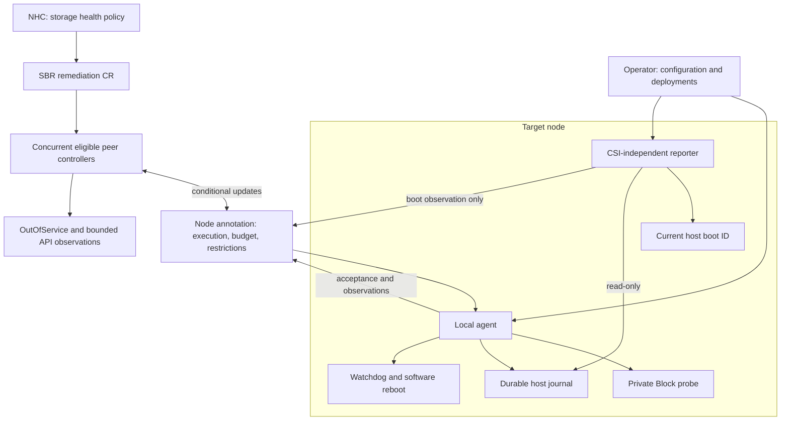
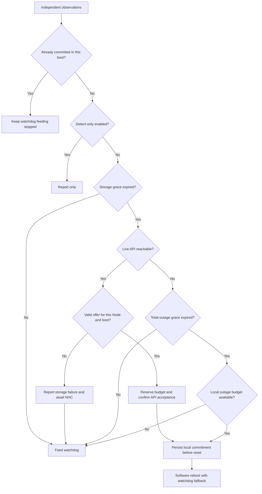
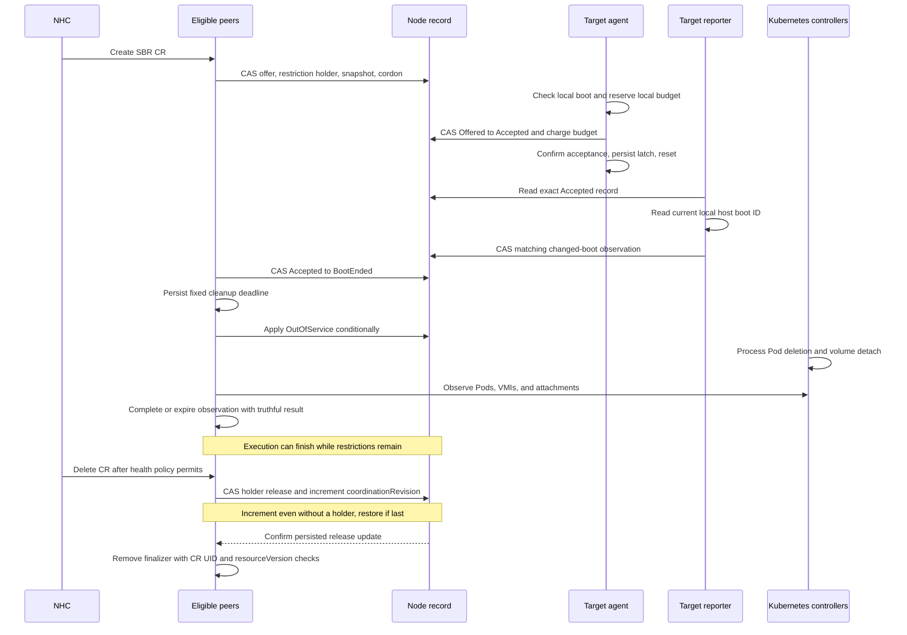

# Storage-Arbitrated Remediation for OpenShift Virtualization

| Item | Value |
|---|---|
| Status | Proposal for review |
| Target release | 5.9.0 |
| Tracking | `RHWA-1839`, `RHWA-1837`, `RFE-9581` |

Contributors: Daniel Froehlich ([@DanielFroehlich](https://github.com/DanielFroehlich)), Wesley Hayutin ([@weshayutin](https://github.com/weshayutin)), Pranav Gaikwad ([@pranavgaikwad](https://github.com/pranavgaikwad)), and Michal Pryc ([@mpryc](https://github.com/mpryc)).

## Index

- [1. Introduction](#1-introduction)
- [2. Motivation](#2-motivation)
- [3. Goals](#3-goals)
- [4. Non-Goals](#4-non-goals)
- [5. Design](#5-design)
  - [5.1. Use-case matrix](#51-use-case-matrix)
  - [5.2. Components and ownership](#52-components-and-ownership)
  - [5.3. Configuration API](#53-configuration-api)
  - [5.4. Private probe volume](#54-private-probe-volume)
  - [5.5. Storage and API decision policy](#55-storage-and-api-decision-policy)
  - [5.6. Host journal and repeated-request checks](#56-host-journal-and-repeated-request-checks)
  - [5.7. Remediation CR status and reboot evidence](#57-remediation-cr-status-and-reboot-evidence)
  - [5.8. Requested remediation, escalation, and cleanup](#58-requested-remediation-escalation-and-cleanup)
  - [5.9. NHC policy and reboot limits](#59-nhc-policy-and-reboot-limits)
  - [5.10. Startup, shutdown, and observability](#510-startup-shutdown-and-observability)
- [6. Open Questions](#6-open-questions)
- [7. Upgrade / Downgrade Concerns](#7-upgrade--downgrade-concerns)
- [8. Test Plan](#8-test-plan)
- [Alternatives considered](#alternatives-considered)
- [Terminology](#terminology)

## 1. Introduction

Storage Based Remediation (SBR) currently uses shared storage for heartbeats and fence messages. Node Healthcheck Operator (NHC) creates a `StorageBasedRemediation` custom resource (remediation CR) when its policy permits remediation.

This proposal adds `BlockPerNode` to the existing `sharedStorageVolumeMode` field in the SBR config CR. Each selected node uses a private Block volume to check storage access. SBR stores remediation history in a file on the host. NHC uses SBR as its only remediation provider for this policy. The host file is called the journal in this document.

SBR owns the local reboot and reports boot information. It uses OutOfService and bounded API observations for workload cleanup. This proposal accepts the existing isolation and scheduling-restoration risks. Existing `Filesystem` and `Block` configurations retain their shared-storage behavior.

See the [Terminology table](#terminology) for definitions of the resource names and design terms used in this document.

## 2. Motivation

The current shared Block volume requires concurrent writes from multiple nodes. Some storage drivers cannot provide this access. Private probe volumes remove that shared-write requirement.

A storage-focused policy should preserve running virtual machines during API or network loss when storage remains usable. When the API remains reachable, NHC should decide whether storage failure permits remediation. When both storage and API access fail, the local agent needs an autonomous decision path.

## 3. Goals

- Preserve existing `Filesystem` and shared `Block` behavior. Keep `Filesystem` as the effective default when the volume mode is absent.
- Introduce new mode `BlockPerNode` that will use private probe volumes per node instead of a shared volume.
- Distinguish temporary input/output (I/O) errors from sustained failure through a storage grace period.
- Keep the watchdog active during isolated API loss when storage remains healthy.
- Reboot autonomously after sustained combined storage and API loss.
- Enforce one local agent per host to control the watchdog and write the journal.
- Persist request identity and boot information across agent and host restarts.
- Retain SBR's OutOfService taint without direct Pod deletion. Report bounded cleanup observations separately from reboot success.
- Report retained reboot evidence independently of the probe volume.
- Resolve accepted execution across stop and deletion. Do not let incomplete cleanup block CR deletion or later execution.

## 4. Non-Goals

- Remove or redesign the existing `Filesystem` and shared `Block` modes.
- In the new mode, inspect another node's private probe volume or exchange fence messages through it.
- Perform or queue cleanup for an autonomous remediation during API loss.
- Provide general hard-dead-node VM high availability without a separately qualified external fencing topology.
- Support multiple StorageClasses or multiple probes per node in this release.
- Guarantee remediation CR lifecycle progress when no eligible peer remains running with API access.

## 5. Design

### 5.1. Use-case matrix

These rows describe the proposed BlockPerNode behavior. They distinguish supported decisions from deferred guarantees. They do not claim that every failure leads to automatic workload recovery.

Every requested lifecycle below assumes a running eligible peer with API access. Local watchdog decisions do not depend on peer availability. If that assumption fails, retain request state and resume when a peer returns.

| # | Scenario | Proposed behavior | Limit or dependency |
|---|---|---|---|
| 1 | Healthy storage and API | Probe storage, feed the watchdog, and report storage healthy. | Probe results describe the selected backend, not every workload volume. |
| 2 | Cluster-wide API outage with healthy storage | Continue watchdog feeding. Do not reboot for API loss alone. | Other Kubernetes and workload controllers have independent behavior. |
| 3 | Broad storage outage with reachable API | Report unhealthy after storage grace. Await an authorized NHC request. Running peers reconcile through the API despite their own probe failures. | NHC thresholds can block new requests. Delayed reports and prior commitments prevent a zero-reboot guarantee. Peer startup can remain blocked by CSI. |
| 4 | Storage and API unavailable | After both grace periods, perform at most one autonomous reset in the unresolved outage period. Skip cleanup for that attempt and preserve any retained requested owner. | Unknown or exhausted budget fails closed. Recovery of Pods elsewhere is not guaranteed. |
| 5 | One node loses API or cluster-network access | Keep feeding while its storage remains healthy. | Configure NHC for the storage condition only. |
| 6 | One node loses storage with API available | NHC creates a request. A peer offers it. The target accepts and resets. After `BootEnded`, apply OutOfService and observe cleanup until completion or the deadline. | Unresolved execution or unavailable evidence can block progress. Continuing isolation is not guaranteed. |
| 7 | Kernel panic, host freeze, or power loss | A qualified armed watchdog can reset a powered host that stops feeding it. | It cannot restore power. A dead node cannot publish the storage condition. Hard-dead failover is outside the base policy. |
| 8 | Planned agent restart or upgrade | Disarm before an uncommitted stop. Preserve request history. Another eligible peer resumes the same API lifecycle state. Compare boot IDs after startup. | Preserve peer coverage during rollout. Verify hardware disarm support and acquire the local agent lock on the host before replacement. |
| 9 | Kubelet failure with healthy storage | Continue feeding while the agent remains functional. | This storage policy does not remediate every kubelet failure. |
| 10 | Slow or hung storage I/O | Bound observation time. Apply storage grace without blocking watchdog decisions or peer remediation CR reconciliation. | A deadline cannot cancel blocked kernel I/O. Bound outstanding operations and avoid shared blocking locks. |
| 11 | Network partition with healthy storage | Do not reset solely for the partition. This NHC policy does not request relocation solely for it. | This is not a guarantee against concurrent workloads created by other controllers. |
| 12 | API or storage recovers after acceptance | Complete the accepted reset. Preserve the bound boot and budget. A different local boot clears only the old latch. Ordered evidence resolves execution. | Stop and deletion can cancel only an offer. Cleanup remains bounded and optional. |
| 13 | Different nodes require different StorageClasses | Deferred. Add explicit node-group to StorageClass mapping. | See Section 6. |
| 14 | One node uses several storage backends | Deferred. Add multiple probes and a health aggregation policy. | See Section 6. |
| 15 | Stuck or terminating workload Pod | Use OutOfService only. At the fixed deadline, finish the policy with incomplete or unknown cleanup recorded separately. Restore owned restrictions during deletion. | Workload finalizers cannot retain execution indefinitely. Workload recovery and safe rejoin are not guaranteed. |
| 16 | Host journal unavailable or recovered | Preserve known commitments and reconcile trusted API records. Unknown autonomous history blocks fresh reset allowance. Peers continue independent API work. | Missing history cannot prove an unused budget. Ordered boot evidence can still resolve a known accepted execution. |
| 17 | Repeated remediation on persistent failure | Enforce the durable node-level outage budget and single local agent. Later remediation CRs wait for ownership release and cannot bypass an unresolved outage period. | Exact requested-reset and rearm values require qualification. |

### 5.2. Components and ownership

NHC watches `SBRStorageUnhealthy=True` and creates an SBR remediation CR. Its name identifies the target node. SBR remains the only remediator in this policy.

Peer agents run the existing `SBRRemediationReconciler`. They process requests concurrently without a lifecycle leader or a Lease per CR. The target's peer controller skips its own Node UID. Its local monitoring loop accepts and executes its own requested reset.

The operator manages configurations and deployments. Its existing leader election does not coordinate remediation requests. A separate reporter can start without the probe volume. It reads the host boot ID and publishes observations. It cannot accept requests, control the watchdog, or perform cleanup.

`BlockPerNode` uses these components:



An eligible peer runs on a different Node and uses the configuration UID recorded for the target. It needs API access and lifecycle permissions. Its probe health, watchdog readiness, and aggregate Pod readiness do not determine eligibility. Peers process requests across namespaces.

At least one eligible peer must remain running with API access for each target requiring lifecycle work. The peer controller remains in the probe Pod. CSI attachment failure can therefore prevent a replacement peer from starting. The reporter does not replace a missing peer controller.

#### Storage-independent reconciliation

Start the BlockPerNode peer manager before probe initialization and storage preflight. Keep its lifetime independent of probe and journal errors. A local error must follow watchdog shutdown rules without cancelling peer reconciliation.

Peer reconciliation uses API objects only. It does not read host journals, inspect probe devices, resolve shared NodeMap entries, or wait for storage locks. Use bounded API calls and requeues. Keep probe I/O, journal I/O, watchdog feeding, and reconciliation on separate execution paths.

Determine the target's configuration before selecting the shared-storage or BlockPerNode path. Missing or conflicting configuration prevents new authorization. Record the Node UID, configuration UID, volume mode, and initial boot ID permanently for each request. Never interpret missing status as permission for shared-storage fencing.

All state writers use conditional updates with `resourceVersion`. After a conflict, read current objects and check identities and permitted transitions again. Preserve unrelated conditions and fields assigned to other writers. Node conditions require strategic merge or an optimistic read-modify-write update.

#### One authoritative execution record

Reuse `sbr.medik8s.io/remediation-owner` on the Node. Its versioned JSON contains one current execution, a node-level budget, separate restriction ownership, and a coordination revision. CR status reports this record. It does not independently authorize execution.

The remediation CR UID identifies a requested attempt. No separate grant ID or ownership UUID is required. The request permanently binds one Node UID and one `beforeBootID`. A changed generation, new configuration, or later boot cannot give that CR another attempt.

An illustrative record is:

```json
{
  "version": 1,
  "nodeUID": "node-uid",
  "coordinationRevision": 12,
  "execution": {
    "requestNamespace": "sbr-system",
    "requestName": "worker-0",
    "requestUID": "request-uid",
    "configUID": "config-uid",
    "beforeBootID": "boot-a",
    "phase": "Accepted",
    "observedBootID": "",
    "cleanupClosed": false
  },
  "budget": {
    "phase": "Known",
    "outageEpoch": "outage-id",
    "requestedAttempts": ["request-uid"],
    "autonomousAttempts": []
  },
  "restrictions": {
    "preExistingUnschedulable": false,
    "preExistingOutOfService": null,
    "holders": [
      {
        "namespace": "sbr-system",
        "name": "worker-0",
        "uid": "request-uid",
        "configUID": "config-uid"
      }
    ]
  }
}
```

`coordinationRevision` is a Node-wide counter. Initialize it to zero with a valid new record. Retain it across execution replacement and restriction release. Increment it in every deletion release update, including retries. Other writers preserve it. This actual mutation changes the Node's `resourceVersion`, even when no holder needs removal.

The counter does not replace `resourceVersion` preconditions or identify a particular request. It requires no retained list of deleted CR UIDs. The release ordering below makes earlier claims conflict with deletion.

The budget fields illustrate retained attempt identities, not an unlimited event log. Retain unresolved attempts and summarize older accounting only under the qualified rearm policy. Missing budget history is `Unknown`, not an unused allowance. Initialize it only from proved first installation or complete trusted history. On the first accepted attempt of a known idle budget, install the locally reserved epoch in the same acceptance update. Otherwise, require the existing epoch to match.

The only execution transitions are:

| From | To | Writer and prerequisite |
|---|---|---|
| No current execution, or reusable terminal execution | `Offered` | Peer selects one eligible request and preserves all budget and restriction state. |
| `Offered` | `Accepted` | Target confirms the bound local boot and reserves its local budget. The same Node update charges the API budget. |
| `Offered` | `Cancelled` | Peer withdraws permission through a conditional update. No target acknowledgement is required. |
| `Accepted` | `BootEnded` | Peer accepts the ordered boot evidence described in Section 5.7. |

An offer is permission to accept, not permission to reset. Acceptance is irreversible for the bound boot. Cancellation and acceptance update the same record. Exactly one can win. CR stop, deletion, restored storage, and elapsed time cannot cancel an accepted request.

The target confirms `Accepted` before requesting reboot or stopping watchdog feeds. A lost update response requires a live read. Before acceptance, the local host boot ID and the bound API boot ID must agree. The target must never execute this request in another boot.

#### Select and finish requests

Install the CR finalizer and record its immutable binding before offering execution. Add the request as a restriction holder and cordon the Node in the same conditional Node update that creates its offer. Capture the original restriction snapshot only when the first holder enters.

Before replacing a terminal execution, persist its terminal phase into any surviving CR. A `Cancelled` or `BootEnded` CR never receives another offer. Keep the old terminal execution in the annotation until a successor replaces it.

For each new claim, use this order:

1. Read the bound Node through the uncached API. Check its UID and retained record.
2. Read the CR through the uncached API. Check its UID, immutable binding, finalizer, deletion timestamp, stop state, and terminal state.
3. Create the offer, holder, and cordon through a conditional update against that Node version.

After a conflict, repeat this complete sequence. Never apply an earlier eligibility decision to a freshly read Node version. Cached CR eligibility cannot authorize a claim. Finalizer removal requires the Node mutation below, so a delayed claim cannot survive completed normal deletion.

An accepted execution remains exclusive until `BootEnded`. Afterwards, it becomes reusable when its bounded cleanup finishes, or its CR is stopped, deleting, or absent. Cleanup can therefore delay a normal successor only until its fixed deadline. Unresolved reboot execution can still block another request.

A stopped CR can remain as history after execution finishes. Preserve its stopped outcome. Do not wait for its deletion before accepting a different eligible request. NHC's own health thresholds, leases, template order, and existing CR names remain independent constraints.

#### Restrictions that outlive execution

Keep the original cordon and OutOfService snapshot independently of the current execution. Every outstanding holder refers to a CR UID, not just its name. Retain the snapshot while any holder remains. A successor must not reinterpret an earlier SBR restriction as an administrator's restriction.

A stopped or successful retained CR keeps its holder. In particular, finishing observation does not remove OutOfService. Deletion removes only the matching holder after that request's execution is cancelled or resolved.

When holders remain, keep the shared SBR restrictions. When the final holder leaves, restore only restrictions that SBR added. Remove that holder and the snapshot in the same conditional Node update. Never clear the execution history or budget as part of restriction release.

A delayed deletion for CR A cannot remove CR B's holder or restrictions. An absent CR is eligible for the same release handling, using its retained UID. A replacement CR with the same name is a different holder.

Preserve any pre-existing cordon, OutOfService taint, and unrelated taints. The OutOfService snapshot identifies the exact key and NoExecute effect that SBR manages. Preserve taints with other effects separately. Check the current taint value before removing an SBR-added taint. The snapshot cannot detect an administrator reasserting the same cordon later. Concurrent administrators must follow the documented ownership convention.

Retained CRs can enlarge the holder set. Prune only verified released or absent holders whose execution is resolved. Bound record size and reject new offers with a visible reason before annotation limits are reached. Never discard live holders or budget history to make space.

#### Automatic execution recovery

Watch Nodes as well as CRs. Reconcile a retained execution even if its CR was forcibly deleted. A peer conditionally cancels an offer, or waits for accepted execution evidence. The reporter publishes into the Node record, so CR absence does not remove its evidence channel.

No local retirement acknowledgement or administrative retirement ConfigMap is required. The permanent boot binding prevents replay after `BootEnded`. The shared API cancellation transition prevents an old offer from executing.

A holder other than the current execution has already resolved execution. Replacing the execution record requires that result. If that holder's CR disappears, a peer can release it without treating the successor's phase as its own.

Peers retry interrupted release operations from the Node record. An absent holder requires no restriction restoration, but does not prove that a delayed offer cannot create one. Do not restore restrictions from a later holder cycle. A later holder must not delay removal of the earlier CR finalizer. Incomplete workload cleanup does not prevent release.

Every normal finalizer removal requires this release sequence, including paths with no offer or holder:

1. Read the deleting CR through the uncached API. Check its UID.
2. Read the bound Node through the uncached API. Check its UID and retained record. Cancel or resolve any execution belonging to this CR before release.
3. Conditionally release the matching holder and restore restrictions when required. Increment `coordinationRevision` in that same Node update, even when no holder exists. Preserve other executions, holders, and budget history.
4. Confirm that the Node update succeeded. Remove the finalizer using CR UID and `resourceVersion` checks. Do not wait for global schedulability or removal of the controller-managed unschedulable taint.

An update that leaves Node data unchanged does not satisfy this sequence. If the release update wins, an earlier offer update fails its Node version check. If the offer wins, the releasing peer must read it and cancel or resolve execution before completing release. Both paths repeat their complete checks after a conflict.

After an unknown release response or peer restart, repeat the guarded Node update before finalizer removal. Another increment is safe. An absent holder alone is insufficient confirmation. Failed API writes do not establish release. Never perform this update on a replacement Node UID.

Each retry uses current restriction ownership. If this CR has no holder, preserve any later holder's restrictions and snapshot. Never repeat an earlier uncordon decision or remove a later holder's OutOfService taint. A later cordon does not reverse this CR's completed holder release.

A missing or invalid record cannot be replaced merely to perform release. Apply the existing history recovery rules.

Deleting the Node destroys this API record. A replacement Node UID does not prove that the old host stopped. Never mutate the replacement through the old request. Recover only from trusted retained history or external evidence. Missing or conflicting identity and budget records cannot create a fresh reset allowance.

Permanent loss of both required local history and API history cannot resolve automatically. Likewise, accepted execution without trustworthy boot evidence remains unresolved. These cases need restored evidence or external recovery, rather than a timeout-based claim of success.

### 5.3. Configuration API

Extend the existing optional `StorageBasedRemediationConfig.spec.sharedStorageVolumeMode` field with `BlockPerNode`. Add two optional grace fields for that value:

| Field | Effective default | Validation | Meaning |
|---|---|---|---|
| `sharedStorageVolumeMode` | `Filesystem` | `Filesystem`, `Block`, or `BlockPerNode` | Existing shared Filesystem, existing shared Block, or one private Block probe per selected node. |
| `storageUnhealthyGracePeriod` | `15s` in `BlockPerNode` | Duration from `0s` through `300s`. Valid only in `BlockPerNode`. | Continuous probe failure required before storage becomes unhealthy. |
| `totalOutageGracePeriod` | `60s` in `BlockPerNode` | Duration from `0s` through `1h`. Valid only in `BlockPerNode`. | Continuous API unavailability required while storage is already unhealthy before autonomous commitment. |

The duration defaults are proposed values for `BlockPerNode`. They do not replace the existing shared-storage detection threshold. An omitted volume mode remains equivalent to explicit `Filesystem`. Explicit `Block` continues to select shared storage.

Use effective getters for defaults. Do not write duration defaults into `Filesystem` or `Block` configurations. An explicit `0s` disables that grace only. It does not disable detection or autonomous remediation.

Proposed additions in [configuration types](../../api/v1alpha1/storagebasedremediationconfig_types.go):

```go
package v1alpha1

// Existing imports, type, constants, and other fields are omitted.
const SharedStorageVolumeModeBlockPerNode SharedStorageVolumeModeType = "BlockPerNode"

type StorageBasedRemediationConfigSpec struct {
	// +kubebuilder:validation:Enum=Filesystem;Block;BlockPerNode
	// +optional
	SharedStorageVolumeMode *SharedStorageVolumeModeType `json:"sharedStorageVolumeMode,omitempty"`

	// +optional
	StorageUnhealthyGracePeriod *metav1.Duration `json:"storageUnhealthyGracePeriod,omitempty"`

	// +optional
	TotalOutageGracePeriod *metav1.Duration `json:"totalOutageGracePeriod,omitempty"`
}

func (s *StorageBasedRemediationConfigSpec) IsBlockPerNodeMode() bool {
	return s.GetSharedStorageVolumeMode() == SharedStorageVolumeModeBlockPerNode
}
```

Keep `GetSharedStorageVolumeMode()` and its `Filesystem` fallback. Keep `IsBlockMode()` specific to shared `Block` behavior. Its existing callers select shared devices, RWX claims, and shared-volume cleanup. Use `IsBlockPerNodeMode()` before those paths instead of treating both values as shared Block.

`BlockPerNode` is an SBR configuration value. It is not a Kubernetes PV or PVC volume mode. The generated private claim still uses `volumeMode: Block` and `ReadWriteOnce`.

Update the `sharedStorageClass` description and validation for both Block values. Preserve the existing StorageClass requirement for shared `Block`. `BlockPerNode` requires a class that supports the private RWO Block claims described in Section 5.4.

Update the custom resource definition (CRD), generated code, webhook, samples, and agent argument construction together. `rebootMethod` and `ioTimeout` are agent command-line flags that the configuration controller currently pins to package constants. For the initial BlockPerNode implementation, the controller selects a provisional ten-second I/O deadline and the `10Mi` probe size. These values remain qualification gates rather than new API fields. See [agent constants](../../internal/agent/constants.go).

#### Field interactions

| Configuration | Existing `Filesystem` or `Block` outcome | `BlockPerNode` outcome |
|---|---|---|
| `sharedStorageVolumeMode` omitted or `Filesystem` | Existing shared Filesystem behavior. | Not selected. |
| `sharedStorageVolumeMode: Block` | Existing shared ReadWriteMany (RWX) Block behavior. | Not selected. |
| `sharedStorageVolumeMode: BlockPerNode` | Not selected. | One private ReadWriteOnce (RWO) Block claim per agent Pod. |
| `sharedStorageClass` | Existing shared-storage validation and provisioning. | Required. Selects the single StorageClass for private probes. It must support dynamic RWO Block provisioning. |
| `watchdogPath` | Existing behavior. | Same device path. One local monitoring loop owns the watchdog. |
| `nodeSelector` omitted or empty | Existing worker-node selection. | Same worker-node selection. The effective selector includes Linux nodes only. |
| `sbrTimeoutSeconds` | Existing timeout and derived intervals. | Reuse `GetSBRUpdateInterval()` as probe interval. It divides the duration by six, with a one-second minimum. Do not use shared heartbeat expiry. |
| `maxConsecutiveFailures` | Existing counter behavior. | Does not decide probe health or replace the storage grace. Retain schema validation for compatibility. |
| `detectOnlyMode: Enabled` | Existing detection-only behavior. | Block new remediation actions. Continue evidence reporting and cleanup for an already committed request. |
| `detectOnlyMode` omitted or `Disabled` | Existing behavior. | Enable requested and autonomous actions under the policy below. |
| Either new grace field is present | Admission rejects the inapplicable field. | Apply the effective duration. |

The existing timeout defaults remain `30` seconds and seven consecutive failures. Their schema ranges remain unchanged. The current internal I/O timeout is two seconds. BlockPerNode does not multiply that timeout by `maxConsecutiveFailures` to calculate storage health.

The provisional ten-second BlockPerNode deadline is valid only after representative CSI qualification. Warn when the storage grace is shorter than the selected deadline. Do not reject it. Explicit `0s` remains valid.

#### Validation and immutability

Extend `ValidateCreate()` and `ValidateUpdate()` in the [configuration webhook](../../api/v1alpha1/storagebasedremediationconfig_webhook.go).

1. Accept `Filesystem`, `Block`, and `BlockPerNode` in the existing volume-mode validation.
2. Validate duration syntax and bounds. Require a StorageClass for `BlockPerNode`.
3. Reject the new grace fields when the effective volume mode is `Filesystem` or `Block`.
4. Reject changes to the effective volume mode and the two new grace fields.
5. Reject configurations that overlap a BlockPerNode configuration on selected nodes.
6. Reject different StorageClasses across BlockPerNode configurations in this release.

Compare durations as values, not strings. Omitted volume mode and explicit `Filesystem` are equivalent. Omitted BlockPerNode grace and an explicit default are equivalent. Removing a nondefault value changes its effective value and must fail.

The existing volume-mode immutability rule covers transitions to and from `BlockPerNode`. Switching between any two distinct effective volume modes requires configuration replacement. Existing field update rules remain unchanged. Mutable fields can still require an agent rollout. For BlockPerNode, replace affected local monitoring loops only after accepted execution and required restriction release are resolved. Incomplete workload cleanup is not a replacement gate.

Apply this replacement rule to selector, StorageClass, watchdog path, and detect-only changes. A selector update must protect removed nodes as well as newly selected nodes. Retain the effective configuration until its executions resolve and its restriction holders release. Cancel unaccepted offers through the Node record.

Current production code does not enforce configuration overlap consistently. The webhook and controller each refer that check to the other component. The new checks must cover namespaces, effective worker selectors, and the Linux restriction. Admission alone cannot prevent concurrent creates or later node-label changes.

The configuration controller must reconcile assignments after admission, including concurrent creates and later label changes. Missing, conflicting, unreadable, or ambiguous effective configuration blocks preparation, commitment, and every new destructive action. An already committed action continues only with the configuration already recorded and retained for that request.

One host process holds permission to perform local actions through a non-blocking exclusive `flock` on `/var/lib/medik8s/state/sbr-executor.lock`. The lock file is separate from the atomically replaced journal and is never unlinked during operation. Acquire it before opening or arming the watchdog, loading mutable journal state, or accepting an offer. Hold it for the local agent's lifetime.

Failure or unsupported locking sets `ExecutorConflict`. That process performs no watchdog or journal writes, but its eligible peer controller can continue API reconciliation. Never break the lock by Pod UID, Lease expiry, peer replacement, or age. Never disarm a watchdog opened by an unknown process.

Set DaemonSet `maxSurge: 0` and `maxUnavailable: 1` explicitly. These settings do not replace the host lock. Assignment checks select the configuration. Node ownership selects the request. Neither selects the process that holds the watchdog.

#### Configuration replacement

To change an immutable value, the administrator removes the old configuration and creates a new configuration after agent cleanup completes. An in-place DaemonSet rollout cannot change these immutable values. Mutable field updates follow the safe rollout rules above.

The BlockPerNode deletion path must complete these steps:

1. Stop authorization of new requests for the old configuration.
2. Resolve accepted execution and release all restriction holders. Incomplete workload cleanup does not block this step.
3. Stop uncommitted local monitoring loops with a verified watchdog disarm.
4. Wait for the old local agents and reporters to terminate before releasing configuration ownership.
5. Remove configuration-owned resources and permit a replacement configuration.

An unreachable node can delay replacement. Do not start a second watchdog owner to avoid that delay. Preserve the host journal across replacement. Configuration deletion must not erase completed request identities.

Retain the agent DaemonSet, its service account, and lifecycle permissions while assigned requests need cancellation, accepted execution resolution, or restriction release. Configuration retirement stops observations without waiting for successful workload cleanup. Include retained Node executions and restriction holders when a request is missing. Keep an eligible peer for each affected target during planned rollout or retirement. A terminating configuration prevents new requests but does not disqualify peers from processing its retained requests. If no peer remains, report the blocked replacement and wait for peer availability.

The current configuration deletion handler removes role-based access control (RBAC) and relies on garbage collection for the DaemonSet. It does not establish this shutdown order. Add a separate BlockPerNode deletion path in [the configuration controller](../../internal/controller/storagebasedremediationconfig_controller.go). Do not apply shared-PV cleanup to private probe claims.

### 5.4. Private probe volume

Each selected node runs one local SBR agent with one generic ephemeral Block volume. The Pod owns its PersistentVolumeClaim (PVC). The controller uses a named `10Mi` request value rather than an embedded manifest literal. Driver allocation granularity can produce a larger volume. A supported backend must accept that request or define its qualified minimum.

The StorageClass must support raw Block, dynamic provisioning, and the probe's direct I/O operations. The claim requests `ReadWriteOnce`. SBR does not require concurrent writes from other nodes.

`SBRStorageUnhealthy` describes this selected probe path, not every VM disk or the whole storage array. Each supported policy documents how the probe StorageClass, backend, and failure domain represent the workloads eligible for remediation. An unqualified or unrepresentative probe blocks destructive remediation. Distinguish `ProbeNotProvisioned`, `ProbeNotAttached`, `ProbeIOFailed`, `StoragePathUnhealthy`, and `BackendUnqualified` in status and events.

Add a BlockPerNode branch before `validateStorageClass()`, `ensurePVC()`, and `ensureSBRDevice()` in [the configuration controller](../../internal/controller/storagebasedremediationconfig_controller.go). Their current shared-volume path rejects some RWO provisioners and creates an RWX PVC. Selecting `Block` alone does not change that behavior. Prefer `WaitForFirstConsumer` for topology-constrained storage. Warn, rather than reject, when `Immediate` binding is combined with topology constraints.

The proposed DaemonSet fragment is:

```yaml
spec:
  updateStrategy:
    type: RollingUpdate
    rollingUpdate:
      maxUnavailable: 1
      maxSurge: 0
  template:
    spec:
      containers:
        - name: sbr-agent
          # Existing image, arguments, and host mounts are omitted.
          volumeDevices:
            - name: storage-probe
              devicePath: /dev/sbr-probe
      volumes:
        - name: storage-probe
          ephemeral:
            volumeClaimTemplate:
              spec:
                accessModes: [ReadWriteOnce]
                volumeMode: Block
                storageClassName: example-block
                resources:
                  requests:
                    storage: 10Mi
```

Keep the watchdog device mount separate from `/dev/sbr-probe`. Mounting the entire host `/dev` over that path can hide the CSI device.

A container restart reuses the Pod's PVC. A node reboot can also retain the same Pod and PVC. A replacement Pod receives its own PVC. Kubernetes deletes the old PVC with its owning Pod. The PersistentVolume (PV) reclaim policy controls what happens to the underlying volume. See [generic ephemeral volume lifecycle](https://kubernetes.io/docs/concepts/storage/ephemeral-volumes/#lifecycle-and-persistentvolumeclaim).

The probe contains disposable test data. It contains no authoritative reboot evidence, shared NodeMap, peer heartbeat, or fence message. SBR does not mount another node's probe.

The local agent must select the private prober before shared-storage initialization in `NewSBRAgentWithWatchdog()`. Disable shared heartbeat writes, peer checks, and fence-slot reads only in BlockPerNode. Keep the existing shared-storage initialization and runtime paths intact. See [the agent constructor and loops](../../cmd/sbr-agent/main.go).

The BlockPerNode entry point must branch before the current storage preflight and constructor. Initialize API clients and start the peer manager without opening the probe. Then initialize the local agent independently. The existing constructor initializes storage and NodeMap before its manager, so it cannot provide this ordering unchanged. Section 5.10 defines the required lifetime separation.

Run the evidence reporter in a separate DaemonSet without the probe volume. It mounts the host journal read-only and has no watchdog device. A sidecar is insufficient because the entire local agent Pod can remain pending when its probe cannot attach. A selected node whose local agent or reporter is pending is uncovered and must be visible through configuration status and events.

The initial implementation keeps one StorageClass across BlockPerNode configurations. Admission rejects different selections, and the controller checks concurrent creations before starting agents. Section 6 describes the deferred extension.

### 5.5. Storage and API decision policy

The local monitoring loop evaluates storage health and live API reachability independently. Probe I/O, API calls, journal writes, and watchdog feeding must not share a blocking execution path.

The probe performs a write and read check with bounded completion time. A failed operation or I/O deadline starts the storage grace. The earliest unhealthy decision is therefore the failure or deadline plus `storageUnhealthyGracePeriod`. Admission does not require the grace to exceed the I/O deadline. Explicit `0s` remains valid.

Storage becomes unhealthy only after continuous failure reaches the grace. A successful fresh probe clears the failure interval.

For hung I/O, the deadline marks failure even if the kernel operation continues. A Go timeout does not cancel an operation blocked in the kernel. Bound outstanding operations to one probe operation per device. Do not launch another operation on each tick while the previous operation remains blocked.

Only a fresh result can restore health. A late result from an expired probe must not overwrite a newer failure decision. Use a monotonic clock within a boot. Scheduling and probe interval can add detection delay beyond the configured grace.

For BlockPerNode, each agent writes `SBRStorageUnhealthy` only on its own Node. It does not infer another node's storage health from a missing heartbeat. It never writes `Unknown`. The existing `Unknown` value is a shared-storage peer-monitor signal and is not part of BlockPerNode.

Update the condition through a strategic merge patch or an optimistic-lock read-modify-write retry. This preserves unrelated Node conditions. Preserve `LastTransitionTime` while the status is unchanged. Combine duplicate writes. Add bounded jitter to failure transitions. NHC's condition duration adds a separate delay after this condition becomes True.

| Storage state | Live API result | Local action before any commitment |
|---|---|---|
| Healthy | Available or unavailable | Feed the watchdog. Do not reboot solely because API access failed. |
| Failure within storage grace | Any result | Continue observation and feed the watchdog. |
| Unhealthy | Reachable, no authorized request | Publish True when possible. Feed the watchdog while NHC decides. |
| Unhealthy | Reachable, valid offered request | Reserve the local budget, conditionally accept, persist the latch, and execute the requested reset. |
| Unhealthy | Unavailable within total-outage grace | Feed the watchdog while the grace runs. |
| Unhealthy | Unavailable through total-outage grace | If the local outage budget permits, persist an autonomous attempt and execute one local reset operation. Skip cleanup. |
| Unhealthy | Unavailable, local outage budget exhausted or unknown | Record exhaustion when possible and keep feeding. Do not reset again until the outage period is safely reset to permit another reset. |
| Any state | Detect-only enabled, no prior commitment | Report observations. Do not perform remediation actions. |

Acceptance requires unhealthy local storage and matching request UID, Node UID, configuration UID, and initial boot ID. The local budget and API budget must permit acceptance. Once the Node record becomes `Accepted`, later health recovery cannot cancel that decision.

If storage recovers before acceptance, keep feeding. A peer can withdraw the offer. Stop and deletion race acceptance through the same conditional Node transition. A separate CR read cannot make this cross-object race atomic. After acceptance wins, stop handling resolves execution rather than cancelling it.

API reachability requires a bounded, authenticated live request. A cached informer result is insufficient. The routine check uses the small SBR remediation CR, or `/readyz` where RBAC permits. A full uncached Node read is reserved for recording request identities, committing to a reset, and updating evidence.

A successful empty result or `NotFound` means the endpoint is reachable. However, Node absence or name reuse is an identity mismatch. Authorization, certificate, proxy, and client-configuration failures prevent request authorization. These failures must not become combined-outage triggers.

Connection failures and network deadlines contribute to API unavailability. For this policy, a received `429` or `5xx` means the configured endpoint is reachable. It cannot authorize a request. Keep feeding and reset the API-unavailability interval for those responses. Credential, certificate-validation, and client-configuration errors report degradation instead of triggering autonomous remediation. Neither a failed Node status write nor a missing remediation CR alone establishes API unavailability.

Start `totalOutageGracePeriod` when storage is unhealthy and API access is unavailable together. Reset that interval if storage recovers or the API becomes reachable. Its duration follows the storage grace rather than replacing it.



NHC's health thresholds can prevent new requests during a broad storage outage. They do not constrain a committed reset or an API-offline autonomous reset. Reports can arrive at different times, and an earlier committed reset continues.

### 5.6. Host journal and repeated-request checks

This design requires a new `github.com/medik8s/common/pkg/nodestate` package. It does not exist in `common v1.17.0`, which the reviewed projects currently pin. Installation requires a common release that provides this contract:

- Node-UID request keys and `ReadBootID`.
- Versioned schemas that preserve unknown top-level fields.
- Required identity and budget records that diagnostic pruning cannot remove.
- Explicit recovery and durability outcomes.
- Safe path handling.
- Atomic temporary writes, file `fsync`, rename, and directory `fsync`.

SBR writes `/var/lib/medik8s/state/sbr.json` on the host. Mount its directory at `/var/lib/medik8s/state` inside the local agent container. This path is independent of the probe volume and Pod identity. Only the process holding the local agent lock writes the journal. The reporter can read completed snapshots.

Use the proposed common envelope below. These names specify the required API, not an existing `v1.17.0` implementation.

| SBR data | Common field | JSON location |
|---|---|---|
| Format version | `Document.SchemaVersion` | `schemaVersion` |
| Node name and immutable Kubernetes Node UID | `Document.Node`, `Document.NodeUID` | `node`, `nodeUID` |
| Current local kernel boot ID | `Document.BootID` | `bootID` |
| Effective configuration | `Document.Config` | `config`, with string values |
| Current reset commitment | `Agent.FenceLatched` | `agent.fenceLatched` |
| Agent shutdown state | `Agent.Shutdown` | `agent.shutdown` |
| Required SBR state | `Agent.Extra` | `agent.extra`, with string values |
| Diagnostic reboot records | `Document.Reboots` | `reboots` |
| Diagnostic samples and events | `Document.IO`, `Document.Conditions`, `Document.Events` | `io`, `conditions`, `events` |

Use four SBR keys inside `agent.extra`: `sbrStateVersion`, `activeAttempt`, `resetLedger`, and `outageState`. Set `sbrStateVersion` to the string `"1"`. Encode each object or array as a JSON string because `Agent.Extra` has type `map[string]string`. SBR validates and changes these records. Common preserves them without interpreting their contents.

The requested action identity is `(StorageBasedRemediation UID, Node UID)`. Use the request UID as its `attemptID`. Bind it permanently to the Node UID, configuration UID, and `beforeBootID`. Generation changes and configuration replacement do not permit another attempt for that request. A new request UID cannot bypass the node-level budget.

The Node execution record is authoritative for `Offered`, `Accepted`, `Cancelled`, and `BootEnded`. A journal entry cannot create acceptance or reverse cancellation. Retain local records for budget accounting and execution recovery. They do not create another ownership or release protocol.

For autonomous remediation, generate one local attempt ID before commitment. Do not fabricate a remediation CR identity. Preserve autonomous history independently of CR creation, stop, deletion, and replacement. A later CR cannot adopt an earlier autonomous attempt as its requested action.

The following fragment shows a committed requested attempt. Common also records its timestamps, revision, and writer metadata.

```json
{
  "schemaVersion": 1,
  "node": "worker-0",
  "nodeUID": "node-uid",
  "bootID": "11111111-1111-4111-8111-111111111111",
  "config": {
    "uid": "config-uid",
    "sharedStorageVolumeMode": "BlockPerNode"
  },
  "agent": {
    "component": "sbr",
    "shutdown": "running",
    "fenceLatched": true,
    "extra": {
      "sbrStateVersion": "1",
      "activeAttempt": "{\"attemptID\":\"request-uid\",\"source\":\"NHC\",\"requestUID\":\"request-uid\",\"nodeUID\":\"node-uid\",\"configUID\":\"config-uid\",\"beforeBootID\":\"11111111-1111-4111-8111-111111111111\",\"outageEpoch\":\"epoch-uuid\",\"phase\":\"Committed\"}",
      "resetLedger": "[{\"attemptID\":\"request-uid\",\"source\":\"NHC\",\"requestUID\":\"request-uid\",\"nodeUID\":\"node-uid\",\"beforeBootID\":\"11111111-1111-4111-8111-111111111111\",\"outageEpoch\":\"epoch-uuid\",\"phase\":\"Committed\"}]",
      "outageState": "{\"epochID\":\"epoch-uuid\",\"phase\":\"Unresolved\"}"
    }
  },
  "reboots": []
}
```

#### Reserve and commit a requested attempt

Use one `Store` and one local decision loop in the process holding the host lock. `Store.Update` serializes each journal transition. The loop also prevents requested and autonomous decisions from overlapping while an API acceptance remains unresolved.

1. Check the exact Node execution record, its permanent identities, the current local boot ID, and the reset budget.
2. Persist a local reservation with the request UID, boot binding, and stable outage epoch. Keep `FenceLatched=false`.
3. Conditionally change the matching Node record from `Offered` to `Accepted`. Charge its requested budget in that same Node update.
4. Confirm that acceptance succeeded. After an unknown API response, read the live record before making another decision.
5. Persist the accepted attempt, its budget entry, and `FenceLatched=true` in one durable journal update.
6. Invoke the software reboot and watchdog fallback defined in Section 5.5.

The Node update uses the request UID to charge the budget once. A retry must adopt the existing charge rather than increment it. Local reconciliation records that same charge without consuming another allowance. Section 5.2 defines the Node record and its conditional updates.

An unresolved acceptance response permits no new reset action. Continue feeding unless an earlier durable commitment already requires reset. Preserve the reservation and retry the API read. Do not release a reservation merely because a call timed out or the CR disappeared.

A trusted successor execution on the same Node UID also proves that the earlier execution resolved. The record must retain the valid schema and budget history. Annotation loss, reinitialization, or conflicting history does not establish this proof.

If the local boot still equals the earlier reservation's boot, that offer must have been cancelled before replacement. Release its uncommitted reservation. If the boot differs, reject the old binding and reconcile its retained budget charge. Never refund an ambiguous or recorded charge merely because the current request changed.

A confirmed `Cancelled` outcome releases an uncommitted reservation. It cannot clear an earlier commitment. Confirmed `Accepted` is irreversible, including after health recovery or CR deletion. If persistence fails before the local latch is durable, preserve the accepted state and report degradation. Resume persistence when possible. Do not change it to `Cancelled`.

#### Preserve journal durability and watchdog state

Common writes a temporary file, synchronizes its contents, renames it, and synchronizes the directory. Readers cannot observe a partial replacement. The separate host lock prevents competing writers.

Bound host I/O waits and retries independently of watchdog feeding. Permit only one outstanding journal operation. An expired wait does not prove that the operation stopped. Do not start another transition while its result remains unresolved.

Before the local latch becomes durable, a persistent journal failure prevents a new reset action. Report degradation when possible. If the qualified device supports safe disarm, verify disarm before stopping the monitoring loop. This does not cancel an Accepted request.

For nowayout or failed-disarm devices, continue feeding in a degraded state until a qualified shutdown or recovery path is available. Never exit and imply a reboot-free stop. A device without a supported fatal-error policy fails qualification before it is armed.

`ErrDurabilityUnconfirmed` means replacement is visible, but survival across a crash is uncertain. It does not authorize a new reset. Common must provide a tested contract for resolving this outcome.

After durable local commitment, journal or API failures must not restore watchdog feeding in the committing boot. Shutdown must not disarm that committed watchdog. Late health recovery cannot reverse the commitment.

Software reboot and watchdog expiry are two mechanisms for one reset operation. Reuse `executeSelfFencing()` in [the agent](../../cmd/sbr-agent/main.go). Persist commitment before invoking the command or stopping feeds. A command return or elapsed timer does not prove that the boot ended.

#### Recover after a process or host restart

Load the journal before normal monitoring. Read the local kernel boot ID through `ReadBootID`. Compare it with the attempt's permanent `beforeBootID`.

`FenceLatched` applies only to that recorded boot. A valid different boot ID requires an atomic journal update before arming the new boot's watchdog. Record the observation and clear only the old boot's latch. Preserve the attempt and budget history. Resume normal feeding for the new boot.

| Record and boot comparison | Action |
|---|---|
| Reservation, acceptance unresolved | Read the authoritative API record. Keep the reservation and block another attempt until its outcome is known. |
| Valid reservation, confirmed Accepted, same boot | Complete the journal commitment before acting. Do not charge the API budget again. |
| Committed attempt, same boot | Resume the committed watchdog state. Do not issue another software reboot command. |
| Attempt, different valid local boot | Never execute that request in the new boot. Preserve its history and report the boot observation. |
| Clean shutdown marker, same boot | Treat it as an agent restart. The marker does not prove a host reboot. |
| Invalid or unavailable boot ID | Block new attempts. Preserve any known commitment and report degradation. |
| `NeverInitialized` | Initialize only after proving first installation and checking the API identities and budget records. |
| Unreadable, corrupt, unsupported, or uncertain history | Enter `HistoryReconciliationRequired`. Reconstruct only facts that complete authoritative API records establish. |

A local comparison alone does not set `BootEnded` or authorize cleanup. Section 5.7 defines ordered observation of the Accepted record and the current host boot ID. The reporter publishes evidence against that exact Node and request record, including when the CR no longer exists.

No local retirement acknowledgement is required. `Cancelled` prevents acceptance. Valid `BootEnded` evidence proves that the boot authorized by Accepted has ended. A process in a different boot must reject that old request.

#### Preserve and reconcile the reset budget

Keep a durable ledger of requested reservations and every committed requested or autonomous attempt. Use stable attempt IDs and outage epoch IDs. Select the existing unresolved epoch before reservation or commitment. If none exists, persist the proposed epoch before any acceptance or autonomous action. Requested acceptance must check that the local epoch agrees with the API budget record.

Acceptance charges a requested attempt in the API. Local autonomous commitment charges the local ledger before reset. An outage epoch becomes unresolved when either charge occurs. It clears only after the qualified sustained period of healthy storage and reachable API. A brief recovery, new CR, agent restart, or configuration replacement does not clear it.

Permit at most one autonomous reset per unresolved epoch. Apply the qualified node-level requested limit before acceptance. Exhaustion reports `Succeeded=False`, `Processing=False`, and `Reason=RebootBudgetExhausted` when the API is available. Resolve an unaccepted offer through `Cancelled`. Exact requested limits and the healthy interval remain qualification decisions.

After API recovery, reconcile local autonomous entries into the API budget by attempt ID and epoch ID. Repeated reconciliation must not charge an entry twice. Preserve API charges from other observations. Complete reconciliation before accepting a new requested attempt or rearming an epoch.

Distinguish first installation from lost, corrupt, incompatible, or uncertain history. An API record can reconstruct only the facts it contains. It cannot prove that no unreported autonomous attempt occurred during an API outage. Unknown autonomous history blocks a fresh attempt until the missing facts are established.

Keep this uncertainty durable across restarts. Never replace it with an empty ledger. A surviving Accepted record can establish that request's acceptance and charge. It cannot reconstruct missing watchdog state or unrelated autonomous history.

Prune diagnostics separately from required attempt and epoch records. Retain records needed to reject duplicate charges, resolve an attempt, or establish the current budget. CR deletion does not authorize their removal. If required records cannot be retained, block new attempts and report degradation.

### 5.7. Remediation CR status and reboot evidence

Add optional fields to [remediation status](../../api/v1alpha1/storagebasedremediation_types.go). Existing conditions remain available. Filesystem and shared Block requests do not require these fields.

Proposed additions are shown below. Other existing fields are omitted.

```go
package v1alpha1

type StorageBasedRemediationStatus struct {
	NodeUID              types.UID      `json:"nodeUID,omitempty"`
	ConfigUID            types.UID      `json:"configUID,omitempty"`
	VolumeMode           string         `json:"volumeMode,omitempty"`
	BeforeBootID         string         `json:"beforeBootID,omitempty"`
	ExecutionPhase       string         `json:"executionPhase,omitempty"`
	ObservedBootID       string         `json:"observedBootID,omitempty"`
	Cleanup              *CleanupStatus `json:"cleanup,omitempty"`
	RestrictionsReleased bool           `json:"restrictionsReleased,omitempty"`
}

type CleanupStatus struct {
	Phase               string       `json:"phase,omitempty"`
	StartedAt           *metav1.Time `json:"startedAt,omitempty"`
	Deadline            *metav1.Time `json:"deadline,omitempty"`
	OutOfServiceApplied bool         `json:"outOfServiceApplied,omitempty"`
	Reason              string       `json:"reason,omitempty"`
}
```

The peer records the binding once. The CR UID comes from metadata. The initial boot ID comes from a live Node read. None of these identities can change during this CR's lifetime.

Peers publish `executionPhase` as `Offered`, `Accepted`, `Cancelled`, or `BootEnded` from the authoritative Node record. They publish the accepted `observedBootID` with `BootEnded`. CR status cannot grant another reset.

`CleanupStatus` reports one bounded operation. Its phases are `Pending`, `Observing`, `Completed`, `Incomplete`, `Unknown`, and `Skipped`. The reason distinguishes deadline expiry, stop, deletion, supersession, missing permissions, and failed API operations. Events and logs describe remaining resources without storing an unbounded target list.

The recorded deadline never moves after the operation starts. `outOfServiceApplied` records confirmed application, not an inference from elapsed time. Missing cleanup status never means completion.

`restrictionsReleased` means that this CR no longer holds SBR restrictions. Another holder or an administrator can still keep the Node cordoned or tainted. Do not call this field proof that the Node is schedulable.

#### Ordered boot observations

The local agent accepts only while its actual host boot ID equals `beforeBootID`. It checks the live Node UID and configuration identity. It reserves its local budget before the conditional acceptance transition.

For an Offered request, the target can report a local boot mismatch through a conditional observation update. A peer then changes that offer to `Cancelled` with reason `InitialBootChanged`. It must not rebind the CR or report `BootEnded` for an unaccepted request.

After acceptance, either the local agent or the separate reporter can publish boot evidence:

1. Read the exact `Accepted` Node execution record through the live API.
2. Check its Node UID and recorded request identity.
3. Read the current local host boot ID with `ReadBootID`.
4. Require a valid nonempty ID different from `beforeBootID`.
5. Conditionally publish that ID into the same execution record.
6. On conflict, repeat the identity and phase checks before retrying.

The reporter cannot change execution phase or budget. An eligible peer validates the observation against the current accepted record. It then changes `Accepted` to `BootEnded` through a conditional Node update. The transition and accepted observed boot ID persist together.

The reporter uses the Node record even when the CR no longer exists. It does not require the probe device to attach. Journal observations can provide diagnostic context, but an authoritative accepted record already supplies the requested identity and initial boot.

A different local boot observed after reading acceptance establishes that the accepted boot ended. It does not establish which reset mechanism caused the change. It also does not prove continuing workload isolation.

A raw change in `Node.status.nodeInfo.bootID` is insufficient by itself for this ordering contract. A later API resource version does not establish physical boot chronology. Node status can corroborate the target observation. It cannot replace the ordered local read. See [the Kubernetes Node status patch implementation](https://github.com/kubernetes/kubernetes/blob/master/staging/src/k8s.io/component-helpers/node/util/status.go).

Delayed observations must still match the accepted request, Node UID, and initial boot. Reject observations for another execution or replacement Node. An accepted observation remains valid if a later boot occurs. Never replace its initial boot ID.

If every reporting path is unavailable, keep execution `Accepted` with reason `EvidenceUnavailable`. Stop, deletion, timeout, missing CR, and Node replacement cannot substitute for evidence. No separate local retirement acknowledgement follows valid `BootEnded`.

### 5.8. Requested remediation, escalation, and cleanup

BlockPerNode retains SBR's OutOfService approach. The BlockPerNode remediation path does not directly delete workload Pods, VMIs, VolumeAttachments, PVCs, or PVs. Kubernetes, KubeVirt, and CSI controllers perform their normal resource handling.

The sequence is cordon, accept one reset, observe the bound boot ending, apply OutOfService, and observe resource removal. Restore SBR-owned scheduling restrictions during CR deletion, subject to other holders.

#### Accepted isolation and rejoin risks

This proposal applies OutOfService after accepted reboot evidence without proving continuing workload isolation. It follows the existing SBR approach and accepts the resulting risk.

Kubernetes requires shutdown or power-off verification before OutOfService. A changed boot ID does not meet that prerequisite. Workloads can restart before the peer applies the taint. Force deletion and detach can then overlap workload writes. See [Kubernetes shutdown guidance](https://kubernetes.io/docs/concepts/cluster-administration/node-shutdown/#non-graceful-node-shutdown-handling).

The design does not add an external fence, early-boot workload hold, isolation attestation, or rejoin authorization protocol. It does not claim protection against duplicate writers. Section 6 records this accepted limitation.

Deletion also restores SBR-owned restrictions without proving that workload deletion and detach finished. Removing the taint cannot cancel operations already accepted by other controllers. This is an accepted risk, not evidence of successful cleanup.

#### One bounded cleanup operation

After `BootEnded`, start one optional cleanup operation for a request that is still active. Here, optional means that cleanup completion is not required for successful completion of the bounded remediation policy. It is not a new configuration switch.

Persist `startedAt` and `deadline` through a conditional CR status update before the first taint attempt. Use a provisional five-minute internal observation limit. Do not add another configuration field in this proposal. Qualification can adjust this constant.

```go
package controller

// Existing imports and other declarations are omitted.
const blockPerNodeCleanupObservationTimeout = 5 * time.Minute
```

Apply `node.kubernetes.io/out-of-service=nodeshutdown:NoExecute` using the existing `ensureOutOfServiceTaint()` behavior with conditional ownership checks. Preserve the original snapshot and all current holders.

Check Node UID, current execution UID, `BootEnded`, `cleanupClosed=false`, and this request's holder inside the Node update. Stop and deletion handling precede new cleanup work. A delayed update cannot apply the taint for an execution that a successor replaced.

Retry failed API operations only within the recorded cleanup period. A peer restart or lost response does not extend that period. Read current state to resolve an uncertain taint update. Record `outOfServiceApplied=true` only after confirming application. A pre-existing matching taint can satisfy application without becoming SBR-owned.

Repeated observations are permitted. Do not start another operation when the deadline expires or a terminal result exists.

Before publishing a terminal cleanup result, conditionally set the Node execution's `cleanupClosed=true`. Stop, deletion, and execution replacement also close this permission. A delayed taint update based on an earlier Node version then fails. Keep this flag independent of whether OutOfService remains present. If the Node permission closed before the CR result was saved, report `Unknown` with reason `ClosureResultUnavailable`. Finish the bounded policy without reopening cleanup or repeating scans.

The deadline stops new cleanup attempts. It cannot cancel an API request already in flight. Close the Node permission before reporting the operation finished. If a delayed taint write wins first, read its result and retain the taint under the holder rules.

Use these results:

| Observation | Cleanup result |
|---|---|
| Confirmed taint application and complete fresh scans find no relevant resources | `Completed` |
| The deadline expires after confirmed taint application, with a complete final scan showing remaining resources | `Incomplete` |
| The deadline expires without a complete final scan, or taint application remains unconfirmed | `Unknown` |
| Stop or deletion prevents cleanup from starting | `Skipped` |
| Stop, deletion, or supersession interrupts observation | `Incomplete` or `Unknown`, according to the available evidence |

Timeout does not establish successful taint application or resource removal. Preserve the application result and error reason separately. A temporary API failure can delay publication of the terminal result, but it cannot restart the observation period.

#### Observation scope and exclusions

Discover current resources from the live API. Do not retain a target list.

- List Pods assigned to the target node name, while checking that the recorded Node UID still exists.
- List VMIs assigned to that node or linked to relevant virt-launcher Pods.
- List VolumeAttachments independently of Pods by target node name.
- Treat remaining terminating objects as present.
- Treat a missing optional KubeVirt API as not applicable only after API discovery confirms that it is absent.
- Treat permission errors, failed lists, incomplete pages, and expired continuation tokens as unknown results.

Exclude only verified SBR agent and reporter Pods. Check namespace, Node identity, Pod UID, DaemonSet owner UID, and configuration ownership. A label alone does not establish an exclusion.

Exclude private probe attachments only when the PV, PVC, and Pod ownership chain establishes their purpose. Missing or unverifiable objects do not establish an exclusion. An excluded volume has no Kubernetes toleration of its own. Its consuming Pod must tolerate OutOfService.

Add this toleration to both agent and reporter Pod templates:

```yaml
spec:
  template:
    spec:
      tolerations:
        - key: node.kubernetes.io/out-of-service
          operator: Exists
          effect: NoExecute
```

Omit `tolerationSeconds` so these Pods do not expire under this taint. Preserve other required tolerations. Tolerations protect against taint eviction, not every deletion or detach path. Test terminating Pods, rolling updates, and probe replacement explicitly.

Ordinary workload Pods remain in scope even when they tolerate OutOfService. Those Pods, workload finalizers, and unavailable controllers can prevent complete cleanup. Report that result without adding direct deletion or stripping finalizers.

Complete fresh scans are required for `Completed`. Separate lists do not form an atomic cluster snapshot. Recheck the Node UID and request state before publishing the result. If the deadline expires before a complete scan finishes, record `Unknown` rather than an empty result.

#### Conditions and NHC behavior

After `BootEnded` and either cleanup completion or deadline expiry, set the existing terminal conditions for an active request:

| Condition | Value | Meaning |
|---|---|---|
| `FencingSucceeded` | `True` | The accepted reboot completed and the bounded remediation policy finished. |
| `FencingInProgress` | `False` | No requested reset remains in progress. |
| `Succeeded` | `True` | The bounded policy completed, including its accepted cleanup limitations. |
| `Processing` | `False` | SBR finished active processing for this request. |
| `Ready` | `True` | Preserve the existing terminal condition convention. |

Keep `cleanup.phase=Incomplete` or `Unknown` when appropriate. Use a reason such as `CleanupObservationExpired` and report the incomplete work. These success conditions do not assert complete resource removal, continuing isolation, or replacement workload startup.

A cleanup timeout before `BootEnded` cannot set these success conditions. Accepted execution without reboot evidence remains unresolved.

The existing [`handleFencingSuccess()`](../../internal/controller/storagebasedremediation_controller.go) sets the terminal conditions after OutOfService. The BlockPerNode branch adds bounded observation and preserves its separate result.

NHC does not use `FencingSucceeded` as a deletion trigger. It requests deletion after Node health recovers, subject to `healthyDelay`. It reads `Succeeded` during escalation. A successful CR can still time out in NHC while the Node remains unhealthy. See [NHC remediation handling](https://github.com/medik8s/node-healthcheck-operator/blob/dc02045b23a8a0d091116a4f4d679d26e9ef3004/internal/controller/nodehealthcheck_controller.go) and [healthy-node handling](https://github.com/medik8s/node-healthcheck-operator/blob/dc02045b23a8a0d091116a4f4d679d26e9ef3004/internal/controller/resources/manager.go).

#### Stop and deletion handling

Process stop and deletion before success returns or observation work. Neither event starts another scan.

| Execution state | Stop or deletion behavior |
|---|---|
| No offer | Stop preparation. During deletion, perform the mandatory Node release update even when no holder exists. |
| `Offered` | Compete with acceptance by conditionally changing the same record to `Cancelled`. |
| `Accepted` | Stop cleanup work. Retain unresolved execution until accepted boot evidence arrives. |
| `Cancelled` or `BootEnded` | Stop observations and permit execution replacement. Preserve the terminal state. |

A stopped retained CR releases execution after cancellation or reboot evidence. Keep its stopped condition outcome and its restriction holder. Do not wait for workload objects to disappear. Do not overwrite an NHC-stopped failure with normal success.

During CR deletion, remove only that CR's restriction holder. When the final holder leaves, restore SBR-owned restrictions from the original snapshot. Incomplete or unknown cleanup does not block this operation. Retry required API changes until their result is known.

Remove the finalizer only after the release sequence in Section 5.2 succeeds. Its conditional Node update must increment `coordinationRevision`, including when an earlier reconciliation already removed the holder. Finalizer completion does not require the Node to become schedulable or the controller-managed unschedulable taint to disappear. Another holder or an administrator can retain scheduling restrictions. Do not remove that taint directly to complete finalization.

The current [`handleDeletion()`](../../internal/controller/storagebasedremediation_controller.go) restores scheduling without scanning workload resources, but waits for unschedulable taint removal. The BlockPerNode path omits that wait. It requires ownership-aware release and the coordination update before finalizer removal. Existing Filesystem and shared Block deletion behavior remains unchanged.

Forced finalizer removal bypasses this ordering and cannot guarantee prevention of offers after deletion. Peers still reconcile retained Node records through the cancellation and release rules. A replacement Node or missing restriction snapshot never authorizes reconstruction from current taints. During normal deletion, unresolved execution and failed required release operations can still retain a finalizer. Cleanup observations alone cannot.

Proposed routing in the existing controller is:

```go
package controller

// Existing fields and shared-storage implementation are omitted.
func (r *SBRRemediationReconciler) Reconcile(
	ctx context.Context, req ctrl.Request,
) (ctrl.Result, error) {
	state, err := r.resolveRequestOrRetainedNodeRecord(ctx, req)
	if err != nil {
		return ctrl.Result{}, err
	}
	if state.IsBlockPerNode() {
		return r.reconcileBlockPerNode(ctx, state)
	}
	return r.reconcileSharedStorage(ctx, req)
}

func (r *SBRRemediationReconciler) reconcileBlockPerNode(
	ctx context.Context, state *blockPerNodeState,
) (ctrl.Result, error) {
	if state.StoppedOrDeletingOrMissing() {
		return r.reconcileExecutionAndRelease(ctx, state)
	}
	if state.ExecutionCancelled() {
		return r.finishCancelledRequest(ctx, state)
	}
	if !state.BootEnded() {
		return r.reconcileExecution(ctx, state)
	}
	if state.CleanupTerminal() {
		return r.publishBoundedPolicyResult(ctx, state)
	}
	return r.reconcileBoundedCleanup(ctx, state)
}
```

These are proposed helpers, not existing interfaces. Node watches supply retained request keys when the CR is absent. Conditional updates remain mandatory inside every helper.

#### API loss and autonomous remediation

Autonomous remediation performs no workload cleanup and creates no deferred cleanup operation. It preserves the local budget and any accepted requested execution.

If an autonomous reset ends a boot with an already accepted requested execution, ordered evidence can resolve that execution. It does not prove SBR's requested reset caused the reboot. An unaccepted request cannot claim an earlier autonomous reboot.

Existing requested cleanup keeps its original deadline during API loss. After API recovery, publish the bounded result or process deletion. Do not resume expired scans or infer successful release from failed writes.



### 5.9. NHC policy and reboot limits

Configure NHC with `SBRStorageUnhealthy=True` and one SBR template. Do not add `Ready=False` or `Ready=Unknown`. NHC combines unhealthy conditions with a logical OR, so it would route a network-only failure to SBR.

BlockPerNode cannot detect a powered-off host that cannot publish its storage condition. By itself, BlockPerNode does not provide general hard-dead-node VM high availability. Any external power-fencing topology is a separate architecture and qualification decision.

NHC controls creation of new requests through its condition duration, `minHealthy`, pause setting, and optional `stormCooldownDuration`. The storm cooldown is inactive when unset. Size `minHealthy` against storage failure domains. These controls do not constrain a committed action or an API-offline autonomous reset. See [the reviewed NHC API](https://github.com/medik8s/node-healthcheck-operator/blob/dc02045b23a8a0d091116a4f4d679d26e9ef3004/api/v1alpha1/nodehealthcheck_types.go).

Two NodeHealthCheck config CRs selecting the same node are not an independent fallback: NHC's per-node lease serializes them and skips the second request while the lease is held.

The reference policy shape is shown below. Names, thresholds, and durations are deployment-specific. This policy must watch only the storage condition.

```yaml
apiVersion: remediation.medik8s.io/v1alpha1
kind: NodeHealthCheck
metadata:
  name: sbr-storage
spec:
  selector:
    matchExpressions:
      - key: node-role.kubernetes.io/worker
        operator: Exists
  minHealthy: "51%"          # size against the storage failure domain
  stormCooldownDuration: 10m # inactive when unset
  healthyDelay: 2m           # independent of the cleanup observation deadline
  unhealthyConditions:
    - type: SBRStorageUnhealthy
      status: "True"
      duration: 30s
  remediationTemplate:
    apiVersion: storage-based-remediation.medik8s.io/v1alpha1
    kind: StorageBasedRemediationTemplate
    name: sbr-block-per-node
    namespace: sbr-system
```

Once locally committed, the local agent does not clear `SBRStorageUnhealthy` in that boot. After reboot, a fresh successful probe truthfully reports `False`. The remediation CR's `cleanup.phase` reports observation progress. The storage condition does not remain untruthfully `True` to represent that work.

NHC requests CR deletion after the node no longer matches its unhealthy condition, subject to `healthyDelay`. SBR then stops observations and completes the release sequence in Section 5.2, including its mandatory Node mutation. Incomplete cleanup does not retain the finalizer. Unresolved accepted execution or failed required release operations can still retain it. Surviving CRs can keep a node outside NHC's healthy count and affect `minHealthy`.

A finite `healthyDelay` can reduce immediate deletion churn but is not a safety mechanism. A negative value must not be used for this policy. Escalation advances only when `escalatingRemediations` is configured and follows its fixed order.

BlockPerNode is supported only where another remediation provider cannot act concurrently on the same Node or failure domain. The SBR owner annotation is not understood by SNR, Fence Agents Remediation (FAR), Machine Deletion Remediation (MDR), MachineHealthCheck (MHC), or manual procedures. Report detectable overlaps and document the remaining administrator responsibility.

Maintenance requires an explicit workflow. A cordon, generic maintenance taint, or NHC `pauseRequests` is insufficient for these reasons:

- SBR cordons the node itself.
- Autonomous action can occur without the API.
- Work already in progress continues.

Before deliberate storage or API disruption, enable detect-only mode or a future durable autonomous-inhibit handshake. Verify that it is enabled before the disruption. An already committed action remains irreversible.

### 5.10. Startup, shutdown, and observability

Start the BlockPerNode peer manager after API client and scheme initialization, before storage preflight or local agent initialization. The current `main()` performs storage preflight before constructing the agent. `NewSBRAgentWithWatchdog()` initializes devices and NodeMap before its controller manager. Add an earlier BlockPerNode path in [the agent entry point](../../cmd/sbr-agent/main.go). Keep the existing shared-storage startup path unchanged.

Use process shutdown and configuration retirement to control the peer manager's lifetime. The current `StartWithContext()` links the agent cancellation context to manager shutdown. Do not reuse that coupling for BlockPerNode storage errors. A probe or journal worker must not cancel the peer manager through a shared context or error group. It reports degradation while the peer manager continues API reconciliation.

Keep local execution safety separate from peer eligibility. A local probe failure or `HistoryReconciliationRequired` prevents unsafe actions on that host. It does not prevent that process from reconciling another target's API state. Never wait for local storage recovery before processing a peer request.

Start normal watchdog monitoring only after the local agent holds the host lock, validates its watchdog, and initializes its probe and journal. A fresh journal requires proved first installation and known API and local budget history. Unknown history enters `HistoryReconciliationRequired`. Do not treat initial provisioning delay as a new storage failure.

After a committed reboot, preserve the request history before starting another decision cycle. For a planned stop without commitment, record the shutdown and verify watchdog disarm. A clean shutdown marker is diagnostic information, not reboot evidence.

Report desired nodes, ready peer controllers, ready local agents, ready reporters, ready probes, and armed watchdogs through metrics. Configuration status uses concise coverage conditions instead of duplicating these counts. Report controller readiness independently of probe and watchdog readiness. Do not use aggregate Pod readiness as a peer eligibility requirement. A peer-ready count includes the target itself. It does not prove that another eligible peer exists for that target.

Conditions and events expose unavailable peer coverage. Keep per-node detail outside an unbounded configuration list. Do not reuse `ConcurrentWriteable`, which describes shared-storage readiness.

The existing `LeadershipAcquired` condition and `HasLeadership()` helper are unused outside tests in the reviewed source and are not part of BlockPerNode.

Expose mode, probe identity, and bounded reasons through status or events. Include `WaitingForExecution`, `Accepted`, `WaitingForBootEvidence`, `EvidenceUnavailable`, `CleanupIncomplete`, `CleanupUnknown`, `ExecutorConflict`, `HistoryUnknown`, `BudgetExhausted`, and `BackendUnqualified`. Metrics cover phase age, reset attempts, coverage, writer conflicts, holder release, and observation results. Never label them with tokens or UIDs.

Report history and writer conflicts. Retain diagnostic timestamps during API loss. Publish current conditions after recovery rather than replaying stale conditions. Treat a finalizer-held request reducing NHC's healthy count as an active alert.

Keep separate service accounts for the operator, the agent that runs both the peer controller and local monitoring, and the reporter. The peer controller and local agent share one process identity and therefore share its API permissions. Kubernetes RBAC cannot separate those roles inside that process.

Update [agent RBAC markers](../../cmd/sbr-agent/main.go) and the generated [agent role](../../config/rbac/sbr_agent_generated_role.yaml) for lifecycle work:

| Resource | Required peer access | Purpose |
|---|---|---|
| SBR remediation CRs, status, and finalizers | Read and conditional update or patch | Bind requests and advance lifecycle state across namespaces. NHC retains request creation and deletion. |
| SBR config CRs | Read | Resolve assignments and retained configuration identities. |
| Nodes and Node status | Read and conditional update or patch | Manage request ownership, cordon, taints, and own-node storage reporting. |
| Pods | Read | Observe workloads and validate SBR exclusions across namespaces. |
| PVCs, PVs, and VolumeAttachments | Read | Discover target-node attachments, verify probe exclusions, and check cleanup completion. |
| DaemonSets | Read | Check the ownership chain before excluding SBR Pods. |
| VMIs | Read | Check relevant KubeVirt workloads during cleanup. |

Retain main-resource Node mutation in the agent role. Add required attachment and workload reads, without Pod-delete permission for this path. Neither peers nor the reporter directly delete workload resources. The operator does not need workload deletion permissions.

Register `storage/v1` and `apps/v1` in the agent schemes used by lifecycle clients. Register KubeVirt types if using a typed VMI client. The current `getScheme()` registers core and SBR types only. Check `initializeKubernetesClients()` as well as manager setup. Use the live API reader for ownership decisions and complete cleanup scans.

Retain the request watch in `SetupWithManager()`. Watch Node execution records and holder sets, including initial synchronization when the CR is absent. Map their stored namespace, name, and UID to recovery work. Pending offers, evidence, bounded cleanup, and holder release requeue with bounded delays. Stop and deletion processing must not wait for a scan.

Cached clients require list and watch permissions for their informers. Do not restrict workload scans or remediation CR watches to the configuration namespace.

Only the local agent component accesses the watchdog and writes the journal. The reporter has read-only host state and observation updates to the Node record. A shared DaemonSet service account cannot scope each Pod dynamically to its Node or restrict individual status fields. Use a separate evidence resource if field separation is a security boundary.

The reporter needs Node read and conditional update access to publish observations after forced CR deletion. Its implementation changes only the matching observation field. RBAC cannot restrict a Node update to one annotation field. Treat agent and reporter code as trusted protocol participants. Preserve accepted state and budget against unrelated Node patches.

Update manifests and OpenShift Security Context Constraints (SCC) bindings for the `/var/lib/medik8s/state` host mount. Require directory mode `0700`, file mode `0600`, expected ownership, no-follow opens, and protection against symlink and path replacement. Avoid storing credentials. A compromised host root can forge local state and is outside this trust boundary.

#### Watchdog validation contract

Before arming in BlockPerNode, perform these checks:

1. Require a character device.
2. Correlate its major and minor numbers with `/sys/class/watchdog/*/dev`.
3. Obtain a positive timeout.
4. Record supported identity and capabilities through `WDIOC_GETSUPPORT` and `WDIOC_GETTIMEOUT` or an explicitly qualified driver contract.

Record nowayout, magic-close, disable-card, process-exit, and disarm behavior. Never use an unrelated sysfs timeout. Never infer successful disarm from `close()`.

An invalid or unmatched device reports `InvalidWatchdogDevice` and zero coverage. It is not armed. Write-based keepalive is allowed only after positive device qualification.

A non-watchdog path is permitted only behind an explicit test-only flag. It reports `UnsafeTestWatchdogDevice`. The production DaemonSet never emits that path. Preflight uses the same validation and never silently substitutes softdog. It checks the magic-`V` or disable operation result.

Runbooks cover unavailable peers, missing reporter or probe, unknown history, inconsistent ownership, and stuck cleanup or CSI detach. They also cover local agent lock or watchdog failure, Node UID replacement, retained restriction holders, configuration deletion, and downgrade. Forced finalizer removal, API-object absence, and Node deletion are never fencing evidence.

## 6. Open Questions

### 6.1. Residual limitation: every evidence path unavailable

The CSI-independent reporter can observe the bound boot ending without the private probe. If every ordered reporting path is unavailable, execution remains `Accepted` with reason `EvidenceUnavailable`.

A healthy peer cannot manufacture target boot evidence. This unresolved execution can retain its finalizer and prevent a later request. Cleanup timeout does not resolve it. NHC can also exclude that node from its healthy count while a remediation CR remains.

### 6.2. Accepted risks: OutOfService and scheduling restoration

The design retains current SBR's OutOfService and rejoin risks. Current SBR uses shared-heartbeat cessation for fencing completion. BlockPerNode requires `BootEnded`, but still does not prove continuing isolation. A rebooted host can restart workloads before the taint arrives. Kubernetes force deletion or detach can then overlap workload writes and cause duplicate writers or data corruption.

Neither a changed boot ID nor the five-minute observation limit proves continuing isolation. The design deliberately adds no external fence or early-boot workload hold. `FencingSucceeded=True` is the provider's terminal policy result, not a guarantee of continuing isolation.

During CR deletion, SBR restores its restrictions after the final holder leaves, even with incomplete or unknown cleanup. Pending controller actions can continue after taint removal. The design accepts this rejoin risk and does not require a separate safety approval.

These risks must appear in user documentation and release qualification. Tests must not assert guarantees that this policy does not provide.

### 6.3. Accepted limitation: cleanup during API loss

Autonomous remediation ignores workload cleanup. It creates no deferred cleanup operation after connectivity returns. Local reboot alone does not guarantee removal of stale API objects or workload relocation.

An existing requested operation retains its deadline during API loss. API recovery permits publication of its result and required holder release.

### 6.4. Reset-budget qualification

The durable outage ledger permits at most one autonomous reset per unresolved outage period. Requested limits and the sustained healthy interval needed for rearm remain qualification decisions. NHC thresholds cannot replace offline local accounting.

Requested acceptance charges the API record once. Local reservations and autonomous entries prevent a new request from bypassing unknown or consumed allowance.

### 6.5. Deferred multiple StorageClasses

Scenario 13 needs an explicit mapping between node groups and StorageClasses. The configuration controller must create the matching probe templates and report their identities. Validation must reject overlap and conflicting watchdog ownership. NHC thresholds may need separate backend failure domains.

Scenario 14 needs several probes per node and a health aggregation policy. Candidate policies include failure of any required backend or every backend. The policy must describe which workload storage each probe represents.

Both extensions need probe-specific status, attachment handling, cleanup exclusions, and tests. This proposal adds neither their API fields nor their controller behavior.

### 6.6. Unknown history and missing Node records

Missing or corrupt local history must remain distinguishable from first installation. Recover only facts supported by surviving authoritative records. Missing autonomous history cannot create fresh allowance.

A Node annotation survives CR deletion but not Node deletion. A replacement Node UID does not prove that the old host stopped. Never execute or restore restrictions on the replacement using old identities.

If both records are lost, automatic reconciliation cannot establish the missing facts. Restore trusted history or use an external recovery procedure. This design does not introduce retirement ConfigMaps or an administrative approval API.

### 6.7. Local process and restriction ownership limits

The host `flock` excludes cooperating local agents. It does not control processes that ignore the lock. Compromised host root can forge local state and remains outside the trust boundary.

The original restriction snapshot preserves pre-existing restrictions. It cannot detect another actor reasserting the same cordon after SBR added it. Document the required administrator coordination.

Retained CRs require retained holder identities. Qualify a record-size limit and visible refusal of new offers before annotation capacity is exhausted. Do not prune unresolved holders.

### 6.8. Accepted limitation: peer availability

At least one eligible peer must remain running with API access for each target. Its probe can be unhealthy. Independent execution paths prevent storage I/O from blocking a running peer.

CSI attachment failure can prevent replacement peer Pods from starting. A shared outage or rollout can therefore remove every eligible controller. A single selected node has no peer for its own request.

Without a peer, lifecycle decisions and finalizer release wait. The target and reporter retain their limited roles. On return, a peer resumes the same execution record and cleanup deadline.

### 6.9. Remaining qualification questions

- Which supported CSI drivers accept the `10Mi` Block request and direct I/O pattern?
- Are the provisional I/O deadline, storage grace, total-outage grace, and five-minute observation limit appropriate under measured latency?
- Which watchdog and RHCOS versions satisfy the nowayout, process-exit, and verified-disarm contract?
- Which KubeVirt and CSI versions exhibit the expected OutOfService behavior?
- Can complete API scans finish within the supported node density and request deadlines?
- Do agent and reporter tolerations preserve their required resources during termination and rolling updates?
- Which recovery procedure establishes missing history without granting fresh reset allowance?
- What holder capacity and requested-reset limits should the supported policy enforce?

The design does not guarantee that a replacement VM or Pod starts successfully. Cleanup observations and replacement workload availability remain different results.

## 7. Upgrade / Downgrade Concerns

An upgrade preserves omitted volume mode as `Filesystem`. Explicit `Filesystem` and `Block` retain their existing behavior. Only `BlockPerNode` selects the new lifecycle. Its grace fields remain optional.

Install compatible CRDs, webhooks, operator, agent, and reporter images before enabling BlockPerNode. Pin a common release that implements the nodestate contract. The feature is unavailable with common v1.17.0.

All components must understand the Node record version, execution phases, boot observations, holder set, and budget accounting. Never send BlockPerNode arguments to an older agent. Unknown mode and record versions must block execution rather than select a shared-storage path.

Install API permissions and OutOfService tolerations before enabling cleanup. Compatible peers can reconcile concurrently. Preserve their field ownership and conditional update rules.

Use `maxSurge: 0`, `maxUnavailable: 1`, and the host lock during replacement. These settings alone do not prove peer coverage. Keep an eligible peer for each unfinished target while planned changes occur.

Publish a qualification matrix for OpenShift, Kubernetes, KubeVirt, NHC, SBR, common, CSI, RHCOS, and watchdog versions. Document the accepted isolation and rejoin risks. Re-anchor source references when implementation begins.

Configuration migration requires replacement because the effective mode is immutable. Pause new NHC requests. Resolve accepted execution and request deletion for retained holders. Bounded cleanup need not complete successfully. Required restriction release and watchdog shutdown must still succeed.

Preserve the host journal and Node budget across configuration replacement. Do not delete the lock file while a process can hold it. Unknown history must remain unknown across restart.

Before downgrade, resolve BlockPerNode execution and release its holders. Remove its configurations through their cleanup path. Confirm agent shutdown before installing incompatible binaries or CRDs. Preserve the durable budget records.

Keep peer Pods and permissions until required release operations finish. A retained historical CR can delay configuration removal if it still holds restrictions. Report that dependency. Incomplete workload cleanup alone must not cause the delay.

Existing shared-storage configurations can coexist only on disjoint node sets. Admission and reconciliation must check assignment conflicts. The host lock prevents a replacement process from controlling the watchdog while an old process still holds it.

## 8. Test Plan

Extend the existing API, controller, agent, and end-to-end suites. The tests below are proposed. No test in this document has been executed. Fake clients cannot establish webhook, watchdog, CSI, or KubeVirt behavior.

### 8.1. API and compatibility

- Test omitted volume mode, explicit `Filesystem`, and explicit `Block`. Preserve their existing defaults and shared-storage behavior.
- Accept explicit `BlockPerNode`. Reject unknown values, a missing required StorageClass, and invalid durations.
- Test grace defaults, explicit zero, bounds, and rejection of grace fields in the existing modes.
- Test immutable effective values, omitted/default equivalence, and equivalent duration strings. Reject transitions between distinct effective volume modes.
- Require private PVCs to use Kubernetes `volumeMode: Block` and RWO access. Never copy `BlockPerNode` into a Kubernetes volume-mode field.
- Test configuration overlap across namespaces, concurrent creation, node-label changes, and conflicting StorageClasses. Permit coexistence on disjoint node sets.
- Test `detectOnlyMode` and `maxConsecutiveFailures` independently of the storage grace policy.
- Validate the execution states and observation identities. Reject unknown states and invalid transitions.

### 8.2. Probe, local decisions, and watchdog

- Test transient storage failure, sustained failure, recovery, and repeated intermittent failure against the configured grace.
- Test bounded I/O observation, late results, explicit zero grace, and hung kernel I/O. Permit only the specified bounded number of outstanding operations.
- Test API-only loss, storage-only loss, and combined loss with independent clocks.
- Test live `NotFound`, authentication failures, authorization failures, 429, 5xx, certificate errors, transport failures, DNS failures, and deadlines.
- Test recovery before execution acceptance and after acceptance. Recovery must not authorize another reset for the same accepted request.
- Test detect-only behavior for requested and autonomous resets.
- Start peer reconciliation before probe initialization. Block probe or journal I/O while the peer processes another node's request.
- Require local failures to report degradation without cancelling the peer manager or failing its liveness check.
- Test exclusive host-lock ownership across process and Pod replacement. A losing process must not access the watchdog or write the journal.
- Exercise qualified watchdogs under software reboot failure, hardware timeout, planned shutdown, nowayout, and process termination. Check disarm results explicitly.
- Reject invalid or mismatched watchdog devices. Confine null-device behavior to explicit test support.
- Preserve existing shared-storage heartbeat and fencing tests.

### 8.3. Execution records, boot evidence, and autonomous history

- Race peers that offer different requests for the same Node UID. Require one accepted execution record and preservation of unrelated Node fields.
- Race `Offered` cancellation against target acceptance. Require exactly one conditional transition to `Cancelled` or `Accepted`.
- Require the target to validate the request identity and current boot before accepting. Stale requests and replacement Nodes must not inherit permission.
- Restart peers and the local agent at every execution transition. Reuse the persisted record without issuing another reset for the same accepted request.
- Require the local agent or reporter to read the exact `Accepted` record before reading the current local boot ID.
- Publish observations conditionally with the matching request UID, initial boot ID, and observed boot ID. Reject a changed record during publication.
- Require an eligible peer to validate the accepted record and observation before setting `BootEnded`.
- Reject same-boot observations, empty boot IDs, mismatched identities, and observations from a previous request.
- Change `Node.status.nodeInfo.bootID` without a valid ordered observation. It must not establish `BootEnded` by itself.
- Test an unrelated boot before acceptance, a boot during observation, and delayed observation publication. None may establish incorrect execution order.
- Keep the target probe unavailable after reboot. Require the independent reporter to publish a valid observation through the API.
- Force-delete the remediation CR in each execution state. The reporter must still process the Node record. An unresolved accepted record must not permit another request.
- Replace the Node with another UID but the same name. Old execution records and observations must not change the replacement Node.
- Test multiple generations of one CR and successive CR UIDs. Neither reconciliation retries nor a new UID may bypass execution ordering or reset budgets.
- Preserve autonomous journal state across process, Pod, and host restart. Test full disks, read-only filesystems, late writes, and uncertain write durability.
- Test lost, corrupt, and unsupported journal history. Unknown history must not reset the autonomous counter or permit an automatic fresh start.
- Keep storage and API unavailable across boots. Require at most one autonomous reset per unresolved outage period.
- Test sustained recovery, interrupted recovery, wall-clock changes. Diagnostic pruning must preserve required budget history.
- Keep requested execution records unchanged during an autonomous reset. Do not assign an earlier autonomous reset to a later remediation CR.

### 8.4. Restrictions, bounded observation, and request completion

Use envtest for the offer and deletion races. Require actual API conflicts and finalizer behavior, rather than relying only on fake clients.

- Race holder creation for multiple CRs. Preserve the initial cordon and OutOfService snapshot while any holder remains.
- Delete one holder while another request remains active. Retain restrictions needed by the remaining holder.
- Delete the final holder. Restore only restrictions that SBR added. Preserve pre-existing restrictions and unrelated taints.
- Race holder deletion, a new holder, and delayed updates from an older request. Check Node UID and resource version on each mutation.
- Pause a claimant after it reads the Node and an eligible CR with no offer or holder. Delete the CR through normal finalizer handling. Require a persisted coordination increment before finalizer removal. Resume the claim after storage fails again, with the condition write delayed. Its stale Node update must fail.
- Reverse that order so the offer wins before the release update. Require cancellation before release, or resolution if target acceptance wins. Never remove the finalizer while that execution remains unresolved.
- Test deletion with no holder and deletion after an earlier peer removed the holder. Require an actual Node mutation. An unchanged update must not satisfy release.
- Release A's final holder and uncordon the Node. Lose the release response or restart the peer before finalizer removal. Let B acquire a holder and cordon the Node again. Retry A's release with the guarded coordination increment. Remove A's finalizer while the unschedulable taint remains. Preserve B's execution, holder, budget, cordon, taints, and restriction snapshot.
- Delay unschedulable taint removal after the final holder leaves. Permit finalizer removal after the required release update succeeds. Repeat with an administrator cordoning the Node before the retry. Preserve that cordon without waiting for the taint to disappear.
- After a claim conflict, change the CR's deletion, stop, or terminal state, or replace its UID. Require a new uncached eligibility read after the Node read. Never reuse cached eligibility with a new Node version.
- Replace the Node before a release retry. Reject the old binding without changing the replacement. Check CR UID and resource version during finalizer removal.
- Require accepted `BootEnded` evidence before requested OutOfService processing. Do not require a separate isolation attestation.
- Confirm that agents and reporters tolerate the OutOfService taint. Observe workload removal through Kubernetes controllers.
- Assert that SBR never directly deletes Pods, VMIs, VolumeAttachments, PVCs, or PVs. The BlockPerNode cleanup path must not require Pod-delete permission.
- Persist the internal five-minute deadline before the first OutOfService attempt. Preserve it across conflicts, peer replacement, and process restart.
- Inject OutOfService update failures and lost API responses. Resolve uncertain writes through live reads. Deadline expiry must not imply successful taint application.
- Test skipped optional observations, empty complete scans, remaining objects, partial scans, API errors, and unavailable optional resource APIs.
- Treat partial or failed observations as unknown. Never report workload cleanup completed because an observation failed or its deadline expired.
- After `BootEnded`, expire the deadline with resources remaining or observations unknown. Complete an unstopped request with `FencingSucceeded=True`, `Succeeded=True`, and `Processing=False`.
- Keep taint application unconfirmed through deadline expiry. Record cleanup as unknown and `outOfServiceApplied=false` with a reason. Permit the same completion policy after `BootEnded` without claiming that the taint was applied.
- After expiry, do not extend the deadline or add the taint. Expiry without valid `BootEnded` evidence must not produce success.
- Retain OOS while its CR remains a holder. Test deletion and rejoin despite incomplete observations, as permitted by the accepted risk.
- Stop a request that NHC retains for escalation history. Release execution ownership without waiting for workload disappearance and preserve its recorded failure outcome.
- Create a later request while earlier observations remain incomplete. Permit it after the required execution transition without waiting for old workload objects.
- Close cleanup permission in the Node record before publishing terminal observation status. Reject delayed taint writes after closure or successor replacement. Crash between closure and status publication. Recover as unknown without reopening the operation.
- Cancel an offer after a reported local boot mismatch. Never rebind the same CR to the new boot.
- Recover a local reservation after a trusted successor replaced its cancelled record and the old CR disappeared. Preserve all budget charges.
- Release a deleted noncurrent holder without using the successor execution phase as its result.
- Test NHC deletion after storage recovery, including deletion during observation. Workload finalizers and remaining attachments must not block CR deletion.
- Test API unavailability separately from incomplete workload cleanup. Failed required Node mutations must remain retryable and must not be reported as completed.
- Remove every eligible peer, then restore one. Resume the persisted execution record, holder set, and original deadline.
- Test configuration deletion and replacement with retained holders. Preserve the peers and permissions needed to remove those holders correctly.

### 8.5. End-to-end coverage

Exercise the use-case matrix in Section 5.1. Retain Filesystem and shared Block coverage. Run private Block tests on representative RWO-capable CSI drivers.

Run at least two peers against one target. Stop a peer during acceptance, observation, and holder removal. Require another peer to continue without repeating the reset or extending the observation deadline.

Keep one running peer's probe I/O blocked while it reconciles another target. Separately prevent all eligible Pods from starting through probe attachment failure. Lifecycle work must wait for a peer, even when the reporter can publish boot observations.

Test Pod and PVC replacement while preserving host state. Test requested reboot, NHC timeout, CR deletion, configuration replacement, and operator restart. Verify that incomplete Pod, VMI, or attachment observations do not prevent the specified completion and deletion behavior.

Start workloads after reboot before OutOfService processing. Record the resulting behavior without claiming that SBR establishes continuing isolation. These tests demonstrate the accepted risk, not a prevention guarantee.

Scenarios 13 and 14 remain deferred. Scenario 17 includes requested execution ordering, autonomous budgets, history uncertainty, and exclusion of a second local agent. A power-loss test must not expect the watchdog to restore power.

### 8.6. Kind cluster testing in CI

Extend [the Block Kind workflow](../../.github/workflows/kind-e2e-block.yaml) with `sharedStorageVolumeMode: BlockPerNode` coverage. Preserve the existing shared Block job and Filesystem coverage.

Extend [the block setup script](https://github.com/medik8s/tools/blob/main/dev/kind-block.sh) and its storage manifest with a separate BlockPerNode fixture. The existing fixture shares one loop device across two workers and exposes one static RWX Block PV.

1. Determine the Kind node count instead of assuming two workers.
2. For N Kind nodes, create N distinct backing images, loop devices, and RWO Block volumes.
3. Map each device only into its assigned node. Give its PV the corresponding node affinity.
4. Verify distinct device, PV, and Pod-owned PVC identities. Require Kubernetes `volumeMode: Block` and RWO access.
5. Provide claim reclamation or provisioning for replacement Pods. A retained PV bound to a deleted claim cannot satisfy its replacement automatically.
6. Use at least three selected workers to test two concurrent peers against another target.
7. Test single-node storage failure and hung I/O without disrupting another node's private probe.
8. Test Pod and claim replacement while retaining required host history.

Extend [the setup tests](https://github.com/medik8s/tools/blob/main/dev/tests/test_kind_block.py) for variable node counts, independent devices, partial setup failure, replacement claims, and repeated teardown. Test failed detach recovery. Collect device mappings, PV/PVC identities, agent and reporter logs, execution records, holder records, and observation results.

Always run teardown after failures. Remove fixture devices and backing images only after the Kind nodes are gone. Preserve undetached devices, their backing files, and cleanup records for retry.

The current reboot watcher waits for `FencingSucceeded` before restarting a Kind container. BlockPerNode requires boot evidence before that condition. Use explicit test-only reboot and boot-evidence adapters with the required observation order. A forced watcher timeout must not count as successful remediation.

Kind shares the host kernel. Its null watchdog cannot qualify hardware watchdog behavior. Keep production checks enabled. Run real-host, CSI, and KubeVirt qualification separately from these simulations.

## Alternatives considered

- Run the BlockPerNode lifecycle controller in the elected operator manager or a separate Pod without a probe volume. This removes the probe-volume startup dependency from lifecycle reconciliation. The selected peer approach reuses the existing agent controller and accepts the availability requirement in Section 6.8.
- Elect one peer or acquire a Lease per remediation CR. Either can reduce duplicate reconciliation, but neither selects between competing requests for one Node. Conditional transitions and the durable Node owner remain required. This proposal uses concurrent peers without another election mechanism.
- Keep the existing shared-storage SBR design. This preserves the current implementation, but it does not support the CSI drivers targeted by this proposal because they cannot provide the required concurrently writable shared Block volume.
- Chain NHC, SNR, and SBR. This reuses SNR reboot and cleanup behavior, but divides one remediation across two providers and requires additional coordination for the watchdog, reboot evidence, and cleanup ownership.
- Trigger remediation from the Node `Ready` condition or make out-of-band fencing the primary path. `Ready` would allow an API or network failure with healthy storage to disrupt a VM. Out-of-band fencing is useful where available, but is not present in every target environment and remains a separately qualified isolation mechanism.

This design was selected because it keeps one remediation provider and one component permitted to perform local actions. It replaces the shared probe with a private per-node Block volume. It is the smallest extension that preserves existing shared-storage behavior and keeps storage health separate from API or network health.

## Terminology

A **remediation CR** is a `StorageBasedRemediation` resource. An **SBR config CR** selects nodes and configures agents. An **NHC config CR** defines the health policy that creates remediation requests.

| Term | Meaning in this design |
|---|---|
| Local agent | The part that checks storage, controls the watchdog, resets its host, and writes the journal. |
| Peer controller | The API controller in an agent that processes requests for other nodes. |
| Reporter | A separate component that reads the current host boot ID and publishes ordered evidence without using the probe. |
| Probe | The private Block volume containing disposable test data. |
| Journal | The durable host file containing attempt and budget history. |
| Request identity | The CR UID and immutable Node UID, with one permanently bound initial boot ID. |
| Offered | A peer has offered one request permission to accept execution. It does not authorize reset by itself. |
| Accepted | The target won the conditional acceptance update and charged the requested budget. This decision cannot be cancelled. |
| Cancelled | The peer withdrew an unaccepted offer through the same authoritative API record. |
| BootEnded | A peer accepted evidence that the boot bound to the accepted request ended. |
| Local commitment | The durable local latch that permits software reboot and stops watchdog feeding in the bound boot. |
| Attempt | One requested or autonomous reset operation. A requested attempt uses its CR UID. An autonomous attempt uses a local ID. |
| Execution ownership | The single current request allowed to accept and complete a reset on the Node. |
| Restriction holder | A CR UID that retains SBR's scheduling restrictions independently of execution ownership. |
| Restriction snapshot | The cordon and OutOfService state before the first current holder entered. |
| Cleanup observation | Bounded API scans of relevant Pods, VMIs, and VolumeAttachments after reboot. |
| Rejoin | Restoration of SBR-owned scheduling restrictions during deletion, without a complete-cleanup or continuing-isolation guarantee. |
| Reset budget | Node-level accounting that a new CR, process, or configuration cannot reset. |
| Outage period | A retained period of failure whose allowance changes only under the qualified sustained-recovery policy. |
| Rearm | Restore reset allowance after the required recovery checks. |

Offer, acceptance, local commitment, boot evidence, and cleanup outcome are separate facts. A completed bounded policy can have incomplete cleanup. Neither success conditions nor elapsed time establish continuing isolation.
