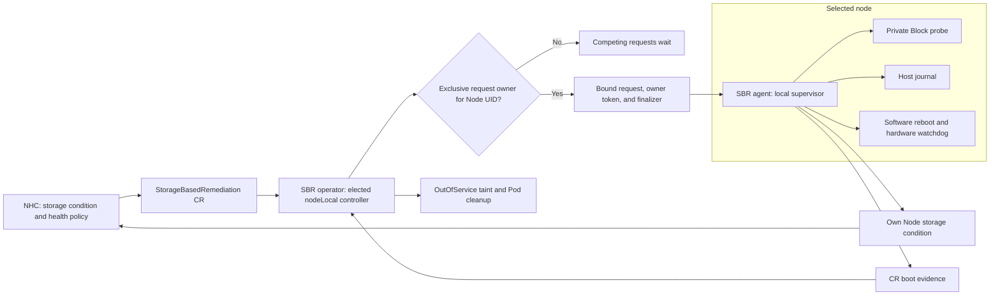
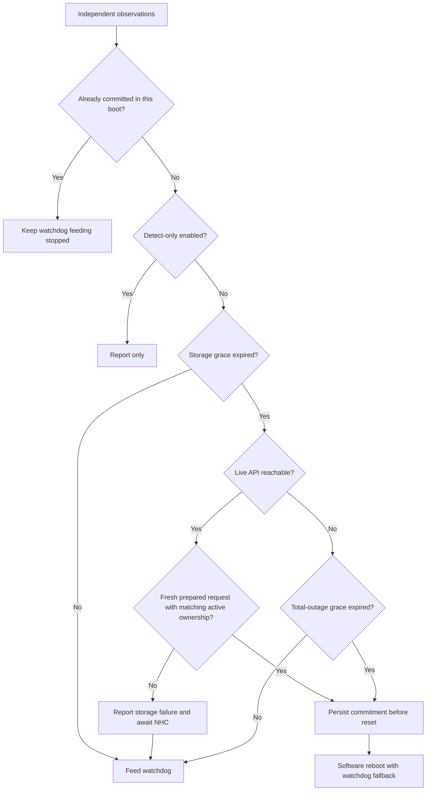
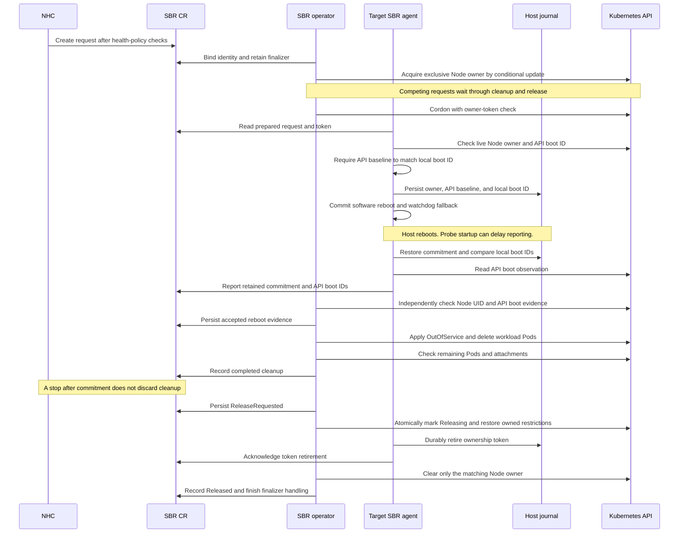

# Storage-Arbitrated Remediation for OpenShift Virtualization

| Item | Value |
|---|---|
| Status | Proposal for review |
| Target release | 5.9.0 |
| Tracking | `RHWA-1839`, `RHWA-1837`, `RFE-9581` |

Contributors: Daniel Froehlich ([@DanielFroehlich](https://github.com/DanielFroehlich)), Wesley Hayutin ([@weshayutin](https://github.com/weshayutin)), Pranav Gaikwad ([@pranavgaikwad](https://github.com/pranavgaikwad)), and Michal Pryc ([@mpryc](https://github.com/mpryc)).

## 1. Introduction

Storage Based Remediation (SBR) currently uses shared storage for heartbeats and fence messages. Node Healthcheck Operator (NHC) creates a `StorageBasedRemediation` custom resource (CR) when its policy permits remediation.

This proposal adds an optional `nodeLocal` operating mode. Each selected node uses a private Block volume to check storage access. SBR stores remediation history in a file on the host. NHC uses SBR as its only remediation provider for this policy.

SBR owns the local reboot, reports boot information, and performs API-based workload cleanup. The default `standard` mode retains the current shared-storage behavior.


## 2. Motivation

The current shared Block volume requires concurrent writes from multiple nodes. Some storage drivers cannot provide this access. Private probe volumes remove that shared-write requirement. They do not establish compatibility with every CSI driver.

A storage-focused policy should preserve running virtual machines during API or network loss when storage remains usable. When the API remains reachable, NHC should decide whether storage failure permits remediation. When both storage and API access fail, the local agent needs an autonomous decision path.

## 3. Goals

- Configure NHC with SBR as the sole remediation provider for this storage policy.
- Preserve existing behavior when `operatingMode` is absent or `standard`.
- Add `nodeLocal` for private Block probes using one StorageClass.
- Distinguish transient I/O errors from sustained failure through a storage grace period.
- Keep the watchdog active during isolated API loss when storage remains healthy.
- Reboot autonomously after sustained combined storage and API loss.
- Suppress repeated requested resets while identity history remains available and one agent process controls the node.
- Persist request identity and boot information across agent and host restarts.
- Retain SBR's out-of-service taint and add direct Pod cleanup when API access permits.
- Preserve unfinished cleanup when NHC stops or deletes a request after reboot commitment.

## 4. Non-Goals

- Remove or redesign the existing `standard` mode.
- Inspect another node's private probe volume or exchange fence messages through it.
- Prevent workloads from restarting after reboot and before cleanup.
- Perform or queue cleanup for an autonomous remediation during API loss.
- Support multiple StorageClasses or multiple probes per node in this release.

## 5. Design

### 5.1. Components and ownership

NHC watches `SBRStorageUnhealthy=True` for the selected nodes. Its remediation template creates only `StorageBasedRemediation`. The CR name continues to identify the target node. No SNR template participates in this policy.

For `nodeLocal`, the SBR operator manager owns the CR lifecycle and cleanup. It runs the new controller under leader election. The target agent owns local storage decisions, watchdog access, reboot execution, and boot reporting. Standard agents retain their existing shared-storage reconciler.

The operator resolves the target node to one applicable SBR configuration. It records the configuration UID, Node UID, and operating mode before authorizing an action. Missing or conflicting configurations prevent authorization. A replacement Node with the same name does not inherit an old request.



The current agent manager does not enable controller-runtime leader election in `initializeControllerManager()`. Its `Reconcile()` also skips its own node. These behaviors cannot serve as the new ownership model without changes. See [agent setup](../../cmd/sbr-agent/main.go) and [remediation reconciliation](../../internal/controller/storagebasedremediation_controller.go).

The operator registers the new lifecycle controller in [manager setup](../../cmd/main.go), which already enables leader election. Agent-side reconcilers ignore nodeLocal requests. The local supervisor handles its own bound request directly.

All reconcilers resolve the target's configuration before acting on an unbound CR. They must not treat missing mode status as authorization for standard fencing. Ambiguous resolution blocks action. After binding, reconcilers use the recorded mode and identities. Mode dispatch precedes the existing own-node exclusion, success return, stop handling, and shared-storage checks.

All writers use conflict-aware patches. The operator owns binding, cleanup state, and lifecycle conditions. The target agent reports its saved commitment and API boot observations. The controller checks the Node's API boot information before accepting that evidence. Each writer preserves the other writer's fields.

#### Exclusive request ownership

Configuration selection and leader election do not select between remediation CRs. SBR requests in different namespaces can target the same Node UID. SBR must serialize their complete lifecycles, including retained cleanup obligations.

This protocol assumes one agent process per node and available local identity records. A request token selects a CR, not a unique agent process. Sections 5.5 and 6 describe the limits after history loss or overlapping agent processes.

Store the current request owner in the Node annotation `sbr.medik8s.io/remediation-owner`. Its JSON value contains the Node UID, configuration UID, CR namespace, CR name, CR UID, ownership token, and phase. The annotation does not expire. NHC lease expiry, request timeout, stop, deletion, or a changed boot ID cannot transfer ownership.

Example annotation value:

```json
{
  "nodeUID": "node-uid",
  "configUID": "config-uid",
  "requestNamespace": "sbr-system",
  "requestName": "worker-0",
  "requestUID": "request-uid",
  "token": "ownership-uuid",
  "phase": "Active"
}
```

Acquire ownership before cordoning or publishing `RemediationPrepared=True`:

1. Validate the live request and target identity.
2. Install the request finalizer before attempting a claim.
3. Read the Node and CRs that record an unreleased ownership token for its UID through the live API.
4. If another owner exists, report `WaitingForNodeOwnership` without preparing the waiting request.
5. If the Node is available, add the owner annotation in phase `Active` using its unchanged `resourceVersion`.
6. On conflict, read the Node again before deciding whether to retry.
7. Record the successful token in CR status and continue preparation.

The first successful conditional update selects the owner. Request creation order does not guarantee priority. A successful claim followed by a controller crash remains authoritative. The replacement controller adopts that exact token, even if the CR status update failed. See [Kubernetes update concurrency](https://kubernetes.io/docs/reference/using-api/api-concepts/#updates-to-existing-resources).

An absent annotation is insufficient when a CR records unreleased ownership for the Node UID. A missing owner CR or inconsistent ownership records block new claims. Report degradation instead of treating missing state as a free Node. Stopped or deleting waiters cannot acquire ownership. A request that never acquired ownership needs no target cancellation acknowledgement or cleanup.

Only the owner can prepare requested execution, capture cleanup targets, or change its Node's scheduling restrictions. Requested commitment requires Node phase `Active`, CR ownership phase `Owned`, and a matching local token. A different request cannot replace a retained local owner. Reboot evidence and cancellation must identify the same token.

Every cordon or taint update must check the Node UID, ownership token, and permitted ownership phase in the same optimistic update. Repeat these checks after a conflict. Preparation and taint addition require phase `Active`. An earlier ownership read followed by an unconditional update is insufficient. A delayed reconciler must not remove a later owner's restrictions. Pod deletion retains the captured UID preconditions.

The following rules determine when request release is permitted:

| Request state | Release rule |
|---|---|
| Stopped or deleting before commitment | Release after durable cancellation. |
| Stopped after commitment | Release after cleanup completes, even if NHC retains the CR for escalation history. |
| Deleting after commitment | Release after cleanup completes. |
| Successful, neither stopped nor deleting | Retain ownership and restrictions until NHC requests deletion under its retention policy. |

Ownership release uses this sequence:

1. Complete cleanup, or receive durable cancellation before commitment.
2. When request release is permitted, persist `ownershipPhase: ReleaseRequested` on the CR.
3. Atomically change the Node owner phase to `Releasing` and restore only this token's scheduling restrictions.
4. After verifying that transition, have the agent durably retire the token through the process-local journal update described in Section 5.5.
5. Have the agent publish that token in `ownershipReleaseAck`.
6. Clear only the matching token in phase `Releasing` through a conditional Node update.
7. Record `ownershipPhase: Released` and remove the request finalizer when deletion is pending.

`ReleaseRequested` and `Released` requests cannot acquire ownership again. With retained local records and one agent process, the local acknowledgement prevents execution from resuming for this token. Cancellation acknowledgement alone does not release ownership. A controller resolves an uncertain annotation-clear result through a live read. It must never clear a different token that another request acquired.

The Node phase transition prevents a delayed reconciler from restoring old restrictions during release. Such writes must reject phase `Releasing`, even when the token still matches. Agent retirement requires the same token in the CR release intent and Node release phase.

Reconciliation resumes release after crashes at any step. It must not repeat Node changes after another token acquires ownership. Keep the request finalizer until release completes. A stopped request can finish release without CR deletion or node recovery. Its retained CR remains terminal and cannot block a later owner after release.

The agent can miss the final API updates after durably retiring its token. A live Node read showing that token is absent completes local release. Preserve the retired token record before clearing `ownedRequest` or accepting a new valid token. Observing the old CR's `Released` status is not required. Without durable token retirement, a missing or different Node token indicates inconsistent state and blocks adoption.

An unavailable agent or incomplete cleanup can retain ownership indefinitely. Later CRs wait, including CRs from another NHC or namespace. This is serialization of outstanding work, not a reboot budget. Recovery from missing or inconsistent records remains an operational question in Section 6.

### 5.2. Configuration API

Add these optional fields to `StorageBasedRemediationConfig.spec`:

| Field | Effective default | Validation | Meaning |
|---|---|---|---|
| `operatingMode` | `standard` | `standard` or `nodeLocal` | Selects the existing shared-storage model or the private Block probe model. |
| `storageUnhealthyGracePeriod` | `15s` in `nodeLocal` | Duration from `0s` through `300s`. Valid only in `nodeLocal`. | Continuous probe failure required before storage becomes unhealthy. |
| `totalOutageGracePeriod` | `60s` in `nodeLocal` | Duration from `0s` through `1h`. Valid only in `nodeLocal`. | Continuous API unavailability required while storage is already unhealthy before autonomous commitment. |

The duration defaults are proposed values for the new mode. They do not replace the existing standard detection threshold. A missing mode has the same meaning as explicit `standard` for existing and new configurations.

Use effective getters for defaults. Do not materialize duration defaults on standard configurations. An explicit `0s` disables that grace only. It does not disable detection or autonomous remediation.

Proposed additions in [configuration types](../../api/v1alpha1/storagebasedremediationconfig_types.go):

```go
package v1alpha1

// Existing imports and fields are omitted.
type OperatingModeType string

const (
	OperatingModeStandard  OperatingModeType = "standard"
	OperatingModeNodeLocal OperatingModeType = "nodeLocal"
)

type StorageBasedRemediationConfigSpec struct {
	// +kubebuilder:validation:Enum=standard;nodeLocal
	// +optional
	OperatingMode *OperatingModeType `json:"operatingMode,omitempty"`

	// +optional
	StorageUnhealthyGracePeriod *metav1.Duration `json:"storageUnhealthyGracePeriod,omitempty"`

	// +optional
	TotalOutageGracePeriod *metav1.Duration `json:"totalOutageGracePeriod,omitempty"`
}
```

Update the CRD, generated code, webhook, samples, and agent argument construction together. The current `rebootMethod` and `ioTimeout` values are internal constants, not configuration fields. This proposal does not add those API fields. See [agent constants](../../internal/agent/constants.go).

#### Field interactions

| Configuration | `standard` outcome | `nodeLocal` outcome |
|---|---|---|
| Mode omitted | Existing behavior. | Not selected. |
| `sharedStorageVolumeMode` omitted or `Filesystem` | Existing Filesystem behavior. | Admission rejects the configuration. Explicit `Block` is required. |
| `sharedStorageVolumeMode: Block` | Existing shared RWX Block behavior. | One private RWO Block claim per agent Pod. |
| `sharedStorageClass` | Existing shared-storage validation and provisioning. | Required. Selects the single StorageClass for private probes. It must support dynamic RWO Block provisioning. |
| `watchdogPath` | Existing behavior. | Same device path. One local supervisor owns the watchdog. |
| `nodeSelector` omitted or empty | Existing worker-node selection. | Same worker-node selection. The effective selector includes Linux nodes only. |
| `sbrTimeoutSeconds` | Existing timeout and derived intervals. | Reuse `GetSBRUpdateInterval()` as probe cadence. It divides the duration by six, with a one-second minimum. Do not use shared heartbeat expiry. |
| `maxConsecutiveFailures` | Existing counter semantics. | Does not decide probe health or replace the storage grace. Retain schema validation for compatibility. |
| `detectOnlyMode: Enabled` | Existing detection-only behavior. | Block new remediation actions. Continue evidence reporting and cleanup for an already committed request. |
| `detectOnlyMode` omitted or `Disabled` | Existing behavior. | Enable requested and autonomous actions under the policy below. |
| Either new grace field is present | Admission rejects the inapplicable field. | Apply the effective duration. |

The existing timeout defaults remain `30` seconds and seven consecutive failures. Their schema ranges remain unchanged. The current internal I/O timeout is two seconds. NodeLocal does not multiply that timeout by `maxConsecutiveFailures` to calculate storage health.

#### Validation and immutability

Extend `ValidateCreate()` and `ValidateUpdate()` in the [configuration webhook](../../api/v1alpha1/storagebasedremediationconfig_webhook.go).

1. Validate the mode, duration syntax, and duration bounds.
2. Require effective `Block` and a StorageClass for `nodeLocal`.
3. Reject nodeLocal grace fields in standard configurations.
4. Reject changes to the effective values of all three new fields.
5. Reject configurations that overlap a nodeLocal configuration on selected nodes.
6. Reject different StorageClasses across nodeLocal configurations in this release.

Compare durations as values, not strings. Omitted mode and explicit `standard` are equivalent. Omitted nodeLocal grace and an explicit default are equivalent. Removing a nondefault value changes its effective value and must fail.

The existing volume-mode immutability rule remains. Existing field update rules remain unchanged. Mutable fields can still require an agent rollout. For nodeLocal, retire affected supervisors only after commitment ambiguity and required cleanup are resolved.

Apply this retirement rule to selector, StorageClass, watchdog path, and detect-only changes. A selector update must protect removed nodes as well as newly selected nodes. Check ownership before starting replacement agents. Retain the effective configuration until its owned requests complete release, including cancellation of prepared requests.

Current production code does not enforce configuration overlap consistently. The webhook and controller each refer that check to the other component. The new checks must cover namespaces, effective worker selectors, and the Linux restriction. Admission alone cannot prevent concurrent creates or later node-label changes.

Use the common library's model of one writer per file, without a host file lock. Set DaemonSet `maxSurge` to `0` to prevent planned overlap during rolling updates. Configuration reconciliation must reject conflicting assignments before starting another supervisor. An API Lease expiry does not authorize a replacement watchdog owner.

These deployment checks do not exclude every overlapping process. A force-deleted Pod can leave its agent running on an unreachable node. Common can report a foreign writer but does not prevent its writes. This condition is unsupported and can cause lost updates or repeated actions. Section 6 states this limit.

#### Configuration replacement

To change an immutable value, the administrator removes the old configuration and creates a new configuration after agent cleanup completes. An in-place DaemonSet rollout cannot change these immutable values. Mutable field updates follow the safe rollout rules above.

The nodeLocal deletion path must complete these steps:

1. Stop authorization of new requests for the old configuration.
2. Retain the configuration until all owned requests complete cancellation or cleanup and ownership release.
3. Stop uncommitted supervisors with a verified watchdog disarm.
4. Wait for the old agents to terminate before releasing configuration ownership.
5. Remove configuration-owned resources and permit a replacement configuration.

An unreachable node can delay replacement. Do not start a second watchdog owner to avoid that delay. Preserve the host journal across replacement. Configuration deletion must not erase completed request identities.

The current configuration deletion handler removes RBAC and relies on garbage collection for the DaemonSet. It does not establish this shutdown order. Add a separate nodeLocal deletion path in [the configuration controller](../../internal/controller/storagebasedremediationconfig_controller.go). Do not apply shared-PV cleanup to private probe claims.

### 5.3. Private probe volume

Each selected node runs one SBR agent with one generic ephemeral Block volume. The Pod owns its PVC. The proposed request size is `10Mi`. Driver allocation granularity can produce a larger volume.

The StorageClass must support raw Block, dynamic provisioning, and the probe's direct I/O operations. The claim requests `ReadWriteOnce`. SBR does not require concurrent writes from other nodes.

Add a nodeLocal branch before `validateStorageClass()`, `ensurePVC()`, and `ensureSBRDevice()` in [the configuration controller](../../internal/controller/storagebasedremediationconfig_controller.go). Their current shared-volume path rejects some RWO provisioners and creates an RWX PVC. Selecting `Block` alone does not change that behavior.

The proposed DaemonSet fragment is:

```yaml
spec:
  template:
    spec:
      containers:
        - name: sbr-agent
          # Existing image, arguments, and host mounts are omitted.
          volumeDevices:
            - name: storage-probe
              devicePath: /dev/sbr-probe
      volumes:
        - name: storage-probe
          ephemeral:
            volumeClaimTemplate:
              spec:
                accessModes: [ReadWriteOnce]
                volumeMode: Block
                storageClassName: example-block
                resources:
                  requests:
                    storage: 10Mi
```

Keep the watchdog device mount separate from `/dev/sbr-probe`. Mounting the entire host `/dev` over that path can hide the CSI device.

A container restart reuses the Pod's PVC. A node reboot can also retain the same Pod and PVC. A replacement Pod receives its own PVC. Kubernetes deletes the old PVC with its owning Pod. The PV reclaim policy controls the underlying volume's disposition. See [generic ephemeral volume lifecycle](https://kubernetes.io/docs/concepts/storage/ephemeral-volumes/#lifecycle-and-persistentvolumeclaim).

The probe contains disposable test data. It contains no authoritative reboot evidence, shared NodeMap, peer heartbeat, or fence message. SBR does not mount another node's probe.

The agent must select the private prober before shared-storage initialization in `NewSBRAgentWithWatchdog()`. Disable shared heartbeat writes, peer checks, and fence-slot reads only in nodeLocal. Keep the standard initialization and runtime paths intact. See [the agent constructor and loops](../../cmd/sbr-agent/main.go).

The initial implementation keeps one StorageClass across nodeLocal configurations. Admission rejects different selections, and the controller checks concurrent creations before starting agents. Section 6 describes the deferred extension.

### 5.4. Storage and API decision policy

The local supervisor evaluates storage health and live API reachability independently. Probe I/O, API calls, journal writes, and watchdog feeding must not share a blocking execution path.

The probe performs a write and read check with bounded completion time. A failed operation or I/O deadline starts the storage grace. Storage becomes unhealthy only after continuous failure reaches `storageUnhealthyGracePeriod`. A successful fresh probe clears the failure interval.

For hung I/O, the deadline marks failure even if the kernel operation continues. A Go timeout does not cancel an operation blocked in the kernel. Bound outstanding operations to one probe operation per device. Do not launch another operation on each tick while the previous operation remains blocked.

Only a fresh result can restore health. A late result from an expired probe must not overwrite a newer failure decision. Use a monotonic clock within a boot. Scheduling and probe cadence can add detection delay beyond the configured grace.

For nodeLocal, each agent writes `SBRStorageUnhealthy` only on its own Node. It does not infer another node's storage health from a missing heartbeat. NHC's condition duration adds a separate delay after this condition becomes True.

| Storage state | Live API result | Local action before any commitment |
|---|---|---|
| Healthy | Available or unavailable | Feed the watchdog. Do not reboot solely because API access failed. |
| Failure within storage grace | Any result | Continue observation and feed the watchdog. |
| Unhealthy | Reachable, no authorized request | Publish True when possible. Feed the watchdog while NHC decides. |
| Unhealthy | Reachable, authorized request | Persist commitment and execute the requested reset. |
| Unhealthy | Unavailable within total-outage grace | Feed the watchdog while the grace runs. |
| Unhealthy | Unavailable through total-outage grace | Persist an autonomous attempt and execute one local reset operation. Skip cleanup. |
| Any state | Detect-only enabled, no prior commitment | Report observations. Do not perform remediation actions. |

A request permits commitment only while local storage remains unhealthy and its ownership token matches the live Node and local journal. The Node owner must be `Active`, and the CR ownership phase must be `Owned`. If storage recovers before commitment, the agent keeps feeding and waits for NHC to release the request. A fresh stop or deletion before commitment also prevents the requested action. The controller must avoid authorizing stale or already completed requests.

API reachability requires a bounded, live request. A cached informer result is insufficient. A successful empty result or `NotFound` means the API is reachable. An authorization failure also proves reachability, but prevents request authorization. It must not become a combined-outage trigger.

Connection failures and network deadlines contribute to API unavailability. For this policy, a received `429` or `5xx` means the configured endpoint is reachable. It cannot authorize a request. Keep feeding and reset the API-unavailability interval for those responses. Credential, certificate-validation, and client-configuration errors report degradation instead of triggering autonomous remediation. Neither a failed Node status write nor a missing CR alone establishes API unavailability.

Start `totalOutageGracePeriod` when storage is unhealthy and API access is unavailable together. Reset that interval if storage recovers or the API becomes reachable. Its duration follows the storage grace rather than replacing it.



NHC's health thresholds can prevent new requests during a broad storage outage. This is not an unconditional zero-reboot guarantee. Reports can arrive at different times, and an earlier committed reset continues.

### 5.5. Host journal and repeated-request checks

Use `github.com/medik8s/common/pkg/nodestate` with `ComponentSBR` and its default directory. SBR writes `/var/lib/medik8s/state/sbr.json` on the host. Mount the host directory at `/var/lib/medik8s/state` inside the agent container. The path is independent of the probe volume and Pod identity. Other components can read this file, but only SBR writes it.

The journal uses common's `Document` format. This mapping uses the existing fields in common's `pkg/nodestate/types.go`:

| SBR data | Common field | JSON location |
|---|---|---|
| Format version | `Document.SchemaVersion` | `schemaVersion` |
| Node name and immutable Kubernetes Node UID | `Document.Node`, `Document.NodeUID` | `node`, `nodeUID` |
| Current local kernel boot ID | `Document.BootID` | `bootID` |
| Effective configuration | `Document.Config` | `config`, with string values |
| Current reset commitment | `Agent.FenceLatched` | `agent.fenceLatched` |
| Agent shutdown state | `Agent.Shutdown` | `agent.shutdown` |
| SBR request and ownership state | `Agent.Extra` | `agent.extra`, with string values |
| Reboot records | `Document.Reboots` | `reboots` |
| Diagnostic samples and events | `Document.IO`, `Document.Conditions`, `Document.Events` | `io`, `conditions`, `events` |

Use these proposed SBR keys inside `agent.extra`: `sbrStateVersion`, `ownedRequest`, `activeAttempt`, `completedRequests`, and `retiredOwnershipTokens`. Set `sbrStateVersion` to the string `"1"`. Encode each object or array as a JSON string because `Agent.Extra` has type `map[string]string`. SBR validates the decoded values and performs their state changes. Common does not interpret these SBR keys.

This representation uses common's existing extension field. It adds no top-level fields to the shared format. Required SBR records use `agent.extra`, not `reboots` or the fields that common preserves as `Unknown`. Keep common's existing retention settings unchanged. The required-record retention rules below remain SBR's responsibility.

The requested action identity is `(StorageBasedRemediation UID, Node UID)`. Here, Node UID means the immutable Kubernetes object identifier, not SBR's numeric shared-storage slot. The agreed common change must use this pair in its request key and lookup behavior. Record the generation for evidence freshness, but do not use it to grant another reboot. A new CR UID permits a separate NHC request, which must acquire ownership before preparation or reset. A configuration replacement does not reset the identity history.

Keep `ownedRequest` separate from `activeAttempt`. It retains the request identity, ownership token, requested reboot evidence, and cancellation or release state. Preserve the original attempt generation, initial boot IDs, and commitment time. Section 5.6 defines when the observed API boot ID becomes accepted evidence. Observing a reboot must not clear this record. Retain it until the release handshake completes.

For autonomous remediation, generate a local attempt ID before commitment. Do not fabricate a CR identity. A later NHC CR cannot claim that this earlier autonomous reset fulfilled its request. An autonomous attempt must not overwrite the retained owner's requested evidence or release its ownership.

Example journal fragment using common's current format follows. Common also writes its timestamps, revision, and writer metadata.

```json
{
  "schemaVersion": 1,
  "node": "worker-0",
  "nodeUID": "node-uid",
  "bootID": "11111111-1111-4111-8111-111111111111",
  "config": {
    "uid": "config-uid",
    "operatingMode": "nodeLocal",
    "storageUnhealthyGracePeriod": "15s",
    "totalOutageGracePeriod": "60s"
  },
  "agent": {
    "component": "sbr",
    "shutdown": "running",
    "fenceLatched": true,
    "extra": {
      "sbrStateVersion": "1",
      "ownedRequest": "{\"requestNamespace\":\"sbr-system\",\"requestName\":\"worker-0\",\"requestUID\":\"request-uid\",\"ownershipToken\":\"ownership-uuid\",\"phase\":\"Owned\",\"reboot\":{\"attemptID\":\"attempt-uuid\",\"requestGeneration\":1,\"beforeBootID\":\"11111111-1111-4111-8111-111111111111\",\"phase\":\"Committed\"}}",
      "activeAttempt": "{\"id\":\"attempt-uuid\",\"source\":\"NHC\",\"requestUID\":\"request-uid\",\"ownershipToken\":\"ownership-uuid\",\"requestGeneration\":1,\"localBeforeBootID\":\"11111111-1111-4111-8111-111111111111\",\"beforeBootID\":\"11111111-1111-4111-8111-111111111111\",\"phase\":\"Committed\"}",
      "completedRequests": "[]",
      "retiredOwnershipTokens": "[]"
    }
  },
  "reboots": []
}
```

The example uses the same UUID for the local boot ID and the API baseline. Section 5.6 requires this agreement before requested commitment.

Use one `Store` and one local supervisor per agent process. Use `Store.Update` to read, check, change, and write request state as one serialized operation within that process. Apply commitment, cancellation, and token retirement through this operation. There is no separate lock file.

Common writes a temporary file, synchronizes its contents, renames it, and synchronizes the directory. This keeps readers from seeing a partial replacement. It does not prevent another process from replacing the same file.

Bound host I/O waits and retries independently of watchdog feeding. Before commitment, a persistent journal failure prevents a new action. Report degradation when possible, disarm the watchdog, and stop the supervisor. A failed disarm must remain an explicit error. Do not claim a guaranteed reboot-free exit on hardware that cannot disarm.

An expired wait does not prove that a write stopped. Permit only one outstanding journal operation. Do not permit another transition while its result remains unresolved. Keep any earlier commitment unchanged.

`ErrDurabilityUnconfirmed` means replacement is visible, but survival across a crash is uncertain. It does not authorize a new reset. The F08 library dependency below must provide a tested contract for resolving these outcomes.

After commitment, journal or API failures must not restore watchdog feeding. A normal shutdown handler must not disarm a committed watchdog. The durable record and the in-memory commitment have precedence over late health recovery.

On startup, load the journal before normal monitoring. Restore any retained owner before accepting another request. Read the local host boot ID through common's `ReadBootID`. Compare it with the saved local boot ID.

This comparison classifies local restart state. It does not authorize workload cleanup. Section 5.6 defines the required API evidence.

| Record and boot comparison | Action |
|---|---|
| Committed attempt, same boot ID | Resume the committed watchdog state. Do not issue another software reboot command. |
| Committed attempt, different local boot ID | Record the local observation and suppress another reset for the retained request. Report the saved commitment. Require API evidence before cleanup. |
| Retained owner with pending cleanup or release | Preserve that owner and its evidence. Do not accept a different requested owner. |
| Retired ownership token awaiting API completion | Retry acknowledgement while the Node retains that token. If a live read shows it absent, finish local release. Never resume its execution. |
| Retained completed request identity | Do not execute that request again, including after a Pod or configuration replacement. |
| Clean shutdown marker, same boot ID | Treat this as an agent restart. The marker alone does not prove a host reboot. |
| Local boot-ID read fails or returns invalid data | Block new attempts and report degradation. Do not classify the boot from an empty value. Preserve any existing commitment. |
| `StatusAbsent` | Use the fresh document returned by common. Absence does not distinguish first installation from lost history. |
| `StatusRecovered` or `StatusIncompatible` | Report common's recovery result and use its fresh document. Do not invent reboot evidence from the missing records. |
| File operation returns an error | Apply the journal-failure rule above. A failed read or write is not successful recovery. |

SBR accepts common's existing recovery behavior. `Load` can quarantine corrupt or unsupported data and return a fresh document. Report `HistoryLost()` and any quarantine failure when the result exposes them. A later process can receive `StatusAbsent`, without a persistent indication that history was lost. This proposal adds no separate history-loss marker or strict recovery API. Recovery must not clear an existing in-memory commitment.

Initialize and save the returned document before accepting a request. Continue to check the live request, Node UID, and ownership token. Fresh local state does not clear the Node owner annotation or a CR's terminal release state. It also does not prove that an existing request never executed. Lost history can permit another reset for that request. Missing commitment records cannot supply reboot evidence or authorize cleanup.

Prune diagnostic samples separately from request identities and retired ownership tokens. Keep identities while their CRs exist or while cleanup or release remains incomplete. During API loss, retain them rather than assuming their CRs disappeared. If the journal cannot retain required identities, block new actions and report degradation.

Software reboot and watchdog expiry are two mechanisms for one reset operation. Reuse `executeSelfFencing()` in [the agent](../../cmd/sbr-agent/main.go). Persist commitment before invoking the software command or stopping watchdog feeding. An attempted command, successful command return, or elapsed timer is not proof of a reset.

No local count, time window, or exponential delay limits autonomous resets. A persistent combined outage can trigger a new autonomous attempt after a later boot. It can use `activeAttempt` while `ownedRequest` retains an earlier request's evidence and cleanup obligation. An existing commitment in the current boot takes precedence over any additional attempt. Deduplicating one attempt does not prevent later autonomous resets.

### 5.6. CR status and reboot evidence

Add optional binding and boot fields to [remediation status](../../api/v1alpha1/storagebasedremediation_types.go). Existing conditions remain available. Standard mode does not require the new fields.

The following example shows only proposed additions:

```go
package v1alpha1

// Existing imports and Conditions are omitted.
type StorageBasedRemediationStatus struct {
	ExecutionMode          OperatingModeType `json:"executionMode,omitempty"`
	ConfigUID              types.UID         `json:"configUID,omitempty"`
	NodeUID                types.UID         `json:"nodeUID,omitempty"`
	OwnershipToken         string            `json:"ownershipToken,omitempty"`
	OwnershipPhase         string            `json:"ownershipPhase,omitempty"`
	OwnershipReleaseAck    string            `json:"ownershipReleaseAck,omitempty"`
	Reboot                 *RebootStatus     `json:"reboot,omitempty"`
	CleanupPhase           string            `json:"cleanupPhase,omitempty"`
	CleanupTargetsRecorded bool              `json:"cleanupTargetsRecorded,omitempty"`
	CleanupTargets         []CleanupTarget   `json:"cleanupTargets,omitempty"`
}

type RebootStatus struct {
	RequestUID         types.UID    `json:"requestUID"`
	OwnershipToken     string       `json:"ownershipToken"`
	ObservedGeneration int64        `json:"observedGeneration"`
	AttemptID          string       `json:"attemptID"`
	Phase              string       `json:"phase"`
	BeforeBootID       string       `json:"beforeBootID"`
	ObservedBootID     string       `json:"observedBootID,omitempty"`
	AttemptedAt        *metav1.Time `json:"attemptedAt,omitempty"`
	ObservedAt         *metav1.Time `json:"observedAt,omitempty"`
}

type CleanupTarget struct {
	Namespace         string               `json:"namespace"`
	PodName           string               `json:"podName"`
	PodUID            types.UID            `json:"podUID"`
	VolumeAttachments []AttachmentIdentity `json:"volumeAttachments,omitempty"`
}

type AttachmentIdentity struct {
	Name         string    `json:"name"`
	UID          types.UID `json:"uid"`
	NodeName     string    `json:"nodeName"`
	PVName       string    `json:"pvName"`
	PVUID        types.UID `json:"pvUID"`
	PVCName      string    `json:"pvcName"`
	PVCNamespace string    `json:"pvcNamespace"`
	PVCUID       types.UID `json:"pvcUID"`
}
```

Define reboot phases as `Prepared`, `Committed`, `Observed`, and `Cancelled`. Define cleanup phases as `Pending`, `InProgress`, and `Completed`. Validate the enums in the generated schema. Add status columns or events that expose waiting for evidence and incomplete cleanup.

Define ownership phases as `Waiting`, `Owned`, `ReleaseRequested`, and `Released`. The controller owns `ownershipToken` and `ownershipPhase`. The agent owns `ownershipReleaseAck`, which contains the exact durably retired token. The Node annotation remains the authority for selecting the owner. Status records the lifecycle and permits recovery across controller restarts.

Before requested commitment, the controller binds the CR, installs its finalizer, and acquires request ownership. It cordons the target through an owner-checked update. Only after that update succeeds does it set the proposed `RemediationPrepared=True` condition. The agent obtains a fresh prepared request. It checks the request UID, Node UID, configuration, ownership token, stop annotations, and deletion state.

Follow common's documented evidence rule in `pkg/nodestate/doc.go`: a local state file must not be the sole authority for destructive actions. `RebootStatus.BeforeBootID` and `ObservedBootID` contain values read from Kubernetes `Node.Status.NodeInfo.BootID`. They do not contain a container start time or a generated writer ID.

Before requested commitment, read the bound Node through the live API. Require its UID to match and its BootID to be nonempty. Require that API value to match the local host value from `ReadBootID`. A live API read can still contain an old kubelet report. This consistency check prevents an older API value from becoming the baseline for a new attempt. If the values disagree, wait for consistent observations before requested commitment.

Save this API baseline with the request's commitment. Save the local value separately as `activeAttempt.localBeforeBootID`. Use local comparisons for restart tracking, including during API loss. They cannot authorize requested cleanup. An autonomous attempt needs no API baseline and creates no requested cleanup evidence.

After a local boot change, the agent preserves the saved commitment and reads the Node's boot ID through the API. It reports the API observation when it agrees with the current local host value. The controller independently reads the live Node before accepting evidence. It requires the bound Node UID and a nonempty API boot ID different from the saved API baseline.

The commitment record must match the bound request, target identity, and ownership token. Both reported API boot IDs must be nonempty and different. Before first acceptance, the reported observed ID must equal the controller's current API value. Evidence from another request, node, owner, or uncommitted attempt must fail validation. Missing local history cannot supply a missing commitment or baseline.

An observed boot change establishes that the host restarted after the recorded attempt. It does not identify the reset mechanism with certainty. It also does not establish that workloads remain stopped after startup.

The agent must report retained committed attempts even when NHC has stopped or deleted the CR. A deletion timestamp does not discard evidence required by the finalizer. Compare evidence with the generation recorded for that attempt. Generation changes do not grant another reboot. They must not discard valid evidence for an already committed attempt.

Persist evidence acceptance through `FencingSucceeded=True` before cleanup. If another boot occurs before acceptance, refresh the agent's observed API value without changing the initial baseline or commitment. The controller then repeats the API evidence checks.

After acceptance, retain the accepted IDs and attempt generation. The agent must preserve them in each conflict-aware status update. A later autonomous reset does not erase accepted evidence or replace the initial baseline.

Status can lag the journal if API access fails immediately before reset. The controller can accept a retained commitment reported after reboot when the API evidence checks succeed. It must not require the pre-reset status patch to have succeeded. If the API is unavailable or still reports the baseline value, cleanup waits.

The agent Pod still depends on its probe volume during startup. If CSI cannot attach that volume, the agent may not report the new boot ID. Cleanup then waits for evidence. This is an accepted limitation for this proposal, as described in Section 6.

### 5.7. Requested remediation, escalation, and cleanup

NodeLocal separates reboot confirmation from cleanup completion. Current `handleFencingSuccess()` sets both fencing success and overall success. That result is insufficient for the proposed cleanup lifecycle.

Use this order for an authorized request:

1. Bind the request and establish its finalizer, exclusive ownership, and cordon.
2. Persist local commitment and execute one reset operation.
3. Accept matching commitment records and independently checked API boot evidence.
4. Set `FencingSucceeded=True` without setting overall success.
5. Persist the cleanup target set.
6. Apply the existing out-of-service taint.
7. Delete captured workload Pods with zero grace.
8. Check cleanup completion.
9. Set `Succeeded=True` and `Processing=False` for a request that NHC has not stopped.
10. Restore owned scheduling restrictions when request release is permitted and cleanup is complete.
11. Complete the ownership release handshake before permitting another requested owner.

Record which scheduling restrictions SBR added. Preserve a pre-existing cordon and unrelated taints. Do not restore scheduling merely because the Node becomes Ready.

Retain `node.kubernetes.io/out-of-service=nodeshutdown:NoExecute` and `ensureOutOfServiceTaint()` from [the current controller](../../internal/controller/storagebasedremediation_controller.go). Kubernetes uses this taint for Pod removal and volume detachment after non-graceful shutdown. Its safety guidance requires the node to be shut down. The deferred workload-restart risk means this proposal does not guarantee that condition throughout cleanup. See [Kubernetes shutdown guidance](https://kubernetes.io/docs/concepts/cluster-administration/node-shutdown/#non-graceful-node-shutdown-handling).

Bring SNR's direct deletion semantics into an SBR helper. The reference helper selects Pods by `spec.nodeName`, uses zero grace, and requests background deletion. It does not wait for disappearance or remove Pod finalizers. See [SNR's vendored cleanup helper](https://github.com/medik8s/self-node-remediation/blob/95ccdacc16ea1297294f7623ab08a16aad3a626d/vendor/github.com/medik8s/common/pkg/resources/resources.go).

Do not call that helper unchanged. It deletes the SBR agent and can cause deletion of its Pod-owned probe PVC. The SBR helper must exclude only verified SBR agent Pods. Verify their node, namespace, DaemonSet owner UID, and configuration owner. A label alone is insufficient.

Before applying OutOfService, atomically persist the cleanup target set and `cleanupTargetsRecorded=true` in CR status. The taint itself can cause Pod deletion. Record workload Pod names, namespaces, UIDs, and associated target-node attachment identities. Preserve the PVC and PV identities used to resolve those attachments. Exclude the verified SBR agent and probe. Retry against that same set rather than repeatedly adding replacement DaemonSet Pods.

Delete target Pods with UID preconditions. This prevents a stale deletion from targeting a replacement Pod with the same name. A replacement UID is not the old cleanup target. An agent exclusion must not exclude ordinary workload Pods or unrelated DaemonSets from the initial set.

Define cleanup completion as the absence of the recorded workload Pod UIDs and their recorded target-node attachments. Record attachment identities before deleting Pods so their volume references remain available. Validate the Pod, PVC, PV, node, and ownership chain for the probe exception. This check does not prove that replacement workloads remain stopped.

The attachment snapshot covers only objects present when SBR records its targets. Later attachments can exist for the same PV. Completion therefore means that the captured API objects are gone. It does not guarantee that all application volumes remain detached.

Keep the out-of-service taint while cleanup remains incomplete. Retry failed operations and expose the blocking Pods or attachments. Do not strip workload finalizers, delete PVCs or PVs, or delete VolumeAttachments directly. Pod finalizers or unavailable CSI controllers can therefore delay completion.

Proposed lifecycle logic in [the remediation controller](../../internal/controller/storagebasedremediation_controller.go):

```go
func (r *NodeLocalRemediationReconciler) reconcileCommitted(
	ctx context.Context,
	remediation *medik8sv1alpha1.StorageBasedRemediation,
) (ctrl.Result, error) {
	// Binding and stop handling are omitted.
	if err := r.requireRequestOwnership(ctx, remediation); err != nil {
		return ctrl.Result{}, err
	}
	node, err := r.getLiveBoundNode(ctx, remediation)
	if err != nil {
		return ctrl.Result{}, err
	}
	if !acceptedRebootEvidence(remediation, node) {
		return r.waitForRebootEvidence(ctx, remediation)
	}
	if err := r.recordRebootAcceptance(ctx, remediation, node); err != nil {
		return ctrl.Result{}, err
	}
	if err := r.ensureCleanupTargets(ctx, remediation); err != nil {
		return ctrl.Result{}, err
	}
	if err := r.ensureOwnedOutOfServiceTaint(ctx, remediation); err != nil {
		return ctrl.Result{}, err
	}
	if err := r.deleteCapturedPods(ctx, remediation); err != nil {
		return ctrl.Result{}, err
	}
	if !r.cleanupComplete(ctx, remediation) {
		return ctrl.Result{RequeueAfter: cleanupCheckInterval}, nil
	}
	return r.finishCleanup(ctx, remediation)
}
```

The helper names in this example are proposed. `getLiveBoundNode()` bypasses the informer cache and checks the bound Node UID. `acceptedRebootEvidence()` applies Section 5.6, including retained acceptance from an earlier cleanup attempt. `recordRebootAcceptance()` persists `FencingSucceeded=True` before cleanup and preserves any earlier acceptance. After a status conflict, it repeats the evidence checks before retrying.

`ensureOwnedOutOfServiceTaint()` checks ownership within its Node update, even after the earlier ownership check succeeds. Reuse existing taint values and preparation behavior with those ownership preconditions. Do not import SNR's strategy API or its complete controller.

#### NHC stop and deletion

An NHC stop annotation prevents a new reboot commitment. Before commitment, SBR cancels the action and releases its preparation safely. After commitment, it continues evidence reporting and cleanup. API recovery, annotation changes, or CR deletion cannot cancel a committed watchdog reset.

The local supervisor and controller must distinguish an uncommitted cancellation from an unreported commitment. Do not remove the finalizer solely because the API lacks a pre-reset commitment status. Require agent acknowledgement or accepted boot evidence when that distinction remains unresolved.

Persist cancellation through the same process-local `Store.Update` operation that serializes commitment. Then publish `reboot.phase: Cancelled` for the bound CR UID, Node UID, and ownership token. With retained records and one agent process, this acknowledgement prevents later commitment. It never satisfies reboot evidence or releases ownership by itself. A statement that the agent has not committed yet is insufficient. Retain the cancelled identity until the request is gone.

For a stopped request, retain NHC's failure outcome. Report later cleanup through `cleanupPhase` and a cleanup condition. Cleanup completion must not rewrite a timed-out request as successful remediation. The finalizer also protects the complete ownership release sequence. Neither a new CR nor NHC lease expiry bypasses a retained cleanup obligation.

Current `handleDeletion()` uncordons the node and removes its out-of-service taint without this cleanup check. Current success and stop returns also bypass later cleanup. The nodeLocal path must replace those transitions while leaving standard behavior unchanged.

#### API-unavailable behavior

An autonomous combined-outage remediation performs only the local reset and journal update. It does not create a CR, apply a taint, delete Pods, or queue later cleanup. API recovery can publish diagnostics, but it does not create a deferred deletion job for that autonomous attempt.

Autonomous policy remains independent of requested ownership. Preserve any existing `ownedRequest` and its evidence during the autonomous reset. Skipping autonomous cleanup must not discard an earlier request's cleanup or release obligation.

An existing CR cleanup remains incomplete when its API operations fail. Its controller retries after API access returns. It must not mark cleanup complete or remove a finalizer because an API request failed.

A target-node API partition does not establish a cluster-wide API outage. A surviving controller can continue an existing request if it has API access and accepted evidence. Local autonomous reset must never wait for those API operations.



### 5.8. NHC policy and reboot limits

Configure NHC with the storage condition and one SBR template. Adding `Ready=False` as another trigger would change the intended behavior during isolated network or kubelet failures.

NHC controls request admission through its configured condition duration, health thresholds, pause settings, and storm cooldown. NHC also controls request timeout and retention after recovery. SBR does not duplicate those controls locally.

Current NHC does not implement a historical per-node reboot count or reboot window. Its `minHealthy` and `maxUnhealthy` fields measure selected node health. They are not reboot counters. See [the reviewed NHC API](https://github.com/medik8s/node-healthcheck-operator/blob/dc02045b23a8a0d091116a4f4d679d26e9ef3004/api/v1alpha1/nodehealthcheck_types.go).

Any future count-based reboot limit belongs in NHC. This design does not add it there. With available identity history and one agent process, SBR suppresses duplicate execution for each request and Node UID pair. A new CR can proceed only after the previous owner completes release. This ownership rule does not expire with NHC's coordination lease. NHC cannot constrain a CR-less autonomous reset while the API is unavailable.

### 5.9. Startup, shutdown, and observability

Start normal watchdog monitoring only after the agent can initialize its probe and journal. Initialization can use a fresh document returned by common's recovery rules. It does not prove that no earlier history existed. Do not treat initial provisioning delay as a new storage failure. This also leaves the accepted coverage gap when the probe prevents startup.

After a committed reboot, preserve the request history before starting another decision cycle. For a planned stop without commitment, record the shutdown and verify watchdog disarm. A clean shutdown marker is diagnostic information, not reboot evidence.

NodeLocal configuration status must report agent readiness and private probe readiness separately from shared write capability. Do not reuse `ConcurrentWriteable` as proof that independent probes are healthy. The current calculation in `updateStorageValidation()` evaluates shared-storage readiness.

Expose the selected mode, probe identity, and degradation reason through status or events. Identify local boot observations separately from API boot evidence. Useful reasons include `StorageUnhealthy`, `APIUnavailable`, `RebootCommitted`, `WaitingForBootEvidence`, `CleanupPending`, and `HostStateUnavailable`. Also expose `WaitingForNodeOwnership`, the blocking request identity, and `WaitingForOwnershipRelease`.

Report history recovery and foreign-writer observations when common returns them. Retain diagnostic timestamps during API loss. Publish current conditions after recovery rather than replaying stale conditions.

The operator needs RBAC for request status, Node updates, Pod deletion, and attachment inspection. Its existing role covers request and Node updates. Add Pod deletion and VolumeAttachment reads for the new controller. Agents need their existing Node reporting access and permission to patch reboot evidence.

Update manifests and OpenShift SCC bindings for the `/var/lib/medik8s/state` host mount. Use common's default directory mode `0700` and file mode `0600`. These modes permit access by the owner only. Avoid storing credentials.

### 5.10. Use-case matrix

These rows describe the proposed nodeLocal behavior. They distinguish supported decisions from deferred guarantees. They do not claim that every failure leads to automatic workload recovery.

| # | Scenario | Proposed behavior | Limit or dependency |
|---|---|---|---|
| 1 | Healthy storage and API | Probe storage, feed the watchdog, and report storage healthy. | Probe results describe the selected backend, not every workload volume. |
| 2 | Cluster-wide API outage with healthy storage | Continue watchdog feeding. Do not reboot for API loss alone. | Other Kubernetes and workload controllers have independent behavior. |
| 3 | Broad storage outage with reachable API | Report unhealthy after storage grace. Await an authorized NHC request. | NHC health thresholds can block new requests. Delayed reports and prior commitments prevent a zero-reboot guarantee. |
| 4 | Storage and API unavailable | After both grace periods, perform an autonomous local reset. Ignore cleanup for that attempt. Preserve any retained requested owner. | No local reboot budget applies. Recovery of Pods elsewhere is not guaranteed. |
| 5 | One node loses API or cluster-network access | Keep feeding while its storage remains healthy. | Configure NHC for the storage condition only. |
| 6 | One node loses storage with API available | NHC creates an SBR CR. After acquiring ownership, SBR records and executes the reset. Cleanup requires API boot evidence. | Available history and one agent process prevent repeated execution. An earlier owner, delayed evidence, or probe startup can block progress. |
| 7 | Kernel panic, host freeze, or power loss | An armed watchdog can reset a powered host that stops feeding it. | It cannot restore power. A dead node cannot publish a fresh storage condition or boot evidence. |
| 8 | Planned agent restart or upgrade | Disarm before an uncommitted stop. Preserve the owned request and identity history. Compare boot IDs after startup. | Verify hardware disarm support. An unexpected process failure can still trigger the watchdog. |
| 9 | Kubelet failure with healthy storage | Continue feeding while the agent remains functional. | This storage policy does not remediate every kubelet failure. |
| 10 | Slow or hung storage I/O | Bound observation time. Apply storage grace without blocking watchdog decisions. | A deadline cannot cancel blocked kernel I/O. Bound outstanding operations. |
| 11 | Network partition with healthy storage | Do not reset solely for the partition. This NHC policy does not request relocation solely for it. | This is not a guarantee against concurrent workloads created by other controllers. |
| 12 | API or storage recovers after commitment | Complete the committed reset. Do not resume watchdog feeding or release the owner prematurely. | Stop and deletion can prevent only an uncommitted action. |
| 13 | Different nodes require different StorageClasses | Deferred. Add explicit node-group to StorageClass mapping. | See Section 6. |
| 14 | One node uses several storage backends | Deferred. Add multiple probes and a health aggregation policy. | See Section 6. |
| 15 | Stuck or terminating workload Pod | Apply OutOfService and request zero-grace deletion after accepted boot evidence. Retain ownership while cleanup remains incomplete. | Finalizers can block later requests indefinitely. The design does not hold workloads stopped until cleanup ends. |
| 16 | Host journal unavailable or recovered | A file-operation error blocks new actions before commitment. Common's successful recovery permits initialization with fresh state. Preserve any in-memory commitment. | Missing history cannot provide reboot evidence. It can permit another requested reset. Disarm failure can still cause a reset. |
| 17 | Repeated remediation on persistent failure | With retained history and one agent process, suppress another reset for the same CR UID and Node UID. Later CRs wait for ownership release. | History loss or overlapping processes can permit repeated execution. A new owner or autonomous attempt can also cause another reset. |

## 6. Open Questions

### 6.1. Accepted limitation: probe unavailable after reboot

The agent Pod can remain pending while CSI attaches its probe volume. In that state, it cannot read the host journal or report its saved commitment. A changed API BootID does not replace that missing request record. The controller must wait rather than infer success from a timer or missing heartbeat.

A reporter that starts independently of the probe could address this failure. This proposal defers that change. The unresolved operational question is how administrators should recover a request when the probe never becomes available.

Missing evidence or release acknowledgement can retain ownership indefinitely. Creating another CR cannot bypass this retained owner.

### 6.2. Accepted limitation: workloads restart before cleanup

The kubelet or runtime can restart workloads before SBR accepts the API boot evidence. This proposal adds no startup hold. A changed API boot ID supports the restart observation, but does not prove that the old workload remains stopped.

Direct Pod deletion and out-of-service volume detachment can therefore race with restarted workloads. This design does not resolve that risk or guarantee exclusive workload execution. A future design would need a startup hold and an explicit release after cleanup.

### 6.3. Accepted limitation: cleanup during API loss

Autonomous remediation ignores workload cleanup. It does not schedule cleanup after connectivity returns. This retains the existing limitation that local reboot alone does not guarantee removal of stale API objects or workload relocation.

### 6.4. Accepted limitation: repeated autonomous reboots

This proposal deliberately omits autonomous reboot limits. A persistent combined outage can cause another reset after a later boot. NHC cannot prevent those resets without API access. A future NHC reboot counter would govern only NHC-managed requests.

### 6.5. Deferred multiple StorageClasses

Scenario 13 needs an explicit mapping between node groups and StorageClasses. The configuration controller would create the corresponding probe templates and report their identities. Validation must reject overlapping node groups and conflicting watchdog ownership. NHC health thresholds may also need separate failure domains for each backend.

Scenario 14 needs multiple probes on each selected node. It also needs a policy that converts per-probe health into one storage condition. Candidate policies include failure of any required backend or failure of every backend. The policy must identify which workload storage each probe represents.

Both extensions need probe-specific status, cleanup exclusions, attachment handling, and tests. This proposal adds neither their API fields nor their controller behavior.

### 6.6. Accepted limitation: lost local history

SBR accepts the fresh state returned by common after file absence, corruption, or an unsupported common schema. It does not maintain a separate persistent history-loss marker. After quarantine and restart, the library can report absence without reporting the earlier loss.

Repeated-request checks depend on retained identity records. Loss of those records can permit another reset for an existing request. Live Node ownership and CR release checks still apply. Missing local history must not create reboot evidence, clear another owner's token, or authorize cleanup.

### 6.7. Accepted limitation: overlapping agent processes

The deployment is intended to run one agent process per node. Common serializes updates only within each process. No host file lock excludes a second process, including a process left running after forced Pod deletion.

Both processes can read the same valid owner token. A later write can replace the other process's state. The design does not guarantee one reset command, consistent cancellation, or exclusive watchdog access in this unsupported condition. Common's foreign-writer report detects some overlap but does not prevent it.

### 6.8. Remaining validation questions

- Which supported CSI drivers accept the proposed `10Mi` Block request and direct I/O pattern?
- Are the proposed 15-second storage grace and 60-second total-outage grace appropriate under measured latency?
- Which watchdog drivers permit verified disarm during configuration replacement and planned upgrades?
- What operator recovery procedure should resolve lost journal history, permanently blocked cleanup, or inconsistent ownership records?
- Should a future configuration permit autonomous combined-outage reboot to be disabled while requested remediation remains enabled?

The existing `detectOnlyMode` disables all remediation actions. It is not a selective autonomous-reboot switch.

Ownership recovery must cover a missing owner CR, a removed annotation, and disagreement with the host journal. Common does not guarantee persistent detection of earlier history loss. Forced finalizer removal does not prove completion. Do not reclaim ownership through a timeout. If the Node UID changes, old requests must not change the replacement Node's scheduling restrictions.

## 7. Upgrade / Downgrade Concerns

An upgrade must preserve configurations that omit all new fields. Their effective mode remains standard. They retain the shared-volume layout, existing failure counters, and existing remediation behavior. New configurations also default to standard.

Install compatible CRDs, webhooks, operator code, and agent images before creating nodeLocal configurations. Use a common version that includes the dependencies in Section 5.5. NodeLocal components must support request tokens and the release handshake. Use ordered replacement and `maxSurge: 0`, without relying on a host lock. The operator must not send nodeLocal arguments to an older agent image. Schema support alone does not establish agent support.

Migration requires configuration replacement because the effective mode is immutable. Pause new NHC requests during the replacement. Complete all owned requests through cancellation or cleanup and release. Remove the old configuration and wait for agent shutdown. Then create the Block nodeLocal configuration and check its readiness before resuming NHC.

Do not delete `/var/lib/medik8s/state/sbr.json` during agent upgrades or configuration replacement. Use common's shared schema and SBR's versioned `agent.extra` values. Common can quarantine an unsupported shared schema and return `StatusIncompatible` with fresh state. Report that result and apply the accepted history-loss rules. A later process can see ordinary absence instead.

SBR must validate its own `sbrStateVersion` before interpreting its extension values. Common does not validate those values. If SBR cannot decode an otherwise valid extension, report the unsupported SBR state and block new actions. This differs from accepting a fresh document explicitly returned by common's recovery path.

Before downgrade, pause NHC and complete nodeLocal ownership release. Remove nodeLocal configurations through their cleanup path. Confirm that their agents have stopped before installing an older operator or CRD. Older schemas can discard new fields and misinterpret a configuration as standard.

Standard and nodeLocal configurations may coexist only on disjoint node sets. The replacement path must not rely solely on admission to enforce that rule. Wait for planned agent shutdown before starting a replacement. This deployment sequence does not guarantee process exclusion after forced deletion or a partition.

## 8. Test Plan

Add tests to existing API, controller, agent, and end-to-end suites. The implementation must test behavior, including absent fields and failure recovery. A fake-client test alone does not establish that the validating webhook works.

### 8.1. API and compatibility

- Test omitted mode and explicit standard with existing configurations and both existing volume modes.
- Test nodeLocal rejection for omitted volume mode, Filesystem, missing StorageClass, invalid mode, and invalid durations.
- Test grace defaults, explicit zero, bounds, and rejection of grace fields in standard mode.
- Test immutable effective values, equivalent durations, omitted/default equivalence, and removal of nondefault values.
- Test the field interaction table, including detect-only and `maxConsecutiveFailures` independence.
- Test live admission, concurrent configuration creation, cross-namespace overlap, node-label changes, and different nodeLocal StorageClasses.
- Test standard/nodeLocal coexistence on disjoint nodes, configuration conflict checks, and planned replacement without overlap.
- Check `maxSurge: 0`. Do not treat that setting as proof that a force-deleted Pod's process has stopped.

### 8.2. Probe and local decisions

- Test transient failures shorter than grace, sustained failures, recovery, and repeated intermittent failures.
- Test probe deadlines, late results, and bounded outstanding operations under hung I/O.
- Test API-only loss, storage-only loss, and combined loss with independent clocks.
- Test live `NotFound`, authorization failures, transport failures, deadlines, and server-error classification.
- Test recovery before commitment and irreversible commitment afterward.
- Test detect-only mode with a request present and during combined outage.
- Check that standard peer heartbeat and shared fence behavior remain unchanged.

### 8.3. Identity, reboot evidence, and journal

- Test the same CR across reconciliation retries, agent restarts, Pod replacements, and configuration replacements while required history remains available.
- Test changed generation with the same UID and a new CR with a different UID.
- Test a replacement Node with the same name and a different UID.
- Test crashes before commitment, after durable commitment, and before a status patch succeeds.
- Test same-boot restart, changed local boot, empty API boot IDs, stale evidence, and mismatched identities.
- Test an old API baseline, local/API disagreement, delayed kubelet status, and API loss after commitment.
- Require independent API evidence before cleanup. Check that local observations or generated writer IDs cannot supply that evidence.
- Retain accepted evidence through later autonomous resets. Preserve the original requested baseline and generation.
- Test corrupt history, lost history, and unsupported common schemas through `Load` and a later process restart.
- Accept common's fresh document and document possible repeated execution after history loss. Never infer reboot completion from that fresh state.
- Test invalid or unsupported SBR extension values separately from common's recovery results.
- Test full disk, read-only filesystems, write deadlines, late completion, and `ErrDurabilityUnconfirmed` without starting another unresolved operation.
- Decode the journal example with common's `Document` type. Check string-valued `config` and `agent.extra` fields.
- Check the exact host mount and file path across Pod replacement. A container-local or `emptyDir` file must not satisfy that requirement.
- Test completed-identity retention separately from diagnostic pruning.
- Keep default common retention in these tests. Check that pruning `reboots` does not remove required SBR records from `agent.extra`.
- Test retained ownership and requested evidence across an autonomous reset during API loss.
- Test that a different CR cannot replace `ownedRequest` before token retirement.
- Test software reboot failure with hardware fallback and verified disarm during planned shutdown.
- Test commitment, cancellation, and token retirement through one process's serialized updates.
- Demonstrate possible lost updates with two processes. Do not assert that common provides process exclusion.
- Require common regression tests for Node UID keys, durable directory creation, read security checks, quarantine age, and uncertain write outcomes.
- Confirm that autonomous attempts have no local count or rate limit. Use controlled test termination for persistent failures.

### 8.4. Controller and cleanup

- Test controller ownership, leader replacement, and concurrent agent evidence patches.
- Test concurrent requests in different namespaces for the same Node UID and require exactly one successful claim.
- Test new requests during preparation, reboot, cleanup, cancellation, and ownership release.
- Test claim success before a controller crash or lost status update and adopt the existing token.
- Test that NHC lease expiry, timeout, deletion, and delayed cleanup cannot transfer ownership.
- Test ownership checks within Node updates and reject delayed writes from a previous owner.
- Test cleanup completion without restriction removal and restriction removal without local release acknowledgement.
- Test API loss and process crashes at every release step, including annotation removal before the final status update.
- Test that a terminal release record prevents the old CR from acquiring ownership again.
- Test completed cleanup for a stopped but retained CR and permit the next owner without waiting for node recovery.
- Test local recovery when the agent misses release completion and the old CR no longer exists.
- Test that an unretired local token blocks adoption when the Node annotation disappears or changes.
- Test missing owner CRs, forced finalizer removal, altered annotations, and disagreement with the host journal.
- Test that confirmed reboot does not immediately set overall success.
- Test zero-grace Pod deletion with UID preconditions and retained workload finalizers.
- Test verified agent and probe exclusions, including forged labels and replacement owners.
- Test target capture before OutOfService, leader replacement, empty target sets, and replacement DaemonSet Pods.
- Test replacement VolumeAttachments and confirm that a captured UID cannot identify a replacement object.
- Test remaining Pods and attachments, API errors, cleanup retries, and incomplete finalizers.
- Test NHC stop before commitment, stop after commitment, deletion before evidence, and delayed commitment reporting.
- Test cancellation racing with commitment within one agent process. Require durable cancellation before the status acknowledgement.
- Test that stopped requests retain their failure outcome after cleanup completes.
- Test that autonomous API-unavailable remediation creates no cleanup job or deferred deletion work.
- Test that target-only API loss does not stop an accessible controller from completing an existing request.

### 8.5. End-to-end coverage

Extend [the existing end-to-end suite](../../test/e2e) with the use-case matrix in Section 5.10. Run private Block tests on representative RWO-capable CSI drivers. Retain the existing standard Filesystem and shared Block coverage.

Verify Pod, PVC, and boot identities across container restart, node reboot, and Pod replacement. Test configuration deletion and recreation with an active watchdog. Test request cleanup after NHC timeout and operator restart.

Create a second CR in another namespace while the first request retains cleanup. Verify that it cannot prepare or reboot the node until the first owner completes release. Test ownership retention across configuration replacement and attempted downgrade.

Reproduce both accepted recovery limits. Keep the probe unavailable after reboot and check that cleanup waits for evidence. Permit workloads to restart before cleanup and document the resulting risk. Do not convert these limits into unsupported safety assertions.

Scenarios 13 and 14 remain deferred tests for later API work. Scenario 17 checks repeated-request suppression with retained history and one agent process. It does not test autonomous reboot suppression. Test the accepted history-loss and overlapping-process limits separately. A real power-loss test must not expect the watchdog to restore power.
