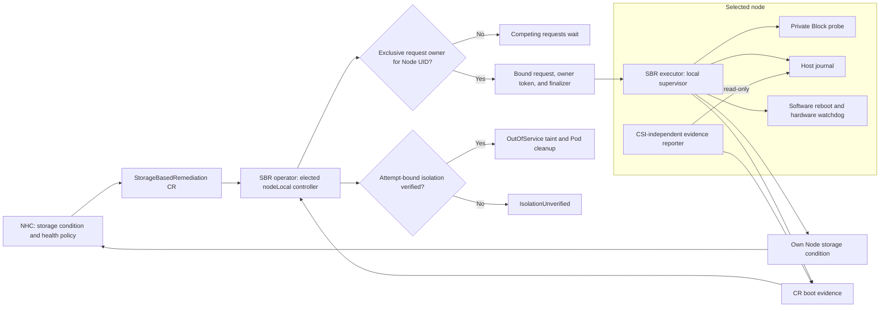
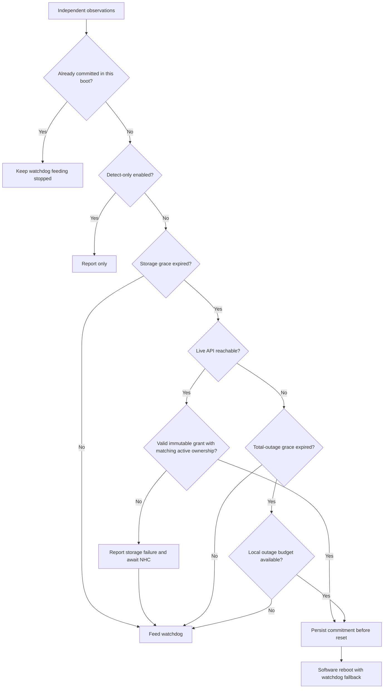

# Storage-Arbitrated Remediation for OpenShift Virtualization

| Item | Value |
|---|---|
| Status | Proposal for review |
| Target release | 5.9.0 |
| Tracking | `RHWA-1839`, `RHWA-1837`, `RFE-9581` |

Contributors: Daniel Froehlich ([@DanielFroehlich](https://github.com/DanielFroehlich)), Wesley Hayutin ([@weshayutin](https://github.com/weshayutin)), Pranav Gaikwad ([@pranavgaikwad](https://github.com/pranavgaikwad)), and Michal Pryc ([@mpryc](https://github.com/mpryc)).

## 1. Introduction

Storage Based Remediation (SBR) currently uses shared storage for heartbeats and fence messages. Node Healthcheck Operator (NHC) creates a `StorageBasedRemediation` custom resource (CR) when its policy permits remediation.

This proposal adds an optional `nodeLocal` operating mode. Each selected node uses a private Block volume to check storage access. SBR stores remediation history in a file on the host. NHC uses SBR as its only remediation provider for this policy.

SBR owns the local reboot, reports boot information, and performs API-based workload cleanup only after the target is independently isolated. A boot change proves that a reboot occurred; it does not prove that the restarted host remains unable to write. The default `standard` mode retains the current shared-storage behavior.


## 2. Motivation

The current shared Block volume requires concurrent writes from multiple nodes. Some storage drivers cannot provide this access. Private probe volumes remove that shared-write requirement. They do not establish compatibility with every CSI driver.

A storage-focused policy should preserve running virtual machines during API or network loss when storage remains usable. When the API remains reachable, NHC should decide whether storage failure permits remediation. When both storage and API access fail, the local agent needs an autonomous decision path.

## 3. Goals

- Configure NHC with SBR as the sole remediation provider for this storage policy.
- Preserve existing behavior when `operatingMode` is absent or `standard`.
- Add `nodeLocal` for private Block probes using one StorageClass.
- Distinguish transient I/O errors from sustained failure through a storage grace period.
- Keep the watchdog active during isolated API loss when storage remains healthy.
- Reboot autonomously after sustained combined storage and API loss.
- Enforce one local watchdog and journal executor per host.
- Bound autonomous and requested resets per unresolved outage.
- Persist request identity and boot information across agent and host restarts.
- Separate reboot observation from continuing isolation.
- Retain SBR's out-of-service taint and add direct Pod cleanup only while attempt-bound isolation is verified.
- Report retained reboot evidence independently of the probe volume.
- Preserve unfinished cleanup when NHC stops or deletes a request after reboot commitment.

## 4. Non-Goals

- Remove or redesign the existing `standard` mode.
- Inspect another node's private probe volume or exchange fence messages through it.
- Perform or queue cleanup for an autonomous remediation during API loss.
- Provide general hard-dead-node VM high availability without a separately qualified external fencing topology.
- Support concurrent remediation providers acting on the same Node or failure domain.
- Support multiple StorageClasses or multiple probes per node in this release.

## 5. Design

### 5.1. Components and ownership

NHC watches `SBRStorageUnhealthy=True` for the selected nodes. Its remediation template creates only `StorageBasedRemediation`. The CR name continues to identify the target node. No SNR template participates in this policy.

For `nodeLocal`, the SBR operator manager owns the CR lifecycle and cleanup. It runs the new controller under leader election. The target executor owns local storage decisions, watchdog access, reboot execution, and journal updates. A separate CSI-independent reporter reads completed journal snapshots and reports boot observations; it has no watchdog, journal-write, ownership, cleanup, or release authority. Standard agents retain their existing shared-storage reconciler.

The operator resolves the target node to one applicable SBR configuration. It records the configuration UID, Node UID, and operating mode before authorizing an action. Missing or conflicting configurations prevent authorization. A replacement Node with the same name does not inherit an old request.



The current agent manager does not enable controller-runtime leader election in `initializeControllerManager()`. Its `Reconcile()` also skips its own node. These behaviors cannot serve as the new ownership model without changes. See [agent setup](../../cmd/sbr-agent/main.go) and [remediation reconciliation](../../internal/controller/storagebasedremediation_controller.go).

The operator registers the new lifecycle controller in [manager setup](../../cmd/main.go), which already enables leader election. Agent-side reconcilers ignore nodeLocal requests. The local supervisor handles its own bound request directly.

All reconcilers resolve the target's configuration before acting on an unbound CR. They must not treat missing mode status as authorization for standard fencing. Ambiguous resolution blocks action. After binding, reconcilers use the recorded mode and identities. Mode dispatch precedes the existing own-node exclusion, success return, stop handling, and shared-storage checks.

All writers use conflict-aware updates and disjoint structured fields with distinct field managers, or live read-merge-update with optimistic retry. A generic merge patch must not replace a status conditions array. Node conditions use a strategic merge patch or an optimistic-lock read-modify-write retry so unrelated conditions are preserved. The operator owns binding, cleanup state, and lifecycle conditions. The target executor and reporter update only their assigned evidence fields. The controller checks the Node's API boot information before accepting that evidence.

#### Exclusive request ownership

Configuration selection and leader election do not select between remediation CRs. SBR requests in different namespaces can target the same Node UID. SBR must serialize their complete lifecycles, including retained cleanup obligations.

Exactly one executor process per host may open, arm, pet, or disarm the watchdog or mutate the journal. A request token selects a CR, not a unique process, so the executor lock in Section 5.2 enforces this invariant. Missing or unknown local identity history fails closed as described in Section 5.5.

Store the current request owner in the Node annotation `sbr.medik8s.io/remediation-owner`. Its JSON value contains the Node UID, configuration UID, CR namespace, CR name, CR UID, ownership token, phase, and an immutable snapshot of the pre-existing cordon and OutOfService state. Capture that snapshot in the same conditional update that acquires ownership, before SBR changes either restriction, and copy it to the bound CR status after the claim succeeds. The annotation does not expire. NHC lease expiry, request timeout, stop, deletion, or a changed boot ID cannot transfer ownership.

Example annotation value:

```json
{
  "nodeUID": "node-uid",
  "configUID": "config-uid",
  "requestNamespace": "sbr-system",
  "requestName": "worker-0",
  "requestUID": "request-uid",
  "token": "ownership-uuid",
  "phase": "Active",
  "preExistingUnschedulable": false,
  "preExistingOutOfService": null
}
```

Acquire ownership before cordoning or publishing `RemediationPrepared=True`:

1. Validate the live request and target identity.
2. Install the request finalizer before attempting a claim.
3. Read the Node and CRs that record an unreleased ownership token for its UID through the live API.
4. If another owner exists, report `WaitingForOwnership` without preparing the waiting request.
5. If the Node is available, add the owner annotation in phase `Active` using its unchanged `resourceVersion`.
6. On conflict, read the Node again before deciding whether to retry.
7. Record the successful token in CR status and continue preparation.

The first successful conditional update selects the owner. Request creation order does not guarantee priority. A successful claim followed by a controller crash remains authoritative. The replacement controller adopts that exact token, even if the CR status update failed. See [Kubernetes update concurrency](https://kubernetes.io/docs/reference/using-api/api-concepts/#updates-to-existing-resources).

An absent annotation is insufficient when a CR records unreleased ownership for the Node UID. A missing owner CR or inconsistent ownership records block new claims. Report degradation instead of treating missing state as a free Node. Stopped or deleting waiters cannot acquire ownership. A request that never acquired ownership needs no target cancellation acknowledgement or cleanup.

Only the owner can prepare requested execution, capture cleanup targets, or change its Node's scheduling restrictions. Requested commitment requires Node phase `Active`, CR ownership phase `Owned`, and a matching local token. A different request cannot replace a retained local owner. Reboot evidence and cancellation must identify the same token.

Every cordon or taint update must check the Node UID, ownership token, and permitted ownership phase in the same optimistic update. Repeat these checks after a conflict. Preparation and taint addition require phase `Active`. An earlier ownership read followed by an unconditional update is insufficient. A delayed reconciler must not remove a later owner's restrictions. Pod deletion retains the captured UID preconditions.

The following rules determine when request release is permitted:

| Request state | Release rule |
|---|---|
| Stopped or deleting before commitment | Release after durable cancellation. |
| Stopped after commitment | Release after cleanup completes, rejoin is authorized, and the token is durably retired, even if NHC retains the CR for escalation history. |
| Deleting after commitment | Release after cleanup completes, rejoin is authorized, and the token is durably retired. |
| Successful, neither stopped nor deleting | Release after cleanup, authorized rejoin, and durable token retirement. Retain the terminal CR as non-executable history. |

Ownership release uses this sequence:

1. Complete cleanup and authorize rejoin, or receive durable cancellation before commitment.
2. When request release is permitted, persist `ownershipPhase: ReleaseRequested` on the CR.
3. Atomically change the Node owner phase to `Releasing` while retaining this token's scheduling restrictions.
4. After verifying that transition, have the agent durably retire the token through the process-local journal update described in Section 5.5.
5. Have the agent publish that token in `ownershipReleaseAck`.
6. Restore only this token's scheduling restrictions and clear only the matching token in phase `Releasing` through a conditional Node update.
7. Record `ownershipPhase: Released` and remove the request finalizer when deletion is pending.

`ReleaseRequested` and `Released` requests cannot acquire ownership again. With retained local records and one executor-lock holder, the local acknowledgement prevents execution from resuming for this token. Cancellation acknowledgement alone does not release ownership. A controller resolves an uncertain annotation-clear result through a live read. It must never clear a different token that another request acquired.

The Node phase transition prevents a delayed reconciler from restoring old restrictions during release. Such writes must reject phase `Releasing`, even when the token still matches. Agent retirement requires the same token in the CR release intent and Node release phase.

Reconciliation resumes release after crashes at any step. It must not repeat Node changes after another token acquires ownership. Keep the request finalizer until release completes. A stopped request can finish release without CR deletion or node recovery. Its retained CR remains terminal and cannot block a later owner after release.

The agent can miss the final API updates after durably retiring its token. A live Node read showing that token is absent completes local release. Preserve the retired token record before clearing `ownedRequest` or accepting a new valid token. Observing the old CR's `Released` status is not required. Without durable token retirement, a missing or different Node token indicates inconsistent state and blocks adoption.

An unavailable agent or incomplete cleanup can retain ownership indefinitely. Later CRs wait, including CRs from another NHC or namespace. This is serialization of outstanding work, not a reboot budget.

Administrative release never follows from a timeout, missing CR, absent annotation, changed boot ID, or replacement Node. An uncommitted owner can be retired only after a durable cancellation acknowledgement proves that it cannot commit. A committed or uncertain owner requires an audited attestation bound to the request UID, Node UID, grant ID, and ownership token that records how the old host was isolated and how unfinished cleanup and rejoin are handled.

The administrator authorizes that recovery by creating an immutable ConfigMap named `sbr-retirement-<token-hash>` in the operator namespace, without an owner reference. Its JSON data contains the four identities, attestation reference, isolation statement, cleanup and rejoin decision, and request time. Fail-closed validating admission reserves that name prefix and permits only the documented administrator role to create a record, including when another service account has general ConfigMap create permission in the namespace. The operator and executor can read these records; only the operator can delete one after acknowledgement and audit retention requirements are met.

The controller resolves an uncertain create through a live read and accepts only a record matching every surviving unreleased record; a conflicting record blocks recovery. The ConfigMap is the durable retirement tombstone and must be verified before any release mutation. The controller then uses one `resourceVersion`-guarded Node update, when that Node still exists, to restore only restrictions proved by both a matching unreleased owner in phase `Active` or `Releasing` and its token-bound snapshot, and clears only that owner. If either proof is missing, it preserves all scheduling restrictions. If the Node UID changed, it does not alter the replacement Node. Node absence skips the Node mutation; it is not itself the release authority.

In any surviving CR, set `ownershipPhase=Released` with reason `AdministrativelyReleased` without changing the recorded reboot, isolation, cleanup, or rejoin truth. Retain it as non-executable history, or remove its finalizer when deletion is already pending only after the retirement record is verified and the applicable Node update has completed. Emit a warning event for the administrative release.

A returning executor with the exact retirement record moves the token to `retiredOwnershipTokens`, clears `ownedRequest`, and never resumes it; a missing or non-matching record fails closed. Keep one record per retired token until exact durable local acknowledgement, or indefinitely if acknowledgement is unavailable, so Node or CR deletion and later retirements cannot erase it. Force release is not reboot evidence, cleanup success, or fencing proof.

### 5.2. Configuration API

Add these optional fields to `StorageBasedRemediationConfig.spec`:

| Field | Effective default | Validation | Meaning |
|---|---|---|---|
| `operatingMode` | `standard` | `standard` or `nodeLocal` | Selects the existing shared-storage model or the private Block probe model. |
| `storageUnhealthyGracePeriod` | `15s` in `nodeLocal` | Duration from `0s` through `300s`. Valid only in `nodeLocal`. | Continuous probe failure required before storage becomes unhealthy. |
| `totalOutageGracePeriod` | `60s` in `nodeLocal` | Duration from `0s` through `1h`. Valid only in `nodeLocal`. | Continuous API unavailability required while storage is already unhealthy before autonomous commitment. |

The duration defaults are proposed values for the new mode. They do not replace the existing standard detection threshold. A missing mode has the same meaning as explicit `standard` for existing and new configurations.

Use effective getters for defaults. Do not materialize duration defaults on standard configurations. An explicit `0s` disables that grace only. It does not disable detection or autonomous remediation.

Proposed additions in [configuration types](../../api/v1alpha1/storagebasedremediationconfig_types.go):

```go
package v1alpha1

// Existing imports and fields are omitted.
type OperatingModeType string

const (
	OperatingModeStandard  OperatingModeType = "standard"
	OperatingModeNodeLocal OperatingModeType = "nodeLocal"
)

type StorageBasedRemediationConfigSpec struct {
	// +kubebuilder:validation:Enum=standard;nodeLocal
	// +optional
	OperatingMode *OperatingModeType `json:"operatingMode,omitempty"`

	// +optional
	StorageUnhealthyGracePeriod *metav1.Duration `json:"storageUnhealthyGracePeriod,omitempty"`

	// +optional
	TotalOutageGracePeriod *metav1.Duration `json:"totalOutageGracePeriod,omitempty"`
}
```

Update the CRD, generated code, webhook, samples, and agent argument construction together. `rebootMethod` and `ioTimeout` are agent command-line flags that the configuration controller currently pins to package constants. For the initial nodeLocal implementation, the controller selects a provisional ten-second I/O deadline and the `10Mi` probe size. These values remain qualification gates rather than new API fields. See [agent constants](../../internal/agent/constants.go).

#### Field interactions

| Configuration | `standard` outcome | `nodeLocal` outcome |
|---|---|---|
| Mode omitted | Existing behavior. | Not selected. |
| `sharedStorageVolumeMode` omitted or `Filesystem` | Existing Filesystem behavior. | Admission rejects the configuration. Explicit `Block` is required. |
| `sharedStorageVolumeMode: Block` | Existing shared RWX Block behavior. | One private RWO Block claim per agent Pod. |
| `sharedStorageClass` | Existing shared-storage validation and provisioning. | Required. Selects the single StorageClass for private probes. It must support dynamic RWO Block provisioning. |
| `watchdogPath` | Existing behavior. | Same device path. One local supervisor owns the watchdog. |
| `nodeSelector` omitted or empty | Existing worker-node selection. | Same worker-node selection. The effective selector includes Linux nodes only. |
| `sbrTimeoutSeconds` | Existing timeout and derived intervals. | Reuse `GetSBRUpdateInterval()` as probe cadence. It divides the duration by six, with a one-second minimum. Do not use shared heartbeat expiry. |
| `maxConsecutiveFailures` | Existing counter semantics. | Does not decide probe health or replace the storage grace. Retain schema validation for compatibility. |
| `detectOnlyMode: Enabled` | Existing detection-only behavior. | Block new remediation actions. Continue evidence reporting and cleanup for an already committed request. |
| `detectOnlyMode` omitted or `Disabled` | Existing behavior. | Enable requested and autonomous actions under the policy below. |
| Either new grace field is present | Admission rejects the inapplicable field. | Apply the effective duration. |

The existing timeout defaults remain `30` seconds and seven consecutive failures. Their schema ranges remain unchanged. The current internal I/O timeout is two seconds. NodeLocal does not multiply that timeout by `maxConsecutiveFailures` to calculate storage health. The provisional ten-second nodeLocal deadline is valid only after representative CSI qualification. Warn when the storage grace is shorter than the selected deadline, but do not reject it; explicit `0s` remains valid.

#### Validation and immutability

Extend `ValidateCreate()` and `ValidateUpdate()` in the [configuration webhook](../../api/v1alpha1/storagebasedremediationconfig_webhook.go).

1. Validate the mode, duration syntax, and duration bounds.
2. Require effective `Block` and a StorageClass for `nodeLocal`.
3. Reject nodeLocal grace fields in standard configurations.
4. Reject changes to the effective values of all three new fields.
5. Reject configurations that overlap a nodeLocal configuration on selected nodes.
6. Reject different StorageClasses across nodeLocal configurations in this release.

Compare durations as values, not strings. Omitted mode and explicit `standard` are equivalent. Omitted nodeLocal grace and an explicit default are equivalent. Removing a nondefault value changes its effective value and must fail.

The existing volume-mode immutability rule remains. Existing field update rules remain unchanged. Mutable fields can still require an agent rollout. For nodeLocal, retire affected supervisors only after commitment ambiguity and required cleanup are resolved.

Apply this retirement rule to selector, StorageClass, watchdog path, and detect-only changes. A selector update must protect removed nodes as well as newly selected nodes. Check ownership before starting replacement agents. Retain the effective configuration until its owned requests complete release, including cancellation of uncommitted grants.

Current production code does not enforce configuration overlap consistently. The webhook and controller each refer that check to the other component. The new checks must cover namespaces, effective worker selectors, and the Linux restriction. Admission alone cannot prevent concurrent creates or later node-label changes.

The configuration controller must reconcile assignments after admission, including concurrent creates and later label changes. Missing, conflicting, unreadable, or ambiguous effective configuration blocks preparation, commitment, and every new destructive action. An already committed action continues only with its retained bound configuration.

One host process holds execution authority through a non-blocking exclusive `flock` on `/var/lib/medik8s/state/sbr-executor.lock`. The lock file is separate from the atomically replaced journal and is never unlinked during operation. Acquire it before opening or arming the watchdog, loading mutable journal state, or accepting a grant; hold it for the process lifetime. Failure or unsupported locking sets `ExecutorConflict`; that process performs no watchdog or journal writes and exits. Never break the lock by Pod UID, Lease expiry, controller failover, or age, and never disarm a watchdog opened by an unknown process.

Set DaemonSet `maxSurge: 0` and `maxUnavailable: 1` explicitly. These are the Kubernetes defaults and document the rollout contract; they do not replace the host lock. Assignment checks, leader election, and Node ownership remain defense in depth.

#### Configuration replacement

To change an immutable value, the administrator removes the old configuration and creates a new configuration after agent cleanup completes. An in-place DaemonSet rollout cannot change these immutable values. Mutable field updates follow the safe rollout rules above.

The nodeLocal deletion path must complete these steps:

1. Stop authorization of new requests for the old configuration.
2. Retain the configuration until all owned requests complete cancellation or cleanup and ownership release.
3. Stop uncommitted supervisors with a verified watchdog disarm.
4. Wait for the old executors and reporters to terminate before releasing configuration ownership.
5. Remove configuration-owned resources and permit a replacement configuration.

An unreachable node can delay replacement. Do not start a second watchdog owner to avoid that delay. Preserve the host journal across replacement. Configuration deletion must not erase completed request identities.

The current configuration deletion handler removes RBAC and relies on garbage collection for the DaemonSet. It does not establish this shutdown order. Add a separate nodeLocal deletion path in [the configuration controller](../../internal/controller/storagebasedremediationconfig_controller.go). Do not apply shared-PV cleanup to private probe claims.

### 5.3. Private probe volume

Each selected node runs one SBR executor with one generic ephemeral Block volume. The Pod owns its PVC. The controller uses a named `10Mi` request value rather than an embedded manifest literal; driver allocation granularity can produce a larger volume. A supported backend must accept that request or define its qualified minimum.

The StorageClass must support raw Block, dynamic provisioning, and the probe's direct I/O operations. The claim requests `ReadWriteOnce`. SBR does not require concurrent writes from other nodes.

`SBRStorageUnhealthy` describes this selected probe path, not every VM disk or the whole storage array. Each supported policy documents how the probe StorageClass, backend, and failure domain represent the workloads eligible for remediation. An unqualified or unrepresentative probe blocks destructive remediation. Distinguish `ProbeNotProvisioned`, `ProbeNotAttached`, `ProbeIOFailed`, `StoragePathUnhealthy`, and `BackendUnqualified` in status and events.

Add a nodeLocal branch before `validateStorageClass()`, `ensurePVC()`, and `ensureSBRDevice()` in [the configuration controller](../../internal/controller/storagebasedremediationconfig_controller.go). Their current shared-volume path rejects some RWO provisioners and creates an RWX PVC. Selecting `Block` alone does not change that behavior. Prefer `WaitForFirstConsumer` for topology-constrained storage. Warn, rather than reject, when `Immediate` binding is combined with topology constraints.

The proposed DaemonSet fragment is:

```yaml
spec:
  updateStrategy:
    type: RollingUpdate
    rollingUpdate:
      maxUnavailable: 1
      maxSurge: 0
  template:
    spec:
      containers:
        - name: sbr-agent
          # Existing image, arguments, and host mounts are omitted.
          volumeDevices:
            - name: storage-probe
              devicePath: /dev/sbr-probe
      volumes:
        - name: storage-probe
          ephemeral:
            volumeClaimTemplate:
              spec:
                accessModes: [ReadWriteOnce]
                volumeMode: Block
                storageClassName: example-block
                resources:
                  requests:
                    storage: 10Mi
```

Keep the watchdog device mount separate from `/dev/sbr-probe`. Mounting the entire host `/dev` over that path can hide the CSI device.

A container restart reuses the Pod's PVC. A node reboot can also retain the same Pod and PVC. A replacement Pod receives its own PVC. Kubernetes deletes the old PVC with its owning Pod. The PV reclaim policy controls the underlying volume's disposition. See [generic ephemeral volume lifecycle](https://kubernetes.io/docs/concepts/storage/ephemeral-volumes/#lifecycle-and-persistentvolumeclaim).

The probe contains disposable test data. It contains no authoritative reboot evidence, shared NodeMap, peer heartbeat, or fence message. SBR does not mount another node's probe.

The executor must select the private prober before shared-storage initialization in `NewSBRAgentWithWatchdog()`. Disable shared heartbeat writes, peer checks, and fence-slot reads only in nodeLocal. Keep the standard initialization and runtime paths intact. See [the agent constructor and loops](../../cmd/sbr-agent/main.go).

Run the evidence reporter in a separate DaemonSet without the probe volume. It mounts the host journal read-only and has no watchdog device. A sidecar is insufficient because the entire executor Pod can remain pending when its probe cannot attach. A selected node whose executor or reporter is pending is uncovered and must be visible through configuration status and events.

The initial implementation keeps one StorageClass across nodeLocal configurations. Admission rejects different selections, and the controller checks concurrent creations before starting agents. Section 6 describes the deferred extension.

### 5.4. Storage and API decision policy

The local supervisor evaluates storage health and live API reachability independently. Probe I/O, API calls, journal writes, and watchdog feeding must not share a blocking execution path.

The probe performs a write and read check with bounded completion time. A failed operation or I/O deadline starts the storage grace. The earliest unhealthy decision is therefore the failure or deadline plus `storageUnhealthyGracePeriod`; admission does not require the grace to exceed the I/O deadline, and explicit `0s` remains valid. Storage becomes unhealthy only after continuous failure reaches the grace. A successful fresh probe clears the failure interval.

For hung I/O, the deadline marks failure even if the kernel operation continues. A Go timeout does not cancel an operation blocked in the kernel. Bound outstanding operations to one probe operation per device. Do not launch another operation on each tick while the previous operation remains blocked.

Only a fresh result can restore health. A late result from an expired probe must not overwrite a newer failure decision. Use a monotonic clock within a boot. Scheduling and probe cadence can add detection delay beyond the configured grace.

For nodeLocal, each agent writes `SBRStorageUnhealthy` only on its own Node. It does not infer another node's storage health from a missing heartbeat and never writes `Unknown`. The existing `Unknown` value is a standard-mode peer-monitor signal and is not part of nodeLocal. Update the condition through a strategic merge patch, or an optimistic-lock read-modify-write retry, so unrelated Node conditions are preserved. Preserve `LastTransitionTime` while the status is unchanged, coalesce duplicate writes, and add bounded jitter to failure transitions. NHC's condition duration adds a separate delay after this condition becomes True.

| Storage state | Live API result | Local action before any commitment |
|---|---|---|
| Healthy | Available or unavailable | Feed the watchdog. Do not reboot solely because API access failed. |
| Failure within storage grace | Any result | Continue observation and feed the watchdog. |
| Unhealthy | Reachable, no authorized request | Publish True when possible. Feed the watchdog while NHC decides. |
| Unhealthy | Reachable, valid execution grant | Persist local commitment and execute the requested reset. |
| Unhealthy | Unavailable within total-outage grace | Feed the watchdog while the grace runs. |
| Unhealthy | Unavailable through total-outage grace | If the local outage budget permits, persist an autonomous attempt and execute one local reset operation. Skip cleanup. |
| Unhealthy | Unavailable, local outage budget exhausted or unknown | Record exhaustion when possible and keep feeding. Do not reset again until the epoch is safely rearmed. |
| Any state | Detect-only enabled, no prior commitment | Report observations. Do not perform remediation actions. |

A request permits commitment only while local storage remains unhealthy and its immutable execution grant matches the live request UID, Node UID, configuration UID, owner token, and local journal. The Node owner must be `Active`, and the CR ownership phase must be `Owned`. If storage recovers before commitment, the agent keeps feeding and waits for NHC to release the request. A fresh stop or deletion that wins before the grant prevents the requested action. The controller must avoid authorizing stale or already completed requests.

API reachability requires a bounded, authenticated live request. A cached informer result is insufficient. The routine check uses the small SBR CR, or `/readyz` where RBAC permits; a full uncached Node read is reserved for bind, commitment, and evidence transitions. A successful empty result or `NotFound` means the endpoint is reachable, but Node absence or name reuse is an identity mismatch. Authorization, certificate, proxy, and client-configuration failures prevent request authorization and must not become combined-outage triggers.

Connection failures and network deadlines contribute to API unavailability. For this policy, a received `429` or `5xx` means the configured endpoint is reachable. It cannot authorize a request. Keep feeding and reset the API-unavailability interval for those responses. Credential, certificate-validation, and client-configuration errors report degradation instead of triggering autonomous remediation. Neither a failed Node status write nor a missing CR alone establishes API unavailability.

Start `totalOutageGracePeriod` when storage is unhealthy and API access is unavailable together. Reset that interval if storage recovers or the API becomes reachable. Its duration follows the storage grace rather than replacing it.



NHC's health thresholds can prevent new requests during a broad storage outage. They do not constrain a committed reset or an API-offline autonomous reset. Reports can arrive at different times, and an earlier committed reset continues.

### 5.5. Host journal and repeated-request checks

This design requires a new `github.com/medik8s/common/pkg/nodestate` package. It does not exist in `common v1.17.0`, which all three reviewed projects currently pin; landing the package and updating the required consumers to a release that provides the contract below is an installation prerequisite. The package must provide Node-UID request keys, `ReadBootID`, versioned schemas with unknown top-level field preservation, non-prunable identity and budget records, explicit recovery and durability outcomes, safe path handling, and atomic temp-write, file `fsync`, rename, and directory `fsync` behavior.

SBR writes `/var/lib/medik8s/state/sbr.json` on the host. Mount the host directory at `/var/lib/medik8s/state` inside the executor container. The path is independent of the probe volume and Pod identity. The reporter reads completed snapshots, but only the executor-lock holder writes the file.

The journal contract uses the following proposed `Document` fields. These names specify the required common API; they do not describe an existing `v1.17.0` implementation:

| SBR data | Common field | JSON location |
|---|---|---|
| Format version | `Document.SchemaVersion` | `schemaVersion` |
| Node name and immutable Kubernetes Node UID | `Document.Node`, `Document.NodeUID` | `node`, `nodeUID` |
| Current local kernel boot ID | `Document.BootID` | `bootID` |
| Effective configuration | `Document.Config` | `config`, with string values |
| Current reset commitment | `Agent.FenceLatched` | `agent.fenceLatched` |
| Agent shutdown state | `Agent.Shutdown` | `agent.shutdown` |
| SBR request and ownership state | `Agent.Extra` | `agent.extra`, with string values |
| Reboot records | `Document.Reboots` | `reboots` |
| Diagnostic samples and events | `Document.IO`, `Document.Conditions`, `Document.Events` | `io`, `conditions`, `events` |

Use these proposed SBR keys inside `agent.extra`: `sbrStateVersion`, `ownedRequest`, `activeAttempt`, `resetLedger`, `completedRequests`, and `retiredOwnershipTokens`. Set `sbrStateVersion` to the string `"1"`. Encode each object or array as a JSON string because `Agent.Extra` has type `map[string]string`. SBR validates the decoded values and performs their state changes. Common does not interpret these SBR keys.

This representation uses the proposed common extension field and adds no SBR-specific top-level fields. Required SBR records use `agent.extra`, not a prunable diagnostic `reboots` list. Common must guarantee that caller-owned identity and budget records remain until SBR retires them.

The requested action identity is `(StorageBasedRemediation UID, Node UID)`. Here, Node UID means the immutable Kubernetes object identifier, not SBR's numeric shared-storage slot. The agreed common change must use this pair in its request key and lookup behavior. Record the generation for evidence freshness, but do not use it to grant another reboot. A new CR UID permits a separate NHC request, but it must acquire ownership and cannot bypass an unresolved node-level reset budget. A configuration replacement does not reset the identity history.

Keep `ownedRequest` separate from `activeAttempt`. It retains the request identity, ownership token, requested reboot evidence, and cancellation or release state. Preserve the original attempt generation, initial boot IDs, and commitment time. Section 5.6 defines when the observed API boot ID becomes accepted evidence. Observing a reboot must not clear this record. Retain it until the release handshake completes.

For autonomous remediation, generate a local attempt ID before commitment. Do not fabricate a CR identity. A later NHC CR cannot claim that this earlier autonomous reset fulfilled its request. An autonomous attempt must not overwrite the retained owner's requested evidence or release its ownership.

An example journal fragment for the required format follows. Common also writes its timestamps, revision, and writer metadata.

```json
{
  "schemaVersion": 1,
  "node": "worker-0",
  "nodeUID": "node-uid",
  "bootID": "11111111-1111-4111-8111-111111111111",
  "config": {
    "uid": "config-uid",
    "operatingMode": "nodeLocal",
    "storageUnhealthyGracePeriod": "15s",
    "totalOutageGracePeriod": "60s"
  },
  "agent": {
    "component": "sbr",
    "shutdown": "running",
    "fenceLatched": true,
    "extra": {
      "sbrStateVersion": "1",
      "ownedRequest": "{\"requestNamespace\":\"sbr-system\",\"requestName\":\"worker-0\",\"requestUID\":\"request-uid\",\"ownershipToken\":\"ownership-uuid\",\"phase\":\"Owned\",\"reboot\":{\"attemptID\":\"attempt-uuid\",\"requestGeneration\":1,\"beforeAPIBootID\":\"11111111-1111-4111-8111-111111111111\",\"phase\":\"Committed\"}}",
      "activeAttempt": "{\"id\":\"attempt-uuid\",\"source\":\"NHC\",\"requestUID\":\"request-uid\",\"ownershipToken\":\"ownership-uuid\",\"requestGeneration\":1,\"beforeLocalBootID\":\"11111111-1111-4111-8111-111111111111\",\"beforeAPIBootID\":\"11111111-1111-4111-8111-111111111111\",\"phase\":\"Committed\"}",
      "resetLedger": "[{\"attemptID\":\"attempt-uuid\",\"source\":\"NHC\",\"grantID\":\"grant-uuid\",\"requestUID\":\"request-uid\",\"outageEpoch\":\"epoch-uuid\",\"bootIDBefore\":\"11111111-1111-4111-8111-111111111111\",\"committedAt\":\"2026-11-02T12:00:00Z\",\"reason\":\"RequestedStorageRemediation\"}]",
      "completedRequests": "[]",
      "retiredOwnershipTokens": "[]"
    }
  },
  "reboots": []
}
```

The example uses the same UUID for the local boot ID and the API baseline. Section 5.6 requires this agreement before requested commitment.

Use one `Store` and one local supervisor in the executor-lock holder. Use `Store.Update` to read, check, change, and write request state as one serialized operation. Apply commitment, cancellation, token retirement, and reset-budget changes through this operation. The stable lock file is separate from the journal.

Common writes a temporary file, synchronizes its contents, renames it, and synchronizes the directory. This keeps readers from seeing a partial replacement. It does not prevent another process from replacing the same file.

Bound host I/O waits and retries independently of watchdog feeding. Before commitment, a persistent journal failure prevents a new action. Report degradation when possible. If the qualified device can be safely disarmed, verify disarm before stopping the supervisor. For nowayout or failed-disarm devices, continue feeding in a degraded state until an audited shutdown or recovery path is selected; never exit and imply a reboot-free stop. A device without a supported fatal-error policy fails qualification before it is armed.

An expired wait does not prove that a write stopped. Permit only one outstanding journal operation. Do not permit another transition while its result remains unresolved. Keep any earlier commitment unchanged.

`ErrDurabilityUnconfirmed` means replacement is visible, but survival across a crash is uncertain. It does not authorize a new reset. The new common dependency must provide a tested contract for resolving this outcome.

After commitment, journal or API failures must not restore watchdog feeding in the committing boot. A normal shutdown handler in that boot must not disarm a committed watchdog. The durable record and the in-memory commitment have precedence over late health recovery.

On startup, load the journal before normal monitoring. Restore any retained owner before accepting another request. Read the local host boot ID through common's `ReadBootID`. Compare it with the saved local boot ID.

This comparison classifies local restart state. It does not authorize workload cleanup. Section 5.6 defines the required API evidence.

`FenceLatched` is scoped to the `activeAttempt.beforeLocalBootID`; it is not a permanent instruction to reset every later boot. When startup reads a valid different local boot ID, it atomically records that value on the retained attempt and clears only the actuator latch before arming the new boot's watchdog. It retains the request, grant, reset ledger, and initial baselines, then resumes normal watchdog feeding. This prevents a reboot loop but is only a local observation: it does not set `RebootObserved`, prove isolation, authorize cleanup, or release ownership. A same or unknown boot ID does not consume the latch.

| Record and boot comparison | Action |
|---|---|
| Committed attempt, same boot ID | Resume the committed watchdog state. Do not issue another software reboot command. |
| Committed attempt, different local boot ID | Record the local observation and suppress another reset for the retained request. Report the saved commitment. Require API evidence before cleanup. |
| Retained owner with pending cleanup or release | Preserve that owner and its evidence. Do not accept a different requested owner. |
| Retired ownership token awaiting API completion | Retry acknowledgement while the Node retains that token. If a live read shows it absent, finish local release. Never resume its execution. |
| Retained completed request identity | Do not execute that request again, including after a Pod or configuration replacement. |
| Clean shutdown marker, same boot ID | Treat this as an agent restart. The marker alone does not prove a host reboot. |
| Local boot-ID read fails or returns invalid data | Block new attempts and report degradation. Do not classify the boot from an empty value. Preserve any existing commitment. |
| `NeverInitialized` | Initialize a new journal only when no live owner, grant, or unresolved request exists. |
| `Unreadable`, `CorruptQuarantined`, `SchemaUnsupported`, `DurabilityUnknown`, or `HistoryUnknown` | Enter `HistoryReconciliationRequired`. Preserve any known commitment and perform no reset, adoption, cleanup, or release. |
| File operation returns an error | Apply the journal-failure rule above. A failed read or write is not successful recovery. |

Recovery must distinguish first installation from lost or incompatible history and persist that distinction across later restarts. If a live Node owner, CR, or grant exists while required history is absent or uncertain, fail closed in `HistoryReconciliationRequired`. Fresh local state never proves that an existing request did not execute and cannot provide reboot evidence, clear an owner, authorize cleanup, or permit another reset.

Prune diagnostic samples separately from request identities and retired ownership tokens. Keep identities while their CRs exist or while cleanup or release remains incomplete. During API loss, retain them rather than assuming their CRs disappeared. If the journal cannot retain required identities, block new actions and report degradation.

Software reboot and watchdog expiry are two mechanisms for one reset operation. Reuse `executeSelfFencing()` in [the agent](../../cmd/sbr-agent/main.go). Persist commitment before invoking the software command or stopping watchdog feeding. An attempted command, successful command return, or elapsed timer is not proof of a reset.

Record every committed requested or autonomous reset in a non-prunable node-level ledger before invoking it. An outage epoch begins with the first commitment and clears only after a qualified sustained period of healthy storage and reachable API, or an audited manual action. A brief recovery does not clear it. Permit at most one autonomous reset per unresolved epoch; unknown budget state fails closed. Requested resets are paced at Node level so a new CR UID cannot bypass an unresolved budget. Before commitment, exhaustion reports `Succeeded=False`, `Processing=False`, and `Reason=RebootBudgetExhausted`, then releases ownership safely. Exact requested-reset and rearm values remain qualification decisions.

### 5.6. CR status and reboot evidence

Add optional binding, grant, reboot, isolation, cleanup, and release fields to [remediation status](../../api/v1alpha1/storagebasedremediation_types.go). Existing conditions remain available. Standard mode does not require the new fields.

The following example shows only proposed additions:

```go
package v1alpha1

// Existing imports and Conditions are omitted.
type StorageBasedRemediationStatus struct {
	ExecutionMode          OperatingModeType `json:"executionMode,omitempty"`
	ConfigUID              types.UID         `json:"configUID,omitempty"`
	NodeUID                types.UID         `json:"nodeUID,omitempty"`
	OwnershipToken         string            `json:"ownershipToken,omitempty"`
	OwnershipPhase         string            `json:"ownershipPhase,omitempty"`
	OwnershipReleaseAck    string            `json:"ownershipReleaseAck,omitempty"`
	RestrictionSnapshot    *NodeRestrictionSnapshot `json:"restrictionSnapshot,omitempty"`
	Grant                  *ExecutionGrant   `json:"grant,omitempty"`
	Reboot                 *RebootStatus     `json:"reboot,omitempty"`
	Isolation              *IsolationStatus  `json:"isolation,omitempty"`
	CleanupPhase           string            `json:"cleanupPhase,omitempty"`
	RejoinPhase            string            `json:"rejoinPhase,omitempty"`
	CleanupTargetsRecorded bool              `json:"cleanupTargetsRecorded,omitempty"`
	CleanupTargets         []CleanupTarget   `json:"cleanupTargets,omitempty"`
	CleanupTargetsRef      string            `json:"cleanupTargetsRef,omitempty"`
}

type NodeRestrictionSnapshot struct {
	Unschedulable     bool          `json:"unschedulable"`
	OutOfServiceTaint *corev1.Taint `json:"outOfServiceTaint,omitempty"`
}

type ExecutionGrant struct {
	GrantID          string            `json:"grantID"`
	RequestUID       types.UID         `json:"requestUID"`
	NodeUID          types.UID         `json:"nodeUID"`
	ConfigUID        types.UID         `json:"configUID"`
	OwnershipToken   string            `json:"ownershipToken"`
	ExecutionMode    OperatingModeType `json:"executionMode"`
	BeforeAPIBootID  string            `json:"beforeAPIBootID"`
	Phase             string            `json:"phase"`
}

type RebootStatus struct {
	RequestUID         types.UID    `json:"requestUID"`
	OwnershipToken     string       `json:"ownershipToken"`
	ObservedGeneration int64        `json:"observedGeneration"`
	AttemptID          string       `json:"attemptID"`
	Phase              string       `json:"phase"`
	BeforeLocalBootID  string       `json:"beforeLocalBootID"`
	BeforeAPIBootID    string       `json:"beforeAPIBootID"`
	ObservedLocalBootID string      `json:"observedLocalBootID,omitempty"`
	ObservedAPIBootID  string       `json:"observedAPIBootID,omitempty"`
	AttemptedAt        *metav1.Time `json:"attemptedAt,omitempty"`
	ObservedAt         *metav1.Time `json:"observedAt,omitempty"`
}

type IsolationStatus struct {
	Phase          string    `json:"phase"`
	NodeUID        types.UID `json:"nodeUID"`
	GrantID        string    `json:"grantID"`
	AttemptID      string    `json:"attemptID"`
	OwnershipToken string    `json:"ownershipToken"`
	Method         string    `json:"method,omitempty"`
	EvidenceRef    string    `json:"evidenceRef,omitempty"`
	RejoinEpoch    string    `json:"rejoinEpoch,omitempty"`
}

type CleanupTarget struct {
	Namespace         string               `json:"namespace"`
	PodName           string               `json:"podName"`
	PodUID            types.UID            `json:"podUID"`
	VolumeAttachments []AttachmentIdentity `json:"volumeAttachments,omitempty"`
}

type AttachmentIdentity struct {
	Name         string    `json:"name"`
	UID          types.UID `json:"uid"`
	NodeName     string    `json:"nodeName"`
	PVName       string    `json:"pvName"`
	PVUID        types.UID `json:"pvUID"`
	PVCName      string    `json:"pvcName"`
	PVCNamespace string    `json:"pvcNamespace"`
	PVCUID       types.UID `json:"pvcUID"`
}
```

Define grant phases as `Pending`, `Issued`, `CancelRequested`, `CancelAcked`, `LocallyCommitted`, and `CommitUnknown`. Grant identity, mode, ownership, configuration, and boot-baseline fields are immutable after `Issued`; only `phase` advances through explicit compare-and-swap transitions. Define reboot phases as `Pending` and `Observed`. Define isolation phases as `Pending`, `Verified`, `Unverified`, and `Revoked`. Define cleanup phases as `Pending`, `InProgress`, `Blocked`, and `Completed`. Validate the enums in the generated schema. Add status columns or events that expose waiting for evidence, isolation, and incomplete cleanup.

In prose and diagrams, `GrantIssued` means `grant.phase=Issued`. `RebootObserved`, `IsolationVerified`, `CleanupComplete`, and `RejoinAuthorized` are condition or shorthand names derived from `reboot.phase=Observed`, `isolation.phase=Verified`, `cleanupPhase=Completed`, and `rejoinPhase=Authorized`. The journal's reboot phase `Committed` is the local record behind `LocalCommit` and maps to `grant.phase=LocallyCommitted`; it is not another CR reboot phase.

Before accepting isolation, the operator requires its Node UID, grant ID, attempt ID, and ownership token to match the live binding and immutable grant. Evidence from a previous attempt cannot be adopted.

Define rejoin phases as `Pending` and `Authorized`, and ownership phases as `Waiting`, `Owned`, `ReleaseRequested`, and `Released`. The controller owns `ownershipToken` and `ownershipPhase`. The agent owns `ownershipReleaseAck`, which contains the exact durably retired token. The Node annotation remains the authority for selecting the owner. Status records the lifecycle and permits recovery across controller restarts.

| Durable transition | Writer | Persist before |
|---|---|---|
| Binding and ownership `Owned` | Operator | Cordon or grant |
| Grant `Issued` | Operator | Executor commitment |
| `LocalCommit(grantID)` in the host journal | Executor | Reset command or stopping watchdog feeds |
| Grant `LocallyCommitted` in CR status | Executor or reporter | Best-effort mirror; never the commitment boundary |
| Reboot `Observed` | Operator after independent checks | Isolation evaluation |
| Isolation `Verified` | Operator | OutOfService, Pod deletion, or detach |
| Cleanup `Completed` | Operator after live rescan and final isolation recheck | Rejoin authorization |
| Rejoin `Authorized` | Operator | Requesting durable token retirement |
| Ownership release acknowledgement | Executor after durable local retirement | Restoring owned restrictions and clearing the owner |
| Ownership `Released` | Operator after restoring restrictions and clearing the owner | A later owner |

Every transition is idempotent and resumes from its durable predecessor after a crash. Unknown grant or journal outcomes remain explicit and never skip forward.

Before requested commitment, the controller binds the CR, installs its finalizer, and acquires request ownership. It cordons the target through an owner-checked update. After re-reading stop and deletion state, it writes the immutable execution grant through a resource-version compare-and-swap. `RemediationPrepared=True` may expose the grant but is not authority by itself. The executor checks the live grant, request UID, Node UID, configuration UID, ownership token, and storage state before durably recording `LocalCommit(grantID, beforeLocalBootID)`.

After `GrantIssued`, a raw stop annotation or deletion timestamp does not silently cancel the grant. It causes the controller to publish `CancelRequested`; until the grant phase is resolved, the executor neither assumes cancellation nor starts a new action. Only durable `CancelAcked` proves that no local commitment exists. Otherwise the grant commits or remains `CommitUnknown` for reconciliation.

A local state file must not be the sole authority for destructive actions. `RebootStatus.BeforeAPIBootID` and `ObservedAPIBootID` contain values read from Kubernetes `Node.Status.NodeInfo.BootID`; the corresponding local fields come from the host boot-ID source. They do not contain a container start time or a generated writer ID.

Before requested commitment, read the bound Node through the live API. Require its UID to match and its BootID to be nonempty. Require `grant.beforeAPIBootID`, the live API value, and the local host value from `ReadBootID` to be identical. A live API read can still contain an old kubelet report. If either current value differs from the immutable grant baseline, never commit that grant: the controller requests cancellation, and the executor records `CancelAcked` only when its journal proves no commitment; otherwise it records `CommitUnknown`. Any later attempt requires a fresh grant and reset-budget check.

Save this API baseline with the request's commitment. Save the local value separately as `activeAttempt.localBeforeBootID`. Use local comparisons for restart tracking, including during API loss. They cannot authorize requested cleanup. An autonomous attempt needs no API baseline and creates no requested cleanup evidence.

After a local boot change, the agent preserves the saved commitment and reads the Node's boot ID through the API. It reports the API observation when it agrees with the current local host value. The controller independently reads the live Node before accepting evidence. It requires the bound Node UID and a nonempty API boot ID different from the saved API baseline.

The commitment record must match the bound request, target identity, and ownership token. Both reported API boot IDs must be nonempty and different. Before first acceptance, the reported observed ID must equal the controller's current API value. Evidence from another request, node, owner, or uncommitted attempt must fail validation. Missing local history cannot supply a missing commitment or baseline.

An observed boot change establishes that the host restarted after the recorded attempt. It does not identify the reset mechanism with certainty. It also does not establish that workloads remain stopped after startup.

The agent must report retained committed attempts even when NHC has stopped or deleted the CR. A deletion timestamp does not discard evidence required by the finalizer. Compare evidence with the generation recorded for that attempt. Generation changes do not grant another reboot. They must not discard valid evidence for an already committed attempt.

Persist accepted boot evidence as `RebootObserved=True`. It does not set nodeLocal `FencingSucceeded=True` and cannot authorize cleanup. If another boot occurs before acceptance, refresh the reported API value without changing the initial baseline or commitment. The controller then repeats the API evidence checks.

After acceptance, retain the accepted IDs and attempt generation. The agent must preserve them in each conflict-aware status update. A later autonomous reset does not erase accepted evidence or replace the initial baseline.

Before invoking reset, the executor makes one bounded best-effort status patch containing the committed grant, attempt identity, owner token, and API baseline. The durable host-journal `LocalCommit` remains the hard prerequisite; the CR patch is only a mirror and may remain `Issued` or `CommitUnknown` until reporter reconciliation. When the patch succeeded, the controller can establish `RebootObserved` from its own live Node read without waiting for the probe-dependent executor to restart.

The independent reporter provides a second evidence path when the executor's probe cannot attach. It verifies the live Node UID, reads a complete journal snapshot and local boot ID, and updates only observation fields. If neither reporting path is available, the request remains `EvidenceUnavailable`; it does not infer success from time, Node deletion, Node UID replacement, or a missing CR. Section 6 describes the residual.

### 5.7. Requested remediation, escalation, and cleanup

NodeLocal separates reboot confirmation from cleanup completion. Current `handleFencingSuccess()` sets both fencing success and overall success. That result is insufficient for the proposed cleanup lifecycle.

#### Isolation and the out-of-service taint

Kubernetes conditions `node.kubernetes.io/out-of-service` on the node being verified shut down or powered off. An observed boot change does not establish that; by the time it is visible, the host is running again and workloads may already have restarted.

`IsolationVerified=True` requires a separately qualified external fence or early-boot workload-start hold bound to the Node UID, grant and attempt identity, owner token, evidence reference, and rejoin epoch. The mechanism is bound before local commitment and must prevent workload writes from commitment through cleanup. An early-boot hold is installed durably before reset and revalidated after boot; a hold established only after reboot cannot retroactively cover the startup window. It remains effective until `RejoinAuthorized`.

If no such mechanism is available, nodeLocal performs the local reset and reports `RebootObserved`, but remains `IsolationUnverified` with its owner, finalizer, and restrictions retained. It does not apply OutOfService, delete workload Pods, force detach, authorize replacement workload start, rejoin, or release. Later requests wait until the attested administrative recovery in Section 5.1 resolves isolation, cleanup, and rejoin. A timeout never converts missing isolation into success.

If isolation is lost during cleanup, set isolation to `Revoked`, set nodeLocal `FencingSucceeded=False` with reason `IsolationRevoked`, and enter `CleanupBlocked`. Retain ownership, the finalizer, the cordon, and other non-destructive restrictions, but immediately remove only SBR's owned OutOfService taint through an owner-checked update because retaining it can continue eviction and detach. A failed removal is an active incident and is retried. Do not issue more destructive operations, rejoin, or release. Already accepted deletion requests cannot be undone. Progress resumes only after a new identity-bound isolation attestation and the incident runbook checks current cleanup state.

Use this order for an authorized request:

1. Bind the request, establish its finalizer, exclusive ownership and cordon, and issue the immutable execution grant.
2. Bind and, where required, install the selected isolation mechanism before commitment.
3. Persist local commitment and execute one reset operation.
4. Accept matching commitment records and independently checked API boot evidence as `RebootObserved=True`.
5. Revalidate the continuing-isolation mechanism for this attempt.
6. Set `IsolationVerified=True` and nodeLocal `FencingSucceeded=True` without setting overall success.
7. Persist the cleanup target set.
8. Apply the existing out-of-service taint.
9. Delete captured workload Pods with zero grace.
10. Check cleanup completion while isolation remains valid.
11. Authorize rejoin, durably retire the ownership token, then restore only its scheduling restrictions and complete release before permitting another requested owner.
12. Set `Succeeded=True` and `Processing=False` for a request that NHC has not stopped.

Use the immutable, token-bound pre-mutation snapshot captured with ownership to record which scheduling restrictions SBR added. Preserve a pre-existing cordon and OutOfService taint as well as unrelated taints. Uncordon or remove OutOfService only if this token added that state. Do not restore scheduling merely because the Node becomes Ready.

Retain `node.kubernetes.io/out-of-service=nodeshutdown:NoExecute` and `ensureOutOfServiceTaint()` from [the current controller](../../internal/controller/storagebasedremediation_controller.go). Kubernetes uses this taint for Pod removal and volume detachment after non-graceful shutdown. Apply it only while the isolation precondition above is verified. See [Kubernetes shutdown guidance](https://kubernetes.io/docs/concepts/cluster-administration/node-shutdown/#non-graceful-node-shutdown-handling).

Bring SNR's direct deletion semantics into an SBR helper. The reference helper selects Pods by `spec.nodeName`, uses zero grace, and requests background deletion. It does not wait for disappearance or remove Pod finalizers. See [SNR's vendored cleanup helper](https://github.com/medik8s/self-node-remediation/blob/95ccdacc16ea1297294f7623ab08a16aad3a626d/vendor/github.com/medik8s/common/pkg/resources/resources.go).

Do not call that helper unchanged. It deletes the SBR agent and can cause deletion of its Pod-owned probe PVC. The SBR helper must exclude only verified SBR agent Pods. Verify their node, namespace, DaemonSet owner UID, and configuration owner. A label alone is insufficient.

Before applying OutOfService, atomically persist the cleanup target set and `cleanupTargetsRecorded=true`. The taint itself can cause Pod deletion. Record workload Pod names, namespaces, UIDs, and associated target-node attachment identities. Preserve the PVC and PV identities used to resolve those attachments. Exclude the verified SBR executor, reporter, and probe. Retry against that same baseline rather than repeatedly adding replacement DaemonSet Pods. If the supported target set can exceed the CR object budget, store bounded owner-referenced child records or a durable restart-safe cursor instead of truncating it.

Delete target Pods with UID preconditions. This prevents a stale deletion from targeting a replacement Pod with the same name. A replacement UID is not the old cleanup target. An agent exclusion must not exclude ordinary workload Pods or unrelated DaemonSets from the initial set.

Define cleanup completion as the absence of the recorded workload Pod UIDs and attachments plus a live UID-aware rescan finding no relevant Pod, VMI or virt-launcher on the target and no relevant target-node VolumeAttachment. A relevant Pod is a non-excluded Pod assigned to the bound Node; a relevant VMI or virt-launcher is assigned to that Node or linked to such a Pod; a relevant PVC or PV is referenced by the baseline or one of those workloads; and a relevant VolumeAttachment targets that Node and resolves to one of those PV identities. Record attachment identities before deleting Pods so their volume references remain available. Validate the Pod, PVC, PV, node, and ownership chain for each exclusion.

Use complete paginated live lists for every resource kind. Restart that kind's scan after an expired resource version or continuation token, and treat any partial response or API error as incomplete rather than empty. Repeat the rescan after retries and controller failover while isolation remains verified. Revalidate the same attempt-bound isolation evidence, evidence reference, and rejoin epoch after the final scan and immediately before recording `CleanupPhase=Completed` and `RejoinPhase=Authorized`.

The recorded target set is an audit and retry baseline, not continuing safety proof. A replacement UID is evaluated and never blindly deleted as the old object. A guessed time interval is never proof of absence.

Keep the out-of-service taint while cleanup remains incomplete and isolation remains verified. Remove only SBR's owned taint on isolation revocation as described above. Retry failed operations and expose the blocking Pods or attachments. Do not strip workload finalizers, delete PVCs or PVs, or delete VolumeAttachments directly. Pod finalizers or unavailable CSI controllers can therefore delay completion.

SBR requests Pod deletion; KubeVirt and Kubernetes controllers retain responsibility for the remaining lifecycle at versions that must be qualified before release. This design promises restart or failover, not live migration. Replacement eligibility and replacement running are distinct from a delete request being accepted.

| Object or transition | Responsible component | Required observation |
|---|---|---|
| Workload Pod or virt-launcher deletion request | SBR | Request accepted and original Pod UID absent. |
| VMI and VM transition | KubeVirt | Qualified version-specific finalizer and restart behavior. |
| VolumeAttachment, PV, and PVC detach state | Kubernetes and CSI | Original target-node attachment UID absent. |
| Replacement eligible and running | KubeVirt | Report separately from deletion and detach; no live migration claim. |

Proposed lifecycle logic in [the remediation controller](../../internal/controller/storagebasedremediation_controller.go):

```go
func (r *NodeLocalRemediationReconciler) reconcileCommitted(
	ctx context.Context,
	remediation *medik8sv1alpha1.StorageBasedRemediation,
) (ctrl.Result, error) {
	// Binding and stop handling are omitted.
	if err := r.requireRequestOwnership(ctx, remediation); err != nil {
		return ctrl.Result{}, err
	}
	node, err := r.getLiveBoundNode(ctx, remediation)
	if err != nil {
		return ctrl.Result{}, err
	}
	if !acceptedRebootEvidence(remediation, node) {
		return r.waitForRebootEvidence(ctx, remediation)
	}
	if err := r.recordRebootAcceptance(ctx, remediation, node); err != nil {
		return ctrl.Result{}, err
	}
	if !acceptedIsolationEvidence(remediation, node) {
		return r.waitForIsolation(ctx, remediation)
	}
	if err := r.ensureCleanupTargets(ctx, remediation); err != nil {
		return ctrl.Result{}, err
	}
	if err := r.requireCurrentIsolation(ctx, remediation); err != nil {
		return r.blockCleanup(ctx, remediation, "IsolationRevoked")
	}
	if err := r.ensureOwnedOutOfServiceTaint(ctx, remediation); err != nil {
		return ctrl.Result{}, err
	}
	if err := r.requireCurrentIsolation(ctx, remediation); err != nil {
		return r.blockCleanup(ctx, remediation, "IsolationRevoked")
	}
	if err := r.deleteCapturedPods(ctx, remediation); err != nil {
		return ctrl.Result{}, err
	}
	if err := r.requireCurrentIsolation(ctx, remediation); err != nil {
		return r.blockCleanup(ctx, remediation, "IsolationRevoked")
	}
	complete, err := r.cleanupComplete(ctx, remediation)
	if err != nil {
		return ctrl.Result{}, err
	}
	if !complete {
		return ctrl.Result{RequeueAfter: cleanupCheckInterval}, nil
	}
	if err := r.requireCurrentIsolation(ctx, remediation); err != nil {
		return r.blockCleanup(ctx, remediation, "IsolationRevoked")
	}
	return r.finishCleanupAndRelease(ctx, remediation)
}
```

The helper names in this example are proposed. `getLiveBoundNode()` bypasses the informer cache and checks the bound Node UID. `acceptedRebootEvidence()` applies Section 5.6, including retained acceptance from an earlier cleanup attempt. `recordRebootAcceptance()` persists `RebootObserved=True`. Only accepted isolation evidence sets nodeLocal `FencingSucceeded=True`. After a status conflict, repeat both checks before retrying.

`ensureOwnedOutOfServiceTaint()` checks ownership within its Node update, even after the earlier ownership check succeeds. Reuse existing taint values and preparation behavior with those ownership preconditions. Do not import SNR's strategy API or its complete controller.

#### NHC stop and deletion

An NHC stop annotation prevents a new execution grant if it wins the resource-version arbitration. Before a grant, SBR cancels and releases preparation safely. After durable local commitment, it continues evidence reporting and, when isolation is verified, cleanup. API recovery, annotation changes, or CR deletion cannot cancel a committed watchdog reset.

There is no atomic transaction spanning the API and host journal. If a grant exists but local commitment is unknown, the controller sets `CancelRequested`. The executor sets `CancelAcked` only after durably recording that it did not and will not commit that grant and after verifying watchdog state. A timeout never substitutes for this acknowledgement. If local commitment exists, the outcome is irreversible.

Persist cancellation through the same executor-locked `Store.Update` operation that serializes commitment. Publish the acknowledgement for the grant ID, CR UID, Node UID, and ownership token. It never satisfies reboot evidence or releases ownership by itself. Retain the cancelled identity until the request is gone.

For a stopped request, retain NHC's failure outcome. Report later cleanup through `cleanupPhase` and a cleanup condition. Cleanup completion must not rewrite a timed-out request as successful remediation. The finalizer also protects the complete ownership release sequence. Neither a new CR nor NHC lease expiry bypasses a retained cleanup obligation.

Current `handleDeletion()` uncordons the node and removes its out-of-service taint without this cleanup check. Current success and stop returns also bypass later cleanup. The nodeLocal path must replace those transitions while leaving standard behavior unchanged.

#### API-unavailable behavior

An autonomous combined-outage remediation performs only the local reset and journal update. It does not create a CR, apply a taint, delete Pods, or queue later cleanup. API recovery can publish diagnostics, but it does not create a deferred deletion job for that autonomous attempt.

Autonomous policy remains independent of requested ownership. Preserve any existing `ownedRequest` and its evidence during the autonomous reset. Skipping autonomous cleanup must not discard an earlier request's cleanup or release obligation.

An existing CR cleanup remains incomplete when its API operations fail. Its controller retries after API access returns. It must not mark cleanup complete or remove a finalizer because an API request failed.

A target-node API partition does not establish a cluster-wide API outage. A surviving controller can continue an existing request if it has API access and accepted evidence. Local autonomous reset must never wait for those API operations.

```mermaid
sequenceDiagram
  participant NHC
  participant CR as SBR CR
  participant C as SBR operator
  participant A as Target SBR executor
  participant R as Evidence reporter
  participant J as Host journal
  participant K as Kubernetes API
  NHC->>CR: Create request after health-policy checks
  C->>CR: Bind identity and retain finalizer
  C->>K: Acquire exclusive Node owner by conditional update
  Note over C,K: Competing requests wait through cleanup and release
  C->>K: Cordon with owner-token check
  C->>CR: Issue immutable execution grant
  C->>CR: Bind or install selected isolation mechanism
  A->>CR: Read grant and token
  A->>K: Check live Node owner and API boot ID
  A->>A: Require API baseline to match local boot ID
  A->>J: Persist grant, owner, and local commitment
  A->>A: Commit software reboot and watchdog fallback
  Note over A,J: Host reboots. Executor probe startup can be delayed.
  R->>J: Read completed journal snapshot
  R->>CR: Report retained commitment and boot observation
  C->>K: Independently check Node UID and API boot evidence
  C->>CR: Persist RebootObserved
  C->>CR: Verify and persist attempt-bound isolation
  C->>K: Apply OutOfService and delete workload Pods
  C->>K: Rescan remaining Pods, VMIs, and attachments
  C->>CR: Record CleanupComplete and RejoinAuthorized
  Note over NHC,CR: A stop after commitment does not discard cleanup
  C->>CR: Persist ReleaseRequested
  C->>K: Atomically mark Releasing; retain owned restrictions
  A->>J: Durably retire ownership token
  A->>CR: Acknowledge token retirement
  C->>K: Restore owned restrictions and clear matching Node owner
  C->>CR: Record Released and finish finalizer handling
```

### 5.8. NHC policy and reboot limits

Configure NHC with `SBRStorageUnhealthy=True` and one SBR template. Do not add `Ready=False` or `Ready=Unknown`: NHC combines unhealthy conditions with a logical OR, so a network-only failure would be routed to SBR. nodeLocal cannot detect a powered-off host that cannot publish its storage condition and, by itself, does not provide general hard-dead-node VM high availability. Any external power-fencing topology is a separate architecture and qualification decision.

NHC controls creation of new requests through its condition duration, `minHealthy`, pause setting, and optional `stormCooldownDuration`. The storm cooldown is inactive when unset. Size `minHealthy` against storage failure domains. These controls do not constrain a committed action or an API-offline autonomous reset. See [the reviewed NHC API](https://github.com/medik8s/node-healthcheck-operator/blob/dc02045b23a8a0d091116a4f4d679d26e9ef3004/api/v1alpha1/nodehealthcheck_types.go).

Two NodeHealthCheck CRs selecting the same node are not an independent fallback: NHC's per-node lease serializes them and skips the second request while the lease is held.

The reference policy shape is shown below. Names, thresholds, and durations are deployment-specific; the required invariant is that this policy watches only the storage condition.

```yaml
apiVersion: remediation.medik8s.io/v1alpha1
kind: NodeHealthCheck
metadata:
  name: sbr-storage
spec:
  selector:
    matchExpressions:
      - key: node-role.kubernetes.io/worker
        operator: Exists
  minHealthy: "51%"          # size against the storage failure domain
  stormCooldownDuration: 10m # inactive when unset
  healthyDelay: 2m           # above expected cleanup duration; never negative
  unhealthyConditions:
    - type: SBRStorageUnhealthy
      status: "True"
      duration: 30s
  remediationTemplate:
    apiVersion: storage-based-remediation.medik8s.io/v1alpha1
    kind: StorageBasedRemediationTemplate
    name: sbr-nodelocal
    namespace: sbr-system
```

Once locally committed, the executor does not clear `SBRStorageUnhealthy` in that boot. After reboot, a fresh successful probe truthfully reports `False`; lifecycle work is represented by CR conditions such as `CleanupPending`, not by keeping the storage condition untruthfully `True`. NHC then deletes the remediation CR after the node no longer matches its unhealthy condition, subject to `healthyDelay`. The SBR finalizer keeps committed cleanup running under `deletionTimestamp`, so this is a normal cleanup path. Any surviving remediation CR, including a finalizer-held deleting CR, keeps the node out of NHC's healthy count and can block remediation of other nodes through `minHealthy`; prolonged cleanup is therefore an active cluster incident. A finite `healthyDelay` can reduce immediate deletion churn but is not a safety mechanism, and a negative value must not be used for this policy. Escalation advances only when `escalatingRemediations` is configured and follows its fixed order.

nodeLocal is supported only where another remediation provider cannot act concurrently on the same Node or failure domain. The SBR owner annotation is not understood by SNR, FAR, MDR, MHC, or manual procedures. Report detectable overlaps and document the remaining administrator responsibility.

Maintenance requires an explicit workflow. A cordon, generic maintenance taint, or NHC `pauseRequests` is insufficient because SBR cordons the node itself, autonomous action can occur without the API, and in-flight work continues. Before deliberate storage or API disruption, enable and verify detect-only mode or a future durable autonomous-inhibit handshake. An already committed action remains irreversible.

### 5.9. Startup, shutdown, and observability

Start normal watchdog monitoring only after the executor holds the host lock, validates its watchdog, and initializes its probe and journal. A fresh journal is permitted only for a proved first installation with no live owner or grant; unknown history enters `HistoryReconciliationRequired`. Do not treat initial provisioning delay as a new storage failure.

After a committed reboot, preserve the request history before starting another decision cycle. For a planned stop without commitment, record the shutdown and verify watchdog disarm. A clean shutdown marker is diagnostic information, not reboot evidence.

NodeLocal configuration status reports bounded counts for desired nodes, executor-ready nodes, reporter-ready nodes, probe-ready nodes, and armed nodes. Conditions report assignment, probe, executor, and reporter readiness. Keep per-node detail in Pod status and events rather than an unbounded configuration list. Do not reuse `ConcurrentWriteable`, which describes shared-storage readiness.

The existing `LeadershipAcquired` condition and `HasLeadership()` helper are unused outside tests in the reviewed source and are not part of nodeLocal.

Expose the selected mode, probe identity, and bounded degradation reasons through status or events. Include `StorageUnhealthy`, `APIUnavailable`, `WaitingForOwnership`, `WaitingForGrant`, `LocallyCommitted`, `WaitingForBootEvidence`, `EvidenceUnavailable`, `IsolationUnverified`, `CleanupBlocked`, `ReleaseAckUnavailable`, `ExecutorConflict`, `HistoryUnknown`, `BudgetExhausted`, and `BackendUnqualified`. Metrics cover phase age, reset attempts, coverage, writer conflict, cleanup blockers, and denied unsafe cleanup; never label them with tokens or UIDs.

Report history and writer conflicts. Retain diagnostic timestamps during API loss. Publish current conditions after recovery rather than replaying stale conditions. Treat a finalizer-held request reducing NHC's healthy count as an active alert.

Split operator, executor, and reporter service accounts and RBAC. Only the operator deletes Pods and reads VolumeAttachments. Its current role can only read Pods and has no VolumeAttachment access, so add those permissions. The current agent role can patch or update every Node and remediation status cluster-wide; remove main-resource Node mutation when the executor needs only reads plus `nodes/status`, and minimize CR verbs. Only the executor accesses the watchdog and writes the journal. The reporter has read-only host state and narrowly scoped observation updates. With a shared DaemonSet service account, RBAC does not dynamically scope each Pod to its scheduled Node and cannot restrict individual status fields, so use a separate evidence resource if that separation is a security boundary.

Treat retirement ConfigMap creation as an administrator-only control. Admission uses `failurePolicy: Fail` and rejects a reserved-name create when it cannot verify the caller or the complete identity and attestation payload; this includes creates from the operator service account. The executor has read-only access, the reporter has none, and the operator can read and delete a record only after the required acknowledgement. Preserve the initiating identity in the API audit record.

Update manifests and OpenShift SCC bindings for the `/var/lib/medik8s/state` host mount. Require directory mode `0700`, file mode `0600`, expected ownership, no-follow opens, and protection against symlink and path replacement. Avoid storing credentials. A compromised host root can forge local state and is outside this trust boundary.

#### Watchdog validation contract

Before arming in nodeLocal, require a character device, correlate its major and minor numbers with `/sys/class/watchdog/*/dev`, obtain a positive timeout, and record supported identity and capabilities through `WDIOC_GETSUPPORT` and `WDIOC_GETTIMEOUT` or an explicitly qualified driver contract. Record nowayout, magic-close, disable-card, process-exit, and disarm behavior. Never use an unrelated sysfs timeout or infer successful disarm from `close()`.

An invalid or unmatched device reports `InvalidWatchdogDevice` and zero coverage; it is not armed. Write-based keepalive is allowed only after positive device qualification. A non-watchdog path is permitted only behind an explicit test-only flag, reports `UnsafeTestWatchdogDevice`, and is never emitted by the production DaemonSet. Preflight uses the same validation, never silently falls back to softdog, and checks the magic-`V` or disable operation result.

Runbooks cover missing reporter or probe, unknown history, inconsistent ownership, stuck cleanup or CSI detach, executor lock or watchdog failure, Node UID replacement, retained isolation, configuration deletion, and downgrade. Forced finalizer removal, API-object absence, and Node deletion are never fencing evidence.

### 5.10. Use-case matrix

These rows describe the proposed nodeLocal behavior. They distinguish supported decisions from deferred guarantees. They do not claim that every failure leads to automatic workload recovery.

| # | Scenario | Proposed behavior | Limit or dependency |
|---|---|---|---|
| 1 | Healthy storage and API | Probe storage, feed the watchdog, and report storage healthy. | Probe results describe the selected backend, not every workload volume. |
| 2 | Cluster-wide API outage with healthy storage | Continue watchdog feeding. Do not reboot for API loss alone. | Other Kubernetes and workload controllers have independent behavior. |
| 3 | Broad storage outage with reachable API | Report unhealthy after storage grace. Await an authorized NHC request. | NHC health thresholds can block new requests. Delayed reports and prior commitments prevent a zero-reboot guarantee. |
| 4 | Storage and API unavailable | After both grace periods, perform at most one autonomous reset in the unresolved outage epoch. Skip cleanup for that attempt and preserve any retained requested owner. | Unknown or exhausted budget fails closed. Recovery of Pods elsewhere is not guaranteed. |
| 5 | One node loses API or cluster-network access | Keep feeding while its storage remains healthy. | Configure NHC for the storage condition only. |
| 6 | One node loses storage with API available | NHC creates an SBR CR. After acquiring ownership and a grant, SBR records and executes the reset. Destructive cleanup requires both `RebootObserved` and `IsolationVerified`. | An earlier owner, delayed evidence, unavailable reporter, or missing isolation can block progress safely. |
| 7 | Kernel panic, host freeze, or power loss | A qualified armed watchdog can reset a powered host that stops feeding it. | It cannot restore power. A dead node cannot publish the storage condition; hard-dead failover is outside the base policy. |
| 8 | Planned agent restart or upgrade | Disarm before an uncommitted stop. Preserve the owned request and identity history. Compare boot IDs after startup. | Verify hardware disarm support and acquire the host executor lock before replacement. |
| 9 | Kubelet failure with healthy storage | Continue feeding while the agent remains functional. | This storage policy does not remediate every kubelet failure. |
| 10 | Slow or hung storage I/O | Bound observation time. Apply storage grace without blocking watchdog decisions. | A deadline cannot cancel blocked kernel I/O. Bound outstanding operations. |
| 11 | Network partition with healthy storage | Do not reset solely for the partition. This NHC policy does not request relocation solely for it. | This is not a guarantee against concurrent workloads created by other controllers. |
| 12 | API or storage recovers after commitment | Complete the committed reset. Keep feeding stopped in the committing boot; after a valid different boot, consume only the actuator latch and resume feeding while retaining all evidence. Do not release the owner prematurely. Continue cleanup only while isolation is verified. | Stop and deletion can prevent only an uncommitted action. |
| 13 | Different nodes require different StorageClasses | Deferred. Add explicit node-group to StorageClass mapping. | See Section 6. |
| 14 | One node uses several storage backends | Deferred. Add multiple probes and a health aggregation policy. | See Section 6. |
| 15 | Stuck or terminating workload Pod | While isolation remains verified, apply OutOfService, request zero-grace deletion, and rescan live Pods, VMIs, and attachments. Retain ownership while cleanup remains incomplete. | Finalizers can block later requests indefinitely and require an operational runbook. |
| 16 | Host journal unavailable or recovered | A file-operation error or unknown history blocks new actions and enters `HistoryReconciliationRequired`. Preserve every known commitment. | Missing history cannot provide evidence, permit another reset, authorize cleanup, or release ownership. |
| 17 | Repeated remediation on persistent failure | Enforce the durable node-level outage budget and single executor. Later CRs wait for ownership release and cannot bypass an unresolved epoch. | Exact requested-reset and rearm values require qualification. |

## 6. Open Questions

### 6.1. Residual limitation: every evidence path unavailable

The pre-reset best-effort status patch and CSI-independent reporter allow boot observation without the private probe. If both are unavailable or incomplete, the request remains `EvidenceUnavailable`; the controller does not infer success from a timer, Node deletion, Node UID replacement, a missing heartbeat, or a missing CR.

Missing evidence or release acknowledgement can retain ownership indefinitely. Any finalizer-held remediation CR also keeps the node outside NHC's healthy count and can block remediation of other nodes through `minHealthy`. Treat this as an active incident. Creating another CR cannot bypass the retained owner.

### 6.2. Release gate: continuing isolation

The kubelet or runtime can restart workloads after reboot. A changed BootID proves the reboot but not continuing isolation. Destructive cleanup is therefore disabled until a qualified external fence or early-boot workload-start hold proves that the old execution cannot write and remains effective through cleanup.

If no such mechanism is qualified for a deployment, nodeLocal performs the local reset and reports `RebootObserved`, while relocation remains an administrator or separately qualified provider action. The request remains `IsolationUnverified` with its owner and finalizer retained until attested administrative recovery resolves cleanup and rejoin; later requests wait. Storage-side detach performed during cleanup is not itself sufficient isolation for the earlier restart window.

### 6.3. Accepted limitation: cleanup during API loss

Autonomous remediation ignores workload cleanup. It does not schedule cleanup after connectivity returns. This retains the existing limitation that local reboot alone does not guarantee removal of stale API objects or workload relocation.

### 6.4. Reset-budget qualification

The durable outage ledger permits at most one autonomous reset per unresolved epoch. Exact requested-reset pacing and the sustained healthy observation required to rearm remain qualification decisions. NHC thresholds cannot replace this local budget because the API can be unavailable.

### 6.5. Deferred multiple StorageClasses

Scenario 13 needs an explicit mapping between node groups and StorageClasses. The configuration controller would create the corresponding probe templates and report their identities. Validation must reject overlapping node groups and conflicting watchdog ownership. NHC health thresholds may also need separate failure domains for each backend.

Scenario 14 needs multiple probes on each selected node. It also needs a policy that converts per-probe health into one storage condition. Candidate policies include failure of any required backend or failure of every backend. The policy must identify which workload storage each probe represents.

Both extensions need probe-specific status, cleanup exclusions, attachment handling, and tests. This proposal adds neither their API fields nor their controller behavior.

### 6.6. Unknown local history

The required nodestate contract persists the distinction between first installation and lost, corrupt, incompatible, or durability-unknown history. With any live owner, request, or grant, uncertainty enters `HistoryReconciliationRequired` and blocks reset, adoption, cleanup, and release. It never permits a fresh start or another reset.

### 6.7. Executor-lock residual

The host `flock` excludes cooperating executor processes, including a replacement Pod while an old process still holds the lock. It is advisory: a process that never attempts the lock is not blocked, and compromised host root can forge the journal. These cases are outside the local trust boundary and must remain visible as security or configuration failures.

### 6.8. Remaining validation questions

- Which supported CSI drivers accept the proposed `10Mi` Block request and direct I/O pattern?
- Are the provisional ten-second I/O deadline, 15-second storage grace, 60-second total-outage grace, and reset rearm policy appropriate under measured latency?
- Which watchdog drivers and RHCOS versions satisfy the validation, nowayout, and verified-disarm contract?
- Which external fence or early-boot hold provides continuing isolation for each supported deployment?
- Which KubeVirt and CSI versions provide the cleanup and rejoin behavior assumed in Section 5.7?
- Are bounded cleanup child records or a durable cursor preferable for supported maximum node density?

The existing `detectOnlyMode` disables new remediation commitments while evidence reporting and already committed cleanup continue. It is not a selective autonomous-reboot switch.

Ownership recovery must cover a missing owner CR, a removed annotation, and disagreement with the host journal. Forced finalizer removal does not prove completion or fencing. Do not reclaim ownership through a timeout or API-object absence. If the Node UID changes, old requests must not change the replacement Node's scheduling restrictions.

## 7. Upgrade / Downgrade Concerns

An upgrade must preserve configurations that omit all new fields. Their effective mode remains standard. They retain the shared-volume layout, existing failure counters, and existing remediation behavior. New configurations also default to standard.

Install compatible CRDs, webhooks, operator, executor, and reporter images before creating nodeLocal configurations. Pin a common release that implements and tests the nodestate contract in Section 5.5; nodeLocal is unavailable with `common v1.17.0`. Components must support request tokens, execution grants, isolation state, and the release handshake. Use ordered replacement with `maxSurge: 0`, `maxUnavailable: 1`, and the host executor lock. The operator must not send nodeLocal arguments to an older agent image, and an older agent must never interpret nodeLocal as standard. Schema support alone does not establish component support.

Before release, publish a support matrix that pins the qualified OpenShift, Kubernetes, OpenShift Virtualization/KubeVirt, NHC, SBR, common, CSI, RHCOS, and watchdog versions. Unlisted combinations are `BackendUnqualified` rather than silently supported. Re-anchor source references in this document to the pinned commits when implementation begins.

Migration requires configuration replacement because the effective mode is immutable. Pause new NHC requests during the replacement. Complete all owned requests through cancellation or cleanup and release. Remove the old configuration and wait for agent shutdown. Then create the Block nodeLocal configuration and check its readiness before resuming NHC.

Do not delete `/var/lib/medik8s/state/sbr.json` or the executor lock during upgrades or configuration replacement. Use common's shared schema and SBR's versioned `agent.extra` values. Corrupt, unsupported, or unknown history must remain distinguishable across restart and enters `HistoryReconciliationRequired` while any owner, request, or grant exists.

SBR must validate its own `sbrStateVersion` before interpreting its extension values. Common does not validate those values. If SBR cannot decode an otherwise valid extension, report the unsupported SBR state and block new actions. Never downgrade that outcome to a fresh document.

Before downgrade, pause NHC and complete nodeLocal ownership release. Remove nodeLocal configurations through their cleanup path. Confirm that their agents have stopped before installing an older operator or CRD. Older schemas can discard new fields and misinterpret a configuration as standard.

Standard and nodeLocal configurations may coexist only on disjoint node sets. The replacement path must not rely solely on admission to enforce that rule. Wait for planned executor shutdown before starting a replacement; a force-deleted or partitioned old process continues to hold the host lock and prevents the replacement from acquiring execution authority.

## 8. Test Plan

Add the proposed tests below to existing API, controller, agent, and end-to-end suites. No test in this document has been executed. The implementation must test behavior, including absent fields and failure recovery. A fake-client test alone cannot establish webhook, watchdog, CSI, KubeVirt, or continuing-isolation behavior.

### 8.1. API and compatibility

- Test omitted mode and explicit standard with existing configurations and both existing volume modes.
- Test nodeLocal rejection for omitted volume mode, Filesystem, missing StorageClass, invalid mode, and invalid durations.
- Test grace defaults, explicit zero, bounds, and rejection of grace fields in standard mode.
- Test immutable effective values, equivalent durations, omitted/default equivalence, and removal of nondefault values.
- Test the field interaction table, including detect-only and `maxConsecutiveFailures` independence.
- Test live admission, concurrent configuration creation, cross-namespace overlap, node-label changes, and different nodeLocal StorageClasses.
- Test standard/nodeLocal coexistence on disjoint nodes, configuration conflict checks, and planned replacement without overlap.
- Check `maxSurge: 0`, `maxUnavailable: 1`, and host-lock contention with a force-deleted Pod whose process remains alive.

### 8.2. Probe and local decisions

- Test transient failures shorter than grace, sustained failures, recovery, and repeated intermittent failures.
- Test the provisional I/O deadline, explicit zero grace, late results, and one bounded outstanding operation under hung I/O.
- Test API-only loss, storage-only loss, and combined loss with independent clocks.
- Test live `NotFound`, 401/403, 429, 5xx, certificate and proxy errors, transport failures, DNS, deadlines, and Node UID mismatch.
- Test recovery before commitment and irreversible commitment afterward.
- Test detect-only mode with a request present and during combined outage.
- Keep the executor probe pending and require the CSI-independent reporter to publish only a complete retained observation.
- Exercise qualified watchdog devices under failed software reboot, hardware timeout, planned stop, nowayout, and process termination; reject fake or mismatched devices.
- Check that standard peer heartbeat and shared fence behavior remain unchanged.

### 8.3. Identity, reboot evidence, and journal

- Test the same CR across reconciliation retries, agent restarts, Pod replacements, and configuration replacements while required history remains available.
- Test changed generation with the same UID and a new CR with a different UID.
- Test a replacement Node with the same name and a different UID.
- Test crashes before commitment, after durable commitment, and before a status patch succeeds.
- Test same-boot restart, changed local boot, empty API boot IDs, stale evidence, and mismatched identities.
- Test an old API baseline, local/API disagreement, delayed kubelet status, and API loss after commitment.
- Carry an issued grant across an unrelated reboot. Require the new local and API boot IDs to reject that stale grant and resolve it without commitment.
- After the committed reset changes the local boot ID, require durable actuator-latch consumption, retained evidence, and resumed watchdog feeding without a reboot loop.
- Require independent API boot evidence and continuing isolation before cleanup. Check that local observations, Node deletion, an SBR-applied taint, or generated writer IDs cannot supply isolation.
- Retain accepted evidence through later autonomous resets. Preserve the original requested baseline and generation.
- Test corrupt history, lost history, and unsupported common schemas through `Load` and a later process restart.
- Require `HistoryReconciliationRequired` after lost, corrupt, incompatible, or durability-unknown history with a live owner or grant. Never permit repeated execution or invent reboot evidence from fresh state.
- Test invalid or unsupported SBR extension values separately from common's recovery results.
- Test full disk, read-only filesystems, write deadlines, late completion, and `ErrDurabilityUnconfirmed` without starting another unresolved operation.
- Decode the journal example with common's `Document` type. Check string-valued `config` and `agent.extra` fields.
- Check the exact host mount and file path across Pod replacement. A container-local or `emptyDir` file must not satisfy that requirement.
- Test completed-identity retention separately from diagnostic pruning.
- Check that diagnostic pruning cannot remove required identity or reset-budget records from `agent.extra`.
- Test retained ownership and requested evidence across an autonomous reset during API loss.
- Test that a different CR cannot replace `ownedRequest` before token retirement.
- Test software reboot failure with hardware fallback and verified disarm during planned shutdown.
- Test execution grant, local commitment, cancellation acknowledgement, and token retirement through executor-locked serialized updates.
- Force an old and replacement process to overlap. Require exactly one lock holder, watchdog executor, and journal writer.
- Require common regression tests for Node UID keys, file and directory fsync, read security, persistent recovery outcomes, schema skew, and uncertain writes.
- Keep storage and API unavailable across boots. Require one autonomous reset per unresolved epoch, durable exhaustion, and qualified rearm despite wall-clock changes.

### 8.4. Controller and cleanup

- Test controller ownership, leader replacement, and concurrent agent evidence patches.
- Race the SBR Node-condition update with kubelet and other condition writers; preserve unrelated conditions and bound fleet-wide write QPS.
- Test concurrent requests in different namespaces for the same Node UID and require exactly one successful claim.
- Test new requests during preparation, reboot, cleanup, cancellation, and ownership release.
- Test claim success before a controller crash or lost status update and adopt the existing token.
- Test that NHC lease expiry, timeout, deletion, and delayed cleanup cannot transfer ownership.
- Test ownership checks within Node updates and reject delayed writes from a previous owner.
- Test cleanup completion without restriction removal and restriction removal without local release acknowledgement. Preserve restrictions that predated ownership.
- Test API loss and process crashes at every release step, including annotation removal before the final status update.
- Test that a terminal release record prevents the old CR from acquiring ownership again.
- Test completed cleanup for a stopped but retained CR and permit the next owner without waiting for node recovery.
- Test local recovery when the agent misses release completion and the old CR no longer exists.
- Test that an unretired local token blocks adoption when the Node annotation disappears or changes.
- Test missing owner CRs, forced finalizer removal, altered annotations, and disagreement with the host journal.
- Reject unauthorized, operator-created, malformed, mutable, or identity-mismatched retirement ConfigMaps. Exercise missing and replacement Nodes, missing CRs, and absent restriction snapshots without changing unrelated restrictions.
- Keep each retirement record through delayed executor startup and durable local acknowledgement. Delete it only after acknowledgement and audit retention; a missing record leaves the old executor blocked.
- Test that confirmed reboot does not immediately set overall success.
- Test that confirmed reboot does not set nodeLocal `FencingSucceeded` or permit OutOfService without `IsolationVerified`.
- Revoke isolation during cleanup and require `CleanupBlocked`, owner-checked removal of SBR's OutOfService taint, and no further destructive progress. Race revocation with the final live scan and require a final isolation recheck before completion.
- Test zero-grace Pod deletion with UID preconditions and retained workload finalizers.
- Test verified agent and probe exclusions, including forged labels and replacement owners.
- Test missing RBAC, stale or forged tokens, invalid owner references, hostPath symlink or path replacement, and a foreign journal writer; no case may authorize privileged action silently.
- Test target capture before OutOfService, object-size overflow through child records or cursor, leader replacement, empty target sets, and replacement DaemonSet Pods.
- Test replacement VolumeAttachments and confirm that a captured UID cannot identify a replacement object.
- Test live Pod, VMI, virt-launcher, and VolumeAttachment churn, paginated-list expiry or partial failure, API errors, cleanup retries, and incomplete finalizers. No incomplete scan may report an empty result.
- Test NHC stop before grant, after grant, before and after local commitment, deletion before evidence, and delayed commitment reporting.
- Inject API-response loss, fsync failure, and executor death while cancellation races with commitment. Require `CancelAcked` or `CommitUnknown`, never a timeout assumption.
- Test that stopped requests retain their failure outcome after cleanup completes.
- Test that autonomous API-unavailable remediation creates no cleanup job or deferred deletion work.
- Test that target-only API loss does not stop an accessible controller from completing an existing request.

### 8.5. End-to-end coverage

Extend [the existing end-to-end suite](../../test/e2e) with the use-case matrix in Section 5.10. Run private Block tests on representative RWO-capable CSI drivers. Retain the existing standard Filesystem and shared Block coverage.

Verify Pod, PVC, and boot identities across container restart, node reboot, and Pod replacement. Test configuration deletion and recreation with an active watchdog. Test request cleanup after NHC timeout and operator restart.

Create a second CR in another namespace while the first request retains cleanup. Verify that it cannot prepare or reboot the node until the first owner completes release. Test ownership retention across configuration replacement and attempted downgrade.

Keep the executor probe unavailable after reboot and require the independent reporter to publish only grounded evidence. Start an old workload before cleanup and require cleanup to remain blocked until continuing isolation is proved.

Scenarios 13 and 14 remain deferred tests for later API work. Scenario 17 covers node-level requested and autonomous budgets, history uncertainty, and executor exclusion. A real power-loss test must either exercise the separately qualified external fencing path or confirm that hard-dead recovery is outside the base scope; it must not expect the watchdog to restore power.

## Alternatives considered

- Keep the existing shared-storage SBR design. This preserves the current implementation, but it does not support the CSI drivers targeted by this proposal because they cannot provide the required concurrently writable shared Block volume.
- Chain NHC, SNR, and SBR. This reuses SNR reboot and cleanup behavior, but divides one remediation across two providers and requires additional coordination for the watchdog, reboot evidence, and cleanup ownership.
- Trigger remediation from the Node `Ready` condition or make out-of-band fencing the primary path. `Ready` would allow an API or network failure with healthy storage to disrupt a VM. Out-of-band fencing is useful where available, but is not present in every target environment and remains a separately qualified isolation mechanism.

This design was selected because it keeps one remediation provider and one local execution authority while replacing the shared probe with a private per-node Block volume. It is the smallest extension that preserves standard SBR behavior and keeps storage health separate from API or network health.
